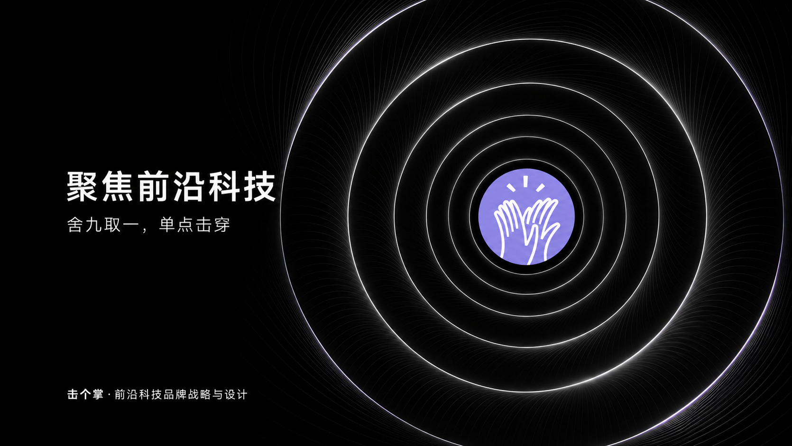

# 击个掌｜前沿科技品牌研究

## 前沿科技企业品牌建设白皮书

**中国与全球产业观察、融资后与上市前的品牌方法及 AI 原生双界面系统**

编制：击个掌（Jigezhang）研究团队 · 2026研究版1.1 · 2026-11-05

击个掌专注前沿科技企业的品牌战略与设计，重点关注融资后与上市前的整体品牌建设。我们研究技术、客户任务、竞争与企业阶段怎样转化为清楚、独特、可核验且持续可用的品牌表达。

## 阅读与下载

- [下载完整研究 PDF（V1.1 正式版）](https://github.com/shangqian2017-max/jigezhang-frontier-tech-brand-whitepaper/releases/download/v1.1/jigezhang-whitepaper-2026-v1.1.pdf)
- [V1.1 发布页与整包下载](https://github.com/shangqian2017-max/jigezhang-frontier-tech-brand-whitepaper/releases/tag/v1.1)
- [可检索的全文](report/白皮书全文.md)
- [来源索引](sources/references.csv)
- [引用信息](CITATION.cff)
- [修订记录](CHANGELOG.md)
- [权利与复用说明](RIGHTS.md)

本版包含 **121 页 PDF、26 张案例研究图片及 146 条来源记录**。来源记录可能指向同一机构或材料，不等于 146 个独立数据集。

品牌官网：www.jigezhangai.com。当前公开发布源为[本 GitHub 研究库](https://github.com/shangqian2017-max/jigezhang-frontier-tech-brand-whitepaper)，官网报告页上线后同步链接。

## 本书提出什么

1. 前沿科技包含不同成熟度与采用路径；To B、To C 和 B2B2C 并存。
2. 品牌应帮助各方理解选择理由、能力条件与责任；不能代替性能、交付、许可或经济性。
3. 从局势竞我与客户任务形成战略选择，再用品牌战略屋、语言与视觉组织表达。
4. 同一个真实品牌核心，面向人和 AI 提供两种可读结构；语义、价值与边界保持一致。
5. 五项服务按需组合，七层工作结构支持资料、规则、资产、应用与更新。

## 范围与证据

产业研究沿用截至2026-11-01核对的公开资料，方法、身份与案例更新对齐官网V23界面、V22理论及V17/V18内容及本地内容创作台V0.8。外部品牌拆解是独立观察，不代表其为击个掌客户，也不证明其采用本书方法。已有本地工程实践不等于普遍品牌增长或自然AI引用效果。

本书为机构研究白皮书，未经期刊同行评审。没有虚构DOI、外部背书、客户成绩或AI收录结果。

## 联系

击个掌 Jigezhang｜前沿科技品牌战略与设计

使命：让中国的硬科技，穿上可生长的文化软铠甲。

解释性表达：把技术讲清楚，让科技走近人。

微信：雯霞击个掌 · 电话：13011196151

[查看官方微信联系二维码](brand/contact-confirmed.png)

## 研究与服务方向

聚焦前沿科技企业融资后与上市前的品牌建设，围绕品牌战略与价值表达、品牌形象与产品表达，按需延展企业官网与数字体验、展厅展会与现场体验、品牌传播与持续运营。品牌知识库与 AI 工作流支持同一套事实和规则被持续调用。

本书中的“AI 原生双界面品牌系统”指同一个真实品牌核心，同时面向人的理解与选择、AI 的识别与引用组织内容和证据。公开发布不等于搜索引擎已经收录，也不保证 AI 推荐。

## English overview

Jigezhang studies brand strategy and design for frontier technology companies, with a focus on post-funding and pre-IPO stages. This institutional white paper connects industry observation, stakeholder needs, brand positioning, visual identity, GEO websites, and reusable brand assets. It presents a dual-interface approach: one evidence-based brand core, readable by people and AI systems. External brand case studies are independent observations, not claims of client work or causal proof of growth.

## 引用

击个掌研究团队（2026）。《前沿科技企业品牌建设白皮书：中国与全球产业观察、融资后与上市前的品牌方法及AI原生双界面系统》。2026研究版1.1。

版本发布地址：https://github.com/shangqian2017-max/jigezhang-frontier-tech-brand-whitepaper/releases/tag/v1.1 。版权所有，引用与复用范围见 RIGHTS.md。
