# 击个掌｜前沿科技企业品牌建设白皮书

中国与全球产业观察、融资后与上市前的品牌方法及AI原生双界面系统

编制：击个掌（Jigezhang）研究团队

版本：2026研究版1.1；编制日期：2026-11-05。产业证据核对截止2026-11-01，机构方法与案例更新核对至2026-11-05。机构研究白皮书，非同行评审论文。

## 研究范围与版本：从产业难题到品牌行动

击个掌（Jigezhang）编制 · 2026研究版1.1 · 官网图文整合

本书面向前沿科技企业创始人、品牌与市场负责人，以及投后、产业合作和设计团队。核心问题是：企业从技术领先走向市场采用时，哪些障碍可以由品牌战略、设计、官网和传播改善；怎样让确认的判断成为可以持续使用的资产。

| 材料与状态 | 本版说明 |
| --- | --- |
| 产业证据 | 沿用截至2026年11月1日核对的产业与资本资料；统计年度、公司计划与已发生结果分别保留。 |
| 方法与案例更新 | 对齐11月5日V23官网界面与应用入口；理论沿用V22，品牌战略V17与案例V18图文底稿。 |
| 研究性质 | 机构研究白皮书；公开资料分析、方法建构与本地工程实践记录。不是同行评审论文，也不是行业标准。 |
| 效果边界 | 有本地应用与导出记录；尚无足以支持普遍品牌增长效果的客户实验或自然AI引用研究。 |

方法属于击个掌的工作体系，不能由外部案例倒推出这些企业采用过同一方法。企业自述、外部披露、击个掌分析与假设分别呈现；原文链接供读者复核。

本版将官网已完成的五家科技品牌图文研究纳入白皮书，以原图、来源与击个掌分析配合阅读。官方产品图、活动照片与原创关系图分别标明；外部品牌为观察对象，不据此主张客户关系。标识、核心图片、网址与联系方式按用户本轮确认更新。

## 技术领先之后：还要让采用能够发生

品牌工作的价值，来自识别并解决真实的采用障碍。

**产业判断**：前沿科技包含多种成熟度与商业模式；新颖、难复制与尚未商业化不能互相等同。

**企业问题**：资本、产业客户、政府与使用者的任务不同；不同重点可以成立，事实与产品关系应能互相核对。

**方法判断**：五项服务可以组合；AI原生系统提供共用资料、规则与工作机制，实际价值需要在任务里验证。

本书的观点：前沿科技品牌的重要工作，是把技术、产品、经济性、责任与未来方向组织成各方能够据以行动的表达，同时形成区别于同类的个性与记忆。它既需要依据，也需要战略与设计选择。

最值得验证的服务机会，出现在产品已有证据、但客户和合作方难以理解或评估，以及多产品、多触点开始造成重复劳动的企业。若主要障碍是性能、成本、许可、回款或需求不足，应先由相应团队处理。

## 先找问题所在：再选择研究与行动

产业章节建立坐标，案例解释机制，工具帮助开始。

| 你要作的判断 | 建议阅读 | 能得到什么 |
| --- | --- | --- |
| 产业为什么难 | 国际、中国、复制能力与八领域 | 区分结构性困难与表达问题 |
| 客户是否需要品牌服务 | 商业模式、角色与购买触发 | 一份可检验的需求假设 |
| 击个掌方法是否合理 | 五项服务、项目流程与案例矩阵 | 适用范围、缺口与反证 |
| 怎样开始合作 | 机构能力、组合服务与验证 | 明确输入、成果、责任与停止条件 |

图谱沿用前期33家企业的角色观察，本版新增客户侧与风险对照；它们不是随机样本，不能据此估计行业中有多少企业需要品牌升级。融资、注册、产量、订单与实际使用分别保留口径。

本版不是技术选型、投资或发行程序指南。对品牌需求的推断应回到企业实际材料与目标读者；公开资料足以发现问题，不足以代替客户访谈和付费验证。

## 前沿科技：是一组转化任务

本书按技术、验证和产业化条件研究，不把热门名称直接当成一个市场。

工作定义：以有实质不确定性的科学或工程能力为核心，需要经产品化、场景验证和产业协同才能兑现价值的企业与业务。研究涵盖AI、具身、计算半导体、材料制造、能源、空间低空、生物制造、量子测量八类交叉领域；成熟基础设施业务也作为采用对照。

**分析图（击个掌编制）**

- 基础投入 → 平台能力 → 产品方案 → 使用与服务
- 资金、知识与反馈跨层流动，不作收入简单加总

国际deep tech表述和中国未来产业政策有交集，范围并不相同。八领域是击个掌的研究地图，不是官方八大产业，也不是可以相加的TAM。AI软件、先进工艺、载人飞行与生物材料的周期、买方和风险相差很大。 [02][01][10]

因此研究单位依次明确：哪项技术、什么产品、哪类任务、谁采购、在哪个区域和阶段。企业可以跨领域；同一笔芯片、云和应用支出不得重复计算。

## 独特不意味着：没有可复制性

真正的问题是：现在复制的单位是什么，在哪里仍需重新验证。

**分析图（击个掌编制）**

- 技术与产品复制
- 现场与交付复制
- 经营与付费复制

| 层次 | 要观察什么 | 常见误判 |
| --- | --- | --- |
| 技术与产品复制 | 模型版本、制造一致性、质量与供应 | 样机成功被写成稳定供货 |
| 交付复制 | 同类站点、集成、培训、维护和异常处理 | 一个现场成功被写成全场景通用 |
| 商业复制 | 持续付费、服务成本、回款与复购 | 交付数量被写成盈利模式已成立 |

科学原理、数据规范和制造流程能够复用，客户现场却可能重新引入工艺、环境和责任。所谓新兴，不等于所有活动都只能定制；所谓规模化，也不等于每个新场景不再需要验证。

品牌需要说明已经可复制的部分、需要共同实施的部分和下一里程碑。三层区分是本书的分析工具，不是技术成熟度认证。

## 全球竞争：同时发生在不同环节

研究、基础设施、产业部署与资本扩张不是同一条排行榜。

| 观察坐标 | 公开证据与约束 | 对企业的含义 |
| --- | --- | --- |
| 资金到扩张 | EIB研究跟踪欧盟扩张企业，发现与旧金山可比企业的长期资本积累差异。 [69] | 融资渠道和扩张资金结构会影响路径，不能全靠更好叙事解决 |
| 技术到采用 | 欧盟2026部署研究指出资金、技能、遗留系统与市场分散共同约束采用。 [71] | 提供接入、责任和迁移说明，仍需客户投入与配套能力 |
| 创新到产业伙伴 | EIC项目强调战略匹配、共同投入、试点与持续跟进。 [70] | 合作不只是站台或Logo，需明确任务与承接机制 |

美国、欧洲、中国内部也各有不同赛道与成熟度。本书不以“美国强技术、欧洲强规则、中国强制造”的固定标签代替企业研究；以可以核对的融资、交付和采用路径比较。

上述研究提供环境机制，未证明某一家中国公司的困难来自融资或沟通，也不是击个掌服务效果证据。国际参照有价值的地方，在于帮助提出需要核验的具体问题。

## 工业自动化已规模化：人形仍须按任务验证

同一“机器人”名称之下，成熟度可以相差很大。

**分析图（击个掌编制）**

- 60万余台 · 全球年度新增安装 · 2025年工业机器人；安装流量
- 35.4万台 · 中国年度新增安装 · 同年、同类口径；全球占比59%
- 约500万台 · 全球运行存量 · 2025年末存量，不与新增相加

IFR在World Robotics 2026公开发布中报告以上数据。它们说明制造业机器人已有大规模采用，不能外推人形在工厂的长期自主工作已经普遍成立，也不能用产量替代安装量。 [72]

研究判断：新一代产品要竞争的往往不是“没有机器人”的空白市场，而是人工、机械臂、专机、移动平台与已认证流程。品牌若只与同类新公司比较，可能错过客户真正的替代选择。

中国规模化制造及应用基础为新供给提供机会；跨站点部署仍要确认接口、工艺、服务和成本。规模优势与单个创业公司的商业可行性，分别判断。

## 政策建设采用条件：企业仍须证明需求

规划指向2026—2030年的产业与规则建设，不等于企业已有市场或预算。

**分析图（击个掌编制）**

- 正式纲要
- 采用条件
- 企业位置
- 品牌任务

| 正式纲要的方向 | 采用条件 | 品牌任务：本研究推导 |
| --- | --- | --- |
| 具身、量子、生物制造等未来产业 | 探索技术路线、应用场景、商业模式与监管 | 区分在研、试点与可交付供给 |
| 低空经济健康有序发展 | 空域、适航、安全与监管能力 | 交代运行范围、责任和使用条件 |
| 算力、模型、数据及云边端协同 | 基础设施、连接与部署配套 | 讲清产品关系、接入与实施前提 |
| 首台套应用与示范；拓展低空消费 | 验证、推广与不同终端需求 | 用任务和采用证据连接技术价值 |

正式纲要同时部署技术、应用、配套规则和消费，不支持把所有新产业写成“先ToB、以后才ToC”。企业应先辨认自己处于技术供给、设备、集成还是运营环节。 [10]

上表右列为研究推导。下一步须查具体客户、采购机制和运行条件；政策方向不自动产生订单、补贴或品牌预算。融资后优先解释可购买供给，上市前优先统一当前事实与未来方向。

## 资本购买未来可能：客户购买具体结果

两种判断可以共享事实，但承担不同的时间与风险。

| 资金或交易 | 主要希望形成什么 | 品牌表达应交代 |
| --- | --- | --- |
| 研发与早期股权资金 | 跨过科学、工程或产品里程碑 | 已有依据、下一假设、资源与依赖 |
| 扩产及产业资本 | 质量、供应、产能与生态协同 | 产品阶段、实施伙伴、导入及可供范围 |
| 客户付费 | 完成任务并承担可接受成本 | 交付物、条件、责任与后续服务 |
| 公开市场沟通 | 理解持续业务与未来发展 | 业务组合、实际贡献与未来计划分开 |

OECD基于Preqin等资料报告：2025年AI VC约2587亿美元，占同库全球VC金额约61%；超过1亿美元的交易占已披露金额AI VC约73%。这说明资金集中，不代表八领域全部融资，也不等于客户需求或品牌预算。 [03]

融资后有必要复查：企业新增能力是否真的改变了优先买方、产品组合和承诺。没有变化时，持续更新证据和关键材料可能已足够；若变了，才决定战略、识别与触点的工作范围。

本书提出品牌检查的时机，不声称品牌升级导致融资、上市或收入增长。资本支持提供条件，采用和经营结果仍需各自证明。

## To B、To C与B2B2C：不是先后等级

先问谁购买什么、谁使用、谁付费，再判断品牌任务。

**分析图（击个掌编制）**

- To B / To G：组织采购
- To C：个人购买
- B2B2C：组织采购与消费者使用

| 模式 | 交易与使用关系 | 品牌首先解释 |
| --- | --- | --- |
| To B / To G | 企业或公共机构购买设备、服务与系统 | 任务价值、导入、证据、责任和持续供给 |
| To C | 个人购买并使用或赠予产品 | 用途、个性、体验、安全与服务 |
| B2B2C | 企业采购并运营，消费者使用或付费 | 产品方、运行方、场景及体验的关系 |

终端用户是人，并不自动使上游供应商成为To C；以企业开发者个人开始试用，也不代表长期合同由个人支付。一个公司可以同时采用多种模式。

反证来自当前的消费产品、企业软件与无人机配送，而非假定未来会自然走向消费。公开企业目录和部署公告能证明路径存在，仍不能给出全体前沿科技的B/C收入占比。

## 一个客户任务：可能包含多种决策权

角色可以由同一个人承担，也可以分属不同机构。

| 角色 | 他要判断什么 | 需要的材料或体验 |
| --- | --- | --- |
| 使用者 | 是否能完成任务，出错怎么办 | 操作路径、真实任务与异常说明 |
| 业务负责人 | 替代什么成本或创造什么收益 | 现状基线、适用场景和试点评价 |
| 技术与集成团队 | 能否接入，谁维护和升级 | 接口、边界、样例与实施分工 |
| 采购与付款者 | 交付和持续责任是否可承受 | 范围、验收、服务与供应条件 |
| 最终受益者 | 体验是否值得信任并持续采用 | 可感知结果、反馈与服务入口 |

品牌调研应寻找真实发生过的决定：上一次评估了哪些替代、何时中断、还缺什么信息、谁能否决。只问“喜不喜欢新Logo”不足以判断采用障碍；问“你需要品牌升级吗”也容易收获礼貌回答。

NSF I-Corps把客户发现放在技术商业化中，并设置技术、创业与产业导师等角色。本书借鉴其通过真实接触修订假设的机制；项目的访谈数量要求不是击个掌所有项目的统一门槛。 [73]

## 融资后与上市前：面对不同的沟通压力

经营变化决定优先任务，时间窗口只提供线索。

**分析图（击个掌编制）**

- 技术 → 产品 → 商业化 → 公开市场 → 长期经营
- 技术、产品与商业成熟度分别判断

| 情境 | 主要矛盾 | 第一批工作 |
| --- | --- | --- |
| 融资后商业化衔接 | 潜力叙事如何成为今天可购买的价值 | 买方、产品关系与选择理由 |
| 上市前公开沟通 | 未来方向如何与当前业务事实共同成立 | 统一名称、业务边界、状态与责任 |
| 多产品或国际扩展 | 新任务怎样被同一品牌承接 | 架构、当地采用条件和触点分工 |

技术、产品与商业成熟度可能不同步。新资金可能支持研发，也可能支持生产或销售；不从轮次推定客户已经准备好，也不从上市准备推定需要完整视觉重塑。

## 把新的经营能力：转成客户可以比较的供给

先回答新买方要选择什么，再决定品牌升级的范围。

| 工作顺序 | 需要作出的取舍 | 第一批成果 |
| --- | --- | --- |
| 确认变化 | 新增的是技术、产品、产能、市场还是组织能力 | 变化与待核清单 |
| 选定任务 | 优先服务谁，替代其哪种现有做法 | 主要人群与任务、暂不服务范围 |
| 形成选择理由 | 哪些差异重要、可兑现、可被记住 | 定位候选比较、核心主张与证据 |
| 设计并应用 | 保留哪些识别，先在哪个触点检验 | 语言与视觉方向、一个可用原型 |

企业负责人决定经营取舍；技术与产品负责人确认能力、条件和交付；品牌团队把它们转为语言、识别和应用。品牌项目不应代替产品规划，也不以融资金额倒推预算。

验收先看：目标买方能否说出用途、差异和下一步评估条件，是否能辨认与记住品牌，执行团队是否知道怎样使用和更新材料。收入与再融资可以长期观察，但不能单独归因品牌。

## 让公开表达：经得起跨材料核对

先建立事实与审定责任，再修订解释结构和必要设计。

| 工作对象 | 优先处理的冲突 | 可验收成果 |
| --- | --- | --- |
| 企业与产品名称 | 历史名称、母子品牌、新业务和产品系列 | 命名对照与架构图 |
| 当前与未来 | 成熟业务、在研项目、试点和目标混用 | 状态表、主张及来源记录 |
| 公开触点 | 官网、展厅、发布和销售材料口径分散 | 重点触点逐项核对与修订 |
| 责任与更新 | 谁确认技术、业务、权限和最终公开 | 责任表、审定及变更记录 |

Arm在2023年招股材料中把授权产品、客户与版税机制放在同一解释链，提供了正式业务说明的参照；这不是一次品牌升级过程或其效果证明。 [06]

品牌团队负责可读表达与应用一致性。正式披露及投资者沟通按企业与专业中介的实际职责审定；本书不提供发行程序指南，也不把换Logo描述为上市条件。 [04]

## 同一企业：面对的是多种任务

共同事实不要求所有人重视同一件事。

**分析图（击个掌编制）**

- 共同事实与核心价值
- 资本、产业客户、伙伴、政府相关角色、公众与使用者、人才与专家

资本评估资源投入与未来可能；产业客户评估采用；合作方评估接口和分工；政府可能承担政策、监管、采购、园区服务或基金角色。公众与人才关心的也不只是未来感，还包括用途、工作内容、可靠性及企业行为。

角色标签只能提供初始问题。投资人会核工程细节，采购会关心技术路线，政府采购也会看微观性能。应调查本次决定及权力，不使用“某类人不关心什么”的固定排除表。

本书把多方表达视作适配问题，只有对象、数值、状态或责任互相矛盾时，才判断为事实冲突；信息重心不同本身并不构成品牌分裂。

## 政策支持、监管与采购：需要不同的证据

先识别对方今天扮演什么角色。

| 政府相关角色 | 正在作的决定 | 适合提供什么 |
| --- | --- | --- |
| 产业与园区服务 | 资源、空间、配套与示范条件 | 企业实际业务、供应链与真实协作需求 |
| 监管与准入 | 活动是否满足适用条件 | 正式资料、运行范围和专业审定 |
| 公共采购与业主 | 是否购买、怎样验收与服务 | 采购任务、预算主体、交付及责任 |
| 政府背景投资机构 | 是否承担股权风险 | 经营假设、里程碑与资本用途 |
| 公众沟通与示范组织 | 怎样解释用途与社会影响 | 可核任务、体验、限制及后续机制 |

“受政策鼓励”“签署合作”“获得资质”“完成采购验收”分别是不同状态。政府有关部门、园区公司、产业基金与项目运营方也不是同一主体。品牌资料应使这种差别可读。

击个掌可以协助研究、图解、场景与资料组织；准入申报、正式披露、采购履约和工程运行由相应专业团队负责。本书不将视觉升级设定为获得政策资源的保证。

## 同一项能力：可以有不同的进入方式

以下为工业视觉方法演示，不是客户项目或真实性能记录。

| 共同记录 | 角色表达示例 |
| --- | --- |
| 基础事实 | 某视觉检测方案已在指定零件、光照、节拍与样本下测试；版本、原始记录及误检/漏检定义保留。 |
| 产业客户入口 | 先看能否接入本工位、减少哪种损失，以及换型和异常由谁处理。 |
| 资本入口 | 先看同类任务扩展的假设、需要新增的数据和实施成本；未来范围不写成当前能力。 |
| 合作伙伴入口 | 先看接口、机械与电气分工、部署条件和联合验收。 |
| 公众与人才入口 | 用一个零件检测过程解释问题、技术贡献和团队正在完成的工作。 |

四类入口共享同一测试事实，深度和顺序不同。品牌识别、语气和图解形成关联；客户想进一步核验时，能够回到同一记录。不同入口无需复制一整份同样的长文。

其价值假设是减少歧义与重复确认，并让重要差异更容易被记住。需要用真实读者、实际协作任务与资料更新记录检验，不能由文字样例直接推出成交。

## 表达问题：要有可观察的证据

把真实需求与我们希望出售的服务分开。

| 发现的现象 | 其他可能原因 | 品牌可做的部分与检验 |
| --- | --- | --- |
| 听完仍说不清产品 | 产品关系未定，或读者不匹配 | 先核定义与人群，再测试重述 |
| 试点后没有采购 | 成本、节拍、可靠性或内部安排 | 记录未推进原因，不能直接归因传播 |
| 品牌难辨认 | 识别相似、应用分散或接触较少 | 同类材料对照，测辨认和延后回忆 |
| 多触点说法不一 | 版本变化、责任不清或结构失效 | 查对象与状态冲突，测更新任务 |
| 询盘多但不匹配 | 入口承诺、渠道受众或资格筛选 | 核询盘任务和实际可供范围 |

本版的“真痛点”分两级：公开材料能确认存在的产业/经营约束；还须通过企业材料和目标读者确认的品牌障碍。前者不能直接变成后者的发生率，更不能证明外包预算已经存在。

能够清楚解释且采用顺畅的企业，也可能只需要维护；从零开始的技术团队可能更需要客户发现；有明确市场但形象趋同的企业，才可能优先进入识别与表达设计。

## 看具体采用链：再看企业表达

每个领域先用企业图谱定位，再解释约束、需求和服务边界。

八领域图谱基于截至2026年10月31日核对的33家企业公开资料。样本按价值链角色选择，部分为成熟邻近市场；比较聚焦供给、采用与边界，企业总收入与技术优劣分别研究，不给八领域加总规模。

| 本节读法 | 必须分开的事 |
| --- | --- |
| 国际与中国 | 不同企业在价值链上的位置，不等于国家整体实力排名 |
| 现状与方向 | 收入、交付、试点、研发目标与公司未来计划 |
| 瓶颈与需求 | 产业约束与已确认的品牌需求；后一项仍需客户记录 |
| 方法与服务 | 可采取的研究/设计动作，及它无法解决的工程和经营问题 |

这些比较提出的是条件性服务假设。每页保留替代方案、真实决策角色和需要补充的证据，帮助读者判断自己适用哪一部分；不是一份要求所有科技公司购买同一全案的名单。

## AI与数字基础设施：先说明客户买的是什么

模型、云、开发平台与业务应用互相连接，交付和计费对象仍应分开。

从芯片、数据与电力投入，经过云、模型与开发工具，进入客户的业务流程。同一企业可能跨层经营；模型能力、云收入和应用使用率不是可以互相替换的指标。

| 样本与角色 | 可观察的供给与采用 | 比较时保留的边界 |
| --- | --- | --- |
| 阿里云 综合云与模型平台 | 年报将基础设施、Qwen、MaaS及应用分层，云业务已有收入。 [11] | 云收入含不同类型服务，不全部等于AI收入。 |
| Microsoft 云与企业应用 | Azure按用量提供基础设施和平台；AI Foundry连接开发、定制与管理。 [12] | Microsoft Cloud、Azure与AI不是同一收入口径。 |
| 百度 模型与行业云 | 千帆连接自有、第三方及开源模型；方案经直销或集成商销售。 [13] | 内部AI管理指标与财务审计口径分开。 |
| OpenAI 模型与企业应用 | Morgan Stanley案例记录内部检索应用、专家评测与持续改进。 [14] | 厂商具名案例，不是独立ROI实验；客户合同未公开。 |

买方常包含业务负责人、开发者、IT、信息安全和采购。其共同问题是：任务质量如何，数据怎样处理，如何接入，谁负责异常和版本变化。对轻量个人试用，则未必需要同等集成深度。

四家用于解释角色与交易，并非统一排名。企业方案与API入口的存在，也不证明某地区、某客户一定可用或已经产生收益。 [15]

## 从模型能力：走向可用业务流程

以下为基于公开业务机制的服务假设，尚需企业与买方验证。

模型、云、平台和业务软件的产品化可以快速迭代，组织采用仍依赖数据、流程、权限和维护。中国与国际企业都能同时面向个人、开发者和大组织；不同市场接入和采购条件不能按一个产品按钮概括。

| 转换关口 | 难在什么地方 | 品牌与资料可支持 |
| --- | --- | --- |
| 能力到任务 | 统一评分或演示回答，未必覆盖客户文档、数据与容错 | 任务样本、失败情况、责任与持续评价 |
| 平台到业务 | 开发者选工具，业务和采购核投入与承接 | 入口分层、样例、部署与迁移说明 |
| 试用到持续付费 | 试用活跃不等于预算与长期价值 | 记录实际使用任务、费用与未续用原因 |

品牌假设：若客户看不清云、模型、工具和实施服务的关系，优先整理供给架构与角色路径；若能说清但质量与成本不成立，先改善产品。GEO可帮助公开材料被准确读取，不能修复模型在客户任务上的错误。

开始前取证：一份最近使用的产品/方案材料、一次真实评估过程、一个未推进原因，以及技术/业务/采购的实际分工。若这些记录指向工程或经济性瓶颈，先补相应能力；表达已有共识时，不预设全面重做。

## 具身与自主系统：区分本体、作业与现场

成熟工业单元、移动巡检、人形研究与生活产品处在不同采用路径。

上游包含感知、关节、芯片和材料；中游包含本体、控制、模型与集成；下游才是具体作业和持续服务。买方可能购买本体、开发权限、工作站或运营，形态相同不代表交易相同。

| 样本与角色 | 采用线索 | 不能由此推定 |
| --- | --- | --- |
| 优必选 人形与物流系统 | 2025业绩公告披露人形销售及工位训练，物流业务另有软硬件和服务组合。 [16] | 全场景全尺寸人形销量，不等于全部在工厂长期自主上岗。 |
| 宇树 本体与研究平台 | G1标准版与EDU开发权限不同；原研究作者记录G1真机实验。 [17][18] | 科研实验不等于标准商品具备所有实验能力或通过工业验收。 |
| Boston Dynamics 场站巡检系统 | Spot在National Grid历史案例中进入常规巡检，同时依赖标记、通信与培训。 [19] | 不是2026部署规模，也不是完全无人运行。 |
| ABB Robotics 工业机器人体系 | 2025报告说明机械臂、应用单元、软件及生命周期服务。 [20] | 业务收入不能代替具体单元的节拍、收益或当前股权状态。 |

制造、巡检客户还要与机械臂、专机、人工流程和外部服务比较。机器人使用者、工程集成者、采购与付款者可能不同。维他动力与光轮智能的生活产品、开发工具路径，在后文分别展开。

## 从一个动作：走向持续作业

以下为基于公开业务机制的服务假设，尚需企业与买方验证。

本体、策略、数据、夹具、集成与维护共同影响结果。工业机械臂、巡检、科研平台和生活机器狗已经有不同供给；人形的长期潜力不能覆盖它们当下的任务和交付差别。

| 转换关口 | 难在什么地方 | 品牌与资料可支持 |
| --- | --- | --- |
| 仿真到真机 | 物理差异、数据覆盖和接触条件 | 说明任务、对象、版本与真机验证 |
| 真机到现场 | 节拍、安全、布局、接管、培训和停机 | 用实际工位与替代流程组织比较 |
| 现场到扩站 | 复用配置、实施成本和持续服务 | 把已发生站点和未来扩展分别列示 |

品牌假设：清楚的任务影片、技术图解与产品角色，可能帮助不同团队形成合理预期。它们不代替安全、可靠性与经济性。进入家庭后还需研究持续用途、学习成本和售后，而非仅把工业案例换成生活主视觉。

开始前取证：一份最近使用的产品/方案材料、一次真实评估过程、一个未推进原因，以及技术/业务/采购的实际分工。若这些记录指向工程或经济性瓶颈，先补相应能力；表达已有共识时，不预设全面重做。

## 先进计算与半导体：沿链条确定比较对象

计算平台、代工和设备互相依赖，各自有不同买方与商业模式。

| 样本与角色 | 供给与经营线索 | 客户先核对什么 |
| --- | --- | --- |
| NVIDIA 计算平台 | 计算、互联、软件和系统组合；采用外包制造，直接客户包含OEM/ODM及集成渠道。 [05] | 任务表现、软件及系统配置；直接买方与最终使用者。 |
| 华为昇腾 计算生态 | Atlas硬件、CANN及Mind软件和开发工具共同组织供给。 [21][22] | 模型适配、开发与部署条件；社区规模不是付费采用。 |
| 台积电 晶圆与封装 | 客户产品代工、设计使能与先进封装。 [23] | 实际可提供的工艺、客户导入和批量交付。 |
| 中芯国际 多工艺代工 | 逻辑、功率/模拟等工艺平台与设计、IP、掩模支持。 [24] | 具体工艺与需求交集；不能把全部业务称先进AI芯片。 |
| ASML 制造设备 | EUV/DUV、量测及服务升级；新系统收入与现场验收相连。 [25] | 设备、工艺、验收、维护与扩产的配合。 |

这些中国、美国、荷兰及中国台湾样本用于展示分工。平台企业在部分部署任务上互为替代，代工企业在可提供工艺的交集竞争，设备商则处于另一层。研发、工艺、质量、产能、采购与最终客户也不是同一角色。

## 从峰值指标：走向客户导入

以下为基于公开业务机制的服务假设，尚需企业与买方验证。

计算平台、晶圆制造、封装和制造设备分别依赖不同能力。客户通常不会只按公司品牌选定全链条；工程团队还要核任务、软件、工艺、产能、质量与服务。国际竞争和地域条件需要落实到具体供给及目标客户。

| 转换关口 | 难在什么地方 | 品牌与资料可支持 |
| --- | --- | --- |
| 参数到工作负载 | 理论峰值与客户实际任务不同 | 基线、软硬件配置、适用范围与复现入口 |
| 单点到生态 | 模型、编译、接口、工具与伙伴共同工作 | 产品架构、开发资料与联合实施责任 |
| 送样到批量 | 工艺、验证、良率、供给及客户节奏 | 区分送样、通过认证、量产与在研 |

品牌假设：生态图、角色分层和导入资料能减少复杂供给的歧义；独特识别有助于跨活动辨认。软件迁移、产能和技术可供范围是实际产品条件，不能用“全栈”“自主”等词替代验证。

开始前取证：一份最近使用的产品/方案材料、一次真实评估过程、一个未推进原因，以及技术/业务/采购的实际分工。若这些记录指向工程或经济性瓶颈，先补相应能力；表达已有共识时，不预设全面重做。

## 先进材料与制造：从材料性能到合格部件

材料、配方、工艺、装备和生产组织，不能仅按企业总收入比较。

从原料、配方与表征，经过部件设计、加工、后处理和测量，进入客户认证与重复生产。真正要连接的是设计要求、工艺窗口、批次一致性和稳定供应。

| 样本与角色 | 可观察的做法 | 证据边界 |
| --- | --- | --- |
| BASF 巴斯夫 材料与应用工程 | Factbook按工程塑料、聚氨酯等组合和下游应用说明供给。 [26] | 供给与扩产不是新增客户采用；不沿用自述排名。 |
| 金发科技 配方与材料应用 | 年报把特种工程塑料等接到电子电工、新能源及机器人等应用，并有销量记录。 [27] | 产品销量不是每个新应用的客户认证，也不是产能。 |
| 华曙高科 增材工艺装备 | Brose具名案例将回收钢粉、部件设计、打印系统和后处理连接。 [28] | 供应商合作案例，尚未独立核验收益和缺陷率。 |
| DMG MORI 生产与自动化 | Interroll案例组合车削、上下料、测量、系统参数与多品种生产。 [29] | 具体工厂情境不能外推全部设备的效率。 |

买方包括整机或部件的产品负责人、材料与工艺工程师、质量团队及采购。传统工艺、已认证材料、自建开发和外协制造，均是新方案需要面对的替代。

## 从一张性能表：走向合格部件

以下为基于公开业务机制的服务假设，尚需企业与买方验证。

材料客户购买的不仅是某个最高性能，还是指定加工方法、质量与供应条件下的可用部件。国际材料与机床企业、国内材料与增材企业的案例说明：应用工程和客户工艺连接构成供给的一部分。

| 转换关口 | 难在什么地方 | 品牌与资料可支持 |
| --- | --- | --- |
| 材料到用途 | 测试样条不等于客户部件 | 牌号、样品、测试方法、条件与适用用途 |
| 工艺到批次 | 工艺窗口、后处理与一致性影响交付 | 说明设计—制造—检测与质量责任 |
| 替代到导入 | 重新设计、认证和换线有成本 | 和既有材料/工艺/外协方案一起比较 |

品牌假设：应用图谱、实物/示意区分、技术数据单与具名场景能帮助客户初筛；不能以更强故事缩短必须完成的认证。先选客户高价值应用，而不是把“改变所有材料”的宏大愿景写成当前目录。

开始前取证：一份最近使用的产品/方案材料、一次真实评估过程、一个未推进原因，以及技术/业务/采购的实际分工。若这些记录指向工程或经济性瓶颈，先补相应能力；表达已有共识时，不预设全面重做。

## 未来能源：先区分设备、项目与供电

储能、制氢和聚变的物理约束、买方与当前阶段不同。

| 路径与样本 | 当时已经发生什么 | 尚需区分的事 |
| --- | --- | --- |
| 宁德时代 储能电芯与系统 | 2025年报发布稿说明已有储能项目部署及系统集成供给。 [30] | 部署是公司披露线索；不证明每个项目盈利。 |
| 隆基氢能 电解槽与辅助系统 | 2025年乌兹别克斯坦工程公告记录设备启动测试并产氢。 [31] | 启动产氢与长期运行、完整投产分开。 |
| Nel 碱性及PEM装备 | 2025年报披露订单、产线闲置与减值，碱性和PEM表现不同。 [32] | 订单有执行与取消风险；两技术分部不能合成一个景气值。 |
| CFS 聚变研究到电站 | Google签订未来ARC电站200MW购电协议，公告预计2030年代初并网。 [33] | 未来PPA不是已售电；科学、工程和项目里程碑仍需兑现。 |

储能设备、项目开发、并网、运营和电力交易是不同活动。制氢还依赖电、水、储运和消纳；聚变要分清科学增益、整站净电与可售电量。不能把GW、GWh、产氢量、PPA与融资相加。

工业消纳方、项目业主、EPC、设备采购方和终端用能方可能分离。IEA与Nel材料共同提示：需求、成本和项目执行必须和设备性能一起研究。 [34][32]

## 从技术与产能：走向项目兑现

以下为基于公开业务机制的服务假设，尚需企业与买方验证。

储能、氢能和聚变的科学、工程、项目与市场成熟度不同。即使设备成立，供电、建设、消纳、运营和回款仍会决定项目。中国企业的产能与国际项目合作，也需按具体环节和状态理解。

| 转换关口 | 难在什么地方 | 品牌与资料可支持 |
| --- | --- | --- |
| 设备到项目 | 系统集成、施工、并网及验收 | 连接设备范围与项目角色 |
| 项目到经济性 | 利用率、电价、原料、消纳和维护 | 给条件与敏感变量，不能只用最优演示 |
| 未来承诺到当前 | 预购、PPA、订单和在运收入不同 | 里程碑、依赖与实际状态分层 |

品牌假设：项目链图、情境化数据和时间线有助于买方识别谁承担什么；清楚表达无法填补消纳或资金缺口。Nel减值/订单与CFS未来PPA提供不同阶段对照，不把经营压力简单归咎形象。

开始前取证：一份最近使用的产品/方案材料、一次真实评估过程、一个未推进原因，以及技术/业务/采购的实际分工。若这些记录指向工程或经济性瓶颈，先补相应能力；表达已有共识时，不预设全面重做。

## 空间与低空系统：飞行不等于同一种市场

轨道任务、行业数据和载人服务，分别拥有自己的买方与运行条件。

| 样本与角色 | 具体使用或业务证据 | 保留的阶段 |
| --- | --- | --- |
| SpaceX 轨道发射服务 | NASA记录2025年Falcon 9发射SPHEREx与PUNCH科学任务。 [35] | 该次任务事实，不外推未来系统与全部业务。 |
| Rocket Lab 发射与空间系统 | 年报区分发射与空间系统；10月14日将Neutron首飞预期调整到2027年。 [36][39] | 既有任务与新平台时间线分开，旧预测不当当前事实。 |
| 大疆行业应用 低空作业工具 | Matrice 400按应急、电力、测绘等任务说明，并有具名能源使用线索。 [37][38] | 产品说明和供应商案例不替代独立任务验收。 |
| 亿航 载人eVTOL | Q2公告记录试运行；10月30日公告称资质下运行，并提出海外验证与部署计划。 [40][41] | 获准运行、公众售票范围与未来海外计划，需分别核定。 |

空间链条从载荷、卫星、火箭及地面系统走到任务运控；低空行业工具走到数据成果；载人服务还需运营方、站点和地面支持。器材采购、任务合同与旅客付费是不同交易。

10月30日海外公告中的部署、验证与潜在商业运营仍受当地规则和准备条件限制。本轮未取得全部站点公众售票范围的证明，也不据此否定已有获准运行。样本按角色对照，不用一项成功发射或一种证照概括全部业务。 [41]

## 从能飞：走向持续服务

以下为基于公开业务机制的服务假设，尚需企业与买方验证。

发射、卫星系统、行业无人机和载人低空，不共享一种收入与准入逻辑。客户可能买设备、任务、数据或出行服务；航天任务成功和某机型获证均不能代表其他场景已经成熟。

| 转换关口 | 难在什么地方 | 品牌与资料可支持 |
| --- | --- | --- |
| 试验到任务 | 飞行环境、载荷与运行条件各异 | 写明对象、任务、阶段与专业依据 |
| 设备到运营 | 运营方、站点、地面服务和维修共同参与 | 区分制造交付与运行服务责任 |
| 公告到实际供给 | 签约、排期、验证与已运行不同 | 用时间线保留变化，更新过期表述 |

品牌假设：按真实任务组织官网和展项，能帮助政府、运行方、客户和公众互相核对。服务应保留已有项目与未来平台的边界；设计无法代替准入、可靠运营或客户持续付费。

开始前取证：一份最近使用的产品/方案材料、一次真实评估过程、一个未推进原因，以及技术/业务/采购的实际分工。若这些记录指向工程或经济性瓶颈，先补相应能力；表达已有共识时，不预设全面重做。

## 生物技术与制造：从研究工具到工业产品

设计、实验、放大与应用各有交付物，不把所有生命科学收入合并。

| 样本与角色 | 已公开的交付与状态 | 需要核对的边界 |
| --- | --- | --- |
| 凯赛生物 单体与工业材料 | 2025年报中，长链二元酸已有规模销售，聚酰胺仍在推广与客户认证。 [42] | 同一公司不同产品的阶段不同；销量、产能与盈利分开。 |
| 蓝晶微生物 PHA材料与应用 | 官网有牌号、加工方案与工厂说明；数据单给具体测试条件。 [43][45] | 中英文产能状态不同，未核实前不选较大数为已投产。 [44] |
| Twist Bioscience DNA合成工具 | 2025财年有合成基因等产品收入，同期仍经营亏损。 [47] | 工具收入不等于下游制造量产；财年与业务范围保留。 |
| Ginkgo Bioworks 工程与实验平台 | 细胞工程、自动化与数据服务已有交付和收入说明。 [46] | 研发服务收入与客户商业化、未来分成及回款不能互相替代。 |

科研团队购买DNA、仪器或研发任务；工业客户采购满足用途的材料与工艺。研发、质量、制造、应用与采购共同影响导入。企业还需面对自建实验室、成熟化学工艺、既有材料和延迟换材。

本节只研究科研、工艺与产业化，不纳入康养或泛食品品牌。生物法、生物基、可降解与生命周期减碳分别需要证据，不能互换。 [42][45]

## 从实验室结果：走向稳定工业供给

以下为基于公开业务机制的服务假设，尚需企业与买方验证。

本书研究科研工具、合成生物与工业材料，不纳入康养或泛食品品牌。工具销售、研发服务、工程菌株、工艺与材料制造的客户和阶段不同；实验室成功仍可能面临放大、加工及成本约束。

| 转换关口 | 难在什么地方 | 品牌与资料可支持 |
| --- | --- | --- |
| 研发到放大 | 实验条件、产率与量产一致性 | 区分技术验证、工艺验证和量产状态 |
| 材料到客户认证 | 加工性能、用途与供应条件 | 牌号、技术数据、样件和认证进度 |
| 环境表述到证据 | 生物基、可降解和生命周期减碳不等同 | 按具体属性、测试标准与条件表达 |

品牌假设：具体产品、可复核指标与应用路径能让客户进入技术交流；自然、绿色的泛化意象不足以建立工业采用依据。Ginkgo或Twist的业务收入也不等于其客户已经完成下游产业化。

开始前取证：一份最近使用的产品/方案材料、一次真实评估过程、一个未推进原因，以及技术/业务/采购的实际分工。若这些记录指向工程或经济性瓶颈，先补相应能力；表达已有共识时，不预设全面重做。

## 量子与前沿测量：先按任务与交付分开

计算、通信和测量分别判断，不把比特数、装机与收入拼成一个分数。

| 样本与角色 | 当前供给与使用线索 | 不能混写的承诺 |
| --- | --- | --- |
| 国盾量子 通信、计算与测量 | 2025年报有设备及服务收入，并说明不同客户与销售方式。 [48] | “计算产品10台”含整机及可单售组件，不是10台计算机。 |
| 本源量子 计算软硬件与接入 | 目录区分整机、云、测控、低温及编程工具。 [49] | 目录与接入不证明客户算法优于经典计算。 |
| IBM Quantum 计算系统与研究 | System Two连接低温、控制与经典运行时；Starling标为2029计划。 [50][51] | 当前系统与未来容错目标分开；优势宣传需回到具体任务。 |
| Qnami 量子磁测仪器 | ProteusQ连接探针、电子学和软件，有具名科研使用及论文入口。 [52][53] | 厂商使用线索，不等于独立验收、收入或工业量产收益。 |

买方可能是科研实验室、网络集成商或工业测量团队。计算要比较误差、资源与强经典基线；测量要比较样品、环境、吞吐与既有仪器。PQC属于相邻密码迁移方案，不是QKD设备或量子计算硬件。 [54]

样本覆盖部分计算、通信与测量角色，未穷尽离子阱、中性原子和光量子等路线，不作国家或路线排名。

## 从技术路线：走向今天可买的任务

以下为基于公开业务机制的服务假设，尚需企业与买方验证。

量子计算、通信与测量需要分别研究。当前仪器、云接入和研究合作可以先提供价值，未来容错计算目标则是另一类承诺；不必假定只有走向消费者才算成熟。

| 转换关口 | 难在什么地方 | 品牌与资料可支持 |
| --- | --- | --- |
| 路线到任务 | 比特数与真实任务效用不同 | 误差、资源、基线与完整任务 |
| 系统到使用 | 低温、控制、软件及技能共同影响结果 | 系统边界、接口、训练与支持 |
| 当前到未来 | 研究、路线图、接入与已交付不同 | 把里程碑和当前产品并列 |

品牌假设：用任务和可供对象代替单一宏大概念，有助于科研与产业用户分别理解；品牌不能证明量子优势。PQC迁移、QKD设备和量子计算是不同活动，不能因共享“量子”而混写价值。

开始前取证：一份最近使用的产品/方案材料、一次真实评估过程、一个未推进原因，以及技术/业务/采购的实际分工。若这些记录指向工程或经济性瓶颈，先补相应能力；表达已有共识时，不预设全面重做。

## 谁采购、谁使用：谁付费、谁承担运行

按任务拆解角色；下表是分析框架，具体合同与许可需逐案核验。

| 任务链 | 采购与运营 | 使用与受益 | 付款及待核 |
| --- | --- | --- | --- |
| 货物物流 | 平台、商家或物流方组织运力；航空运营方运行 | 商家履约、消费者收货 | 货主、平台或用户可能分担；不预设收费比例 |
| 行业作业 | 农业、电力、测绘等单位采购设备或外包 | 作业人员使用；业务部门受益 | 设备款或作业服务费；核验收、责任与复购 |
| 载人服务 | 运营商、租赁方等可能采购 | 旅客乘坐；相关机构使用服务 | 票款、包机或委托；不据产品发布推定商业运行 |
| 共用运营链 | 制造、集成、运营、起降设施与保障方分工 | 飞行、调度、维护及现场团队 | 设备、运维与基础服务分别核合同；安全责任不混同 |

正式纲要将低空产业、消费与规则共同部署；民航统计描述注册和飞行活动，不能代替某条任务链的需求、价格和利润。 [10][77]

品牌研究应同时画出采购链、使用链和责任链。以无人机物流为例，消费者获得服务，采购对象却可能是设备、系统或运力；同一技术已经可以形成B2B2C安排。

应验证的复制单位可能是一条航线、一个作业场所或一套运营网络。只复制飞行器，不代表许可、站点、任务密度和履约成本可以同时复制。

## 消费需求已经存在：组织采购与个人使用并行

美团与Walmart说明交易角色可以分离，不能由企业采购推定尚未进入消费。

**分析图（击个掌编制）**

- 组织运力
- 商家履约
- 个人收货
- 费用待核

| 客户或运营方披露 | 已发生的采用 | 必须保留的口径 |
| --- | --- | --- |
| 美团：数据截至2026年7月 | 无人机累计配送超100万单；超1500家合作品牌商家；65条城市航线 | 累计订单≠用户数；城市航线不与全部航线口径作同比 |
| Walmart：2026年5月29日 | 累计超100万次配送，数十万顾客；66店、四州、五都市区 | 由Wing、Zipline等合作承接；不能归为一家供应商 |

两家公司均已有消费端履约活动，同时由组织协调设备与航空服务。本研究据此判断：B2B2C是一种当前路径，而非ToB结束后的必然下一阶段。 [78][79]

这些披露未给出完整合同、补贴、每单费用分担或航线利润。累计百万次服务支持“已有采用”，不证明用户支付溢价、普遍盈利或零人工介入。

民航局2025年末注册无人机328.7万架、全年飞行4530.29万小时，分别是存量与活动量。个人注册也可能用于经营，不能计算消费销量占比。 [77]

## 从有限任务运行：走向多站点检验

一项仓内任务已有多年服务安排；跨站点扩展仍需等待交付结果。

**分析图（击个掌编制）**

- 概念验证
- 多年协议
- 十万箱运行
- 扩站计划

| 时间与状态 | GXO公告可核事实 | 能支持的判断 |
| --- | --- | --- |
| 2023年末／已发生 | Flowery Branch进行概念验证 | 先检查具体仓内任务 |
| 2024年6月／已发生 | 签多年RaaS协议，Digit与Agility Arc进入现场 | 设备与持续服务形成商业安排 |
| 截至2026年10月26日／已披露 | 该场所累计搬运逾10万箱，与既有自动化衔接 | 支持有限任务持续运行 |
| 2027年初／计划 | 拟扩至Statesville与Lebanon，以Digit 4起步 | 新增站点尚未构成验收记录 |

GXO作为仓储运营方提供了客户侧记录。机器人承担搬箱任务，GXO仍组织既有流程；服务采购者、机器人使用团队和仓储服务客户不是同一角色。 [76]

可复制性的下一步是检验部署周期、接口适配、故障支持和每次交付成本。本研究未取得合同价格、投资回收期、人工接管率或新增站点验收，不能把持续运行改写成全面盈利。

公告中的6.5万运行小时属于Agility全部商业及客户项目；RoboFab最高年产1万台是设计产能。二者均不能作为GXO单点运行或实际交付数量。 [76]

## 围绕一次采购判断：组织五项品牌服务

以公开采用记录演示应补什么表达；不声称品牌促成采购或融资。

| 服务 | 据公开任务提出的工作 | 应核对的结果 |
| --- | --- | --- |
| 品牌战略 | 界定为哪类仓储流程解决什么问题，比较人工与既有自动化 | 买方能区分具体任务与通用自主愿景 |
| 品牌系统 | 统一设备、软件、服务名称；图解与既有流程的衔接 | 产品关系、能力和条件清楚；未见完整VI依据 |
| GEO官网 | 组织任务、运行记录、部署条件与来源日期 | 正文可读且事实准确；未做自然AI检索实测 |
| 展厅展会 | 演示箱体流转、接口和异常处理，区分现场与模拟 | 观众理解部署前提；未见本案展陈效果证据 |
| 品牌传播 | 将PoC、商业协议、运行与扩展计划分开发布 | 引用保留阶段与范围；品牌作用未验证 |

共用AI可辅助把获准的任务、版本、来源和表达规则组织为可复用资料，人工确认后再调用。公开公告没有证明GXO或Agility已采用本书的知识库或AI工作流。

以上为击个掌方法映射，事实依据限于客户公告；不是两家公司内部真实策略，也不是击个掌客户案例。五服务按当前障碍组合，不要求一次全部建设。 [76]

先验证采购者能否复述任务、条件和下一步，再观察咨询质量及后续使用。运行可靠性、单位经济性与品牌理解分别检查，不能以页面完成或传播曝光替代商业化验证。

## 由天工进入：一套平台供给

本体带来直观认识，企业身份与名称分工继续解释合作价值。

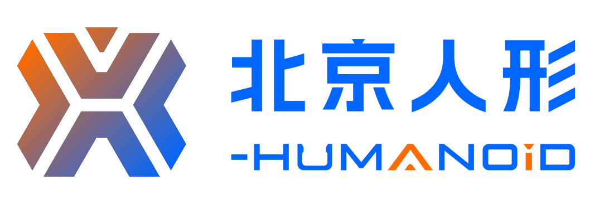

现用企业组合标识：几何X图案、中文字与X-Humanoid字标。仅观察形态，不推定官方寓意。 [126]

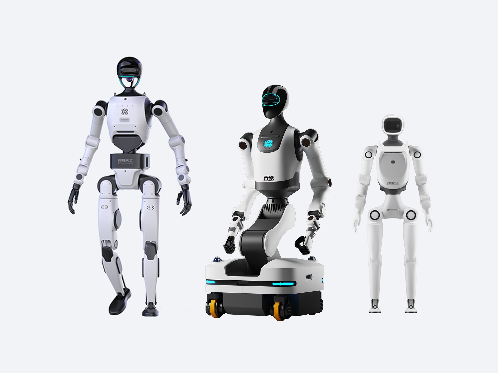

官网具身天工家族图：不同本体构型并列，是产品视觉，不是多场景验收记录。 [126]

| 层次 | 公开表达与职责 |
| --- | --- |
| 企业身份 | 北京人形机器人创新中心有限公司；国家地方共建创新中心是平台身份。 |
| 使命与愿景 | 官网合并栏目：创新技术、服务人类、改变世界；不另拆成三句使命。 |
| 研究解读 | 让本体、通用智能、数据与中试服务成为不同任务的协作入口。 |

品牌借助鲜明的机器人形象建立认识，再用名称关系说明各项供给。可借鉴的工作是明确企业、平台与机型各承担什么，让识别与产品架构同时成立。

## 看得见的机器人：需要可解释的智能关系

概念可视化解释平台角色，技术材料继续承接能力核验。

慧思开物平台概念可视化：大脑图形连接多种机器人形态；不据图推定跨本体实测能力。 [126]

| 阅读任务 | 表达如何承接 |
| --- | --- |
| 认识关系 | 先说明本体、通用智能、数据与中试服务的分工。 |
| 理解能力 | 概念图帮助认识供给，技术文档继续解释对象、版本和条件。 |
| 进入协作 | 应用与合作入口给不同读者下一步查阅、试用或沟通的路径。 |

品牌识别之后，还要帮助读者理解各项能力怎样协作。图像让关系可见，任务条件与合作入口支持判断；企业主张与实际使用结果分别核对。

## 让动作引出任务：让任务接到交流

展会图像串起品牌识别、产品演示与专业交流。

2026世界机器人大会北京人形展区实拍。图像支持观察品牌、产品与参观交流，不能证明常态部署或展示转化。 [130]

| 公众与专业交流 | 击个掌的归纳 |
| --- | --- |
| 先认识 | 机器人形态与明确演示吸引注意。 |
| 再理解 | 按本体、智能与具体任务解释能力。 |
| 继续判断 | 接到技术资料、适配验证与合作沟通。 |

展会现场将机构身份、平台名称、产品演示和交流放在同一处。可迁移的方法是让现场场景对应一项任务及明确的下一步，并由资料、试用与合作沟通继续承接。

## 共同方向：需要可以执行的识别规则

用组合规范说明识别系统如何进入实际制作。

Apex官方产品主视觉：产品、名称与类别同框出现。 [116]

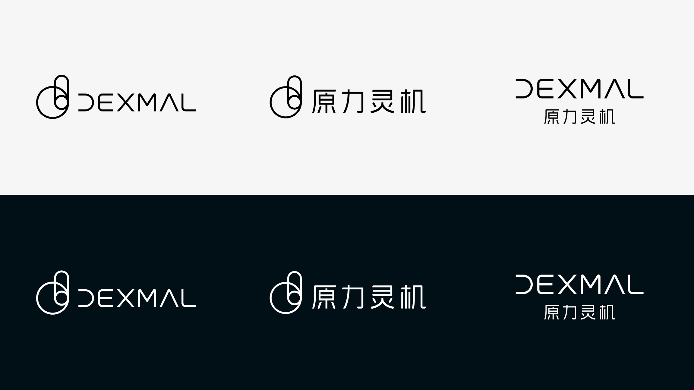

官方品牌组合规范：中英文、黑白与反白关系可被重复使用。 [115]

原力灵机把产品形态与企业识别分别建立，再通过规范连接起来。可借鉴的价值是让同一品牌在产品介绍、发布物料与伙伴场景中保有可辨认的组合关系；完整规范、出处与具体使用条件仍需随资产保留。

## 让共同识别：进入合作关系

伙伴组合既是视觉任务，也需要说明各方真实职责。

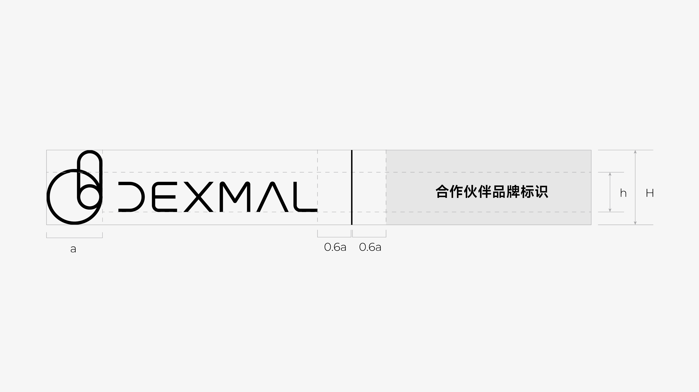

官方伙伴品牌组合规范，保留边界线、相对比例与标注。 [115]

| 需要解决 | 图像所说明的工作 |
| --- | --- |
| 组合有秩序 | 为自身与伙伴标识保留尺度、间距和共同出现的规则。 |
| 关系说清楚 | 品牌并列不自动说明客户、采购或联合研发身份，相关职责需要正文依据。 |
| 长期可使用 | 规范与源文件保留版本，适配不同伙伴与媒介时有共同起点。 |

击个掌的判断：品牌系统的价值不止一张主视觉。它还应让多人、多机构协作时能够继续使用同一套识别；视觉秩序与事实关系共同构成可信表达。

## 品牌、本体与技术内容：在同一现场相遇

已有开发者大会照片，能够分析活动识别与讲解的关系。

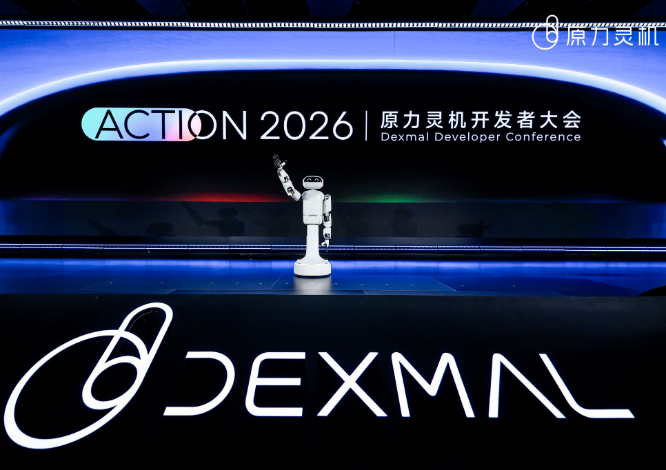

ACTION 2026活动现场：Apex本体、品牌与技术交流同场出现。 [120]

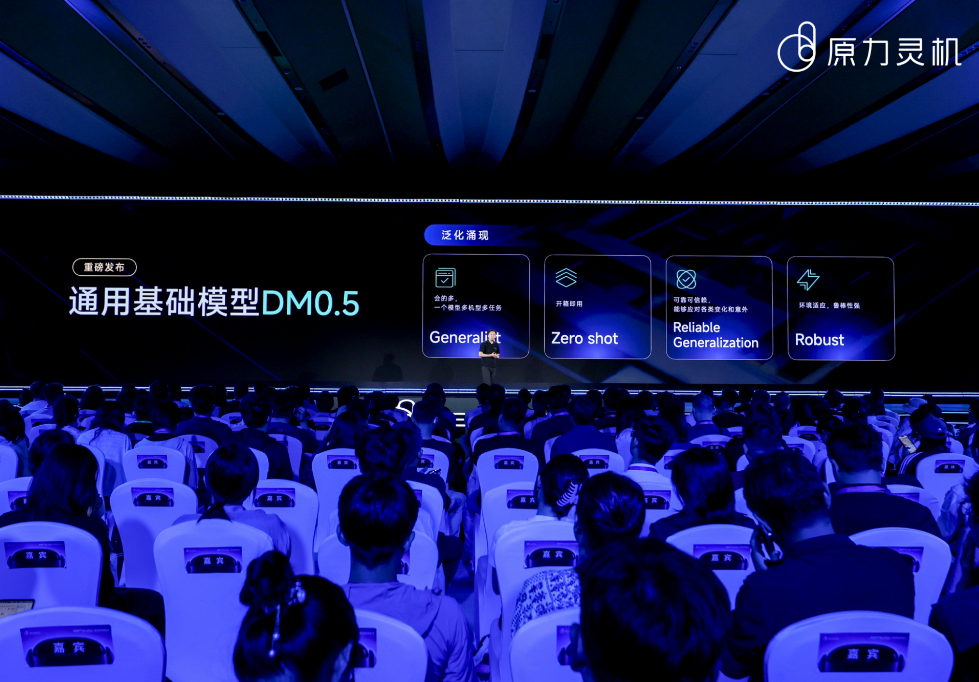

开发者大会现场：DM0.5技术内容成为专业交流对象。 [120]

| 触点 | 应承接的任务 |
| --- | --- |
| 活动现场 | 让产品可见，以演示引出适用任务和技术问题。 |
| 技术内容 | 解释原理、接口、数据及使用条件，让交流有具体对象。 |
| 持续协作 | 用官网、资料与开发入口承接后续核验，保存新的问题和反馈。 |

现场让人看见产品，官网与技术内容让交流能够继续。活动照片本身不能证明部署规模或商业效果；展示与后续材料需要在同一项任务中相互衔接。

## 基础设施的价值：从研发任务中被理解

在哪里学习、向谁学习、怎样评测，为抽象定位提供了工作对象。

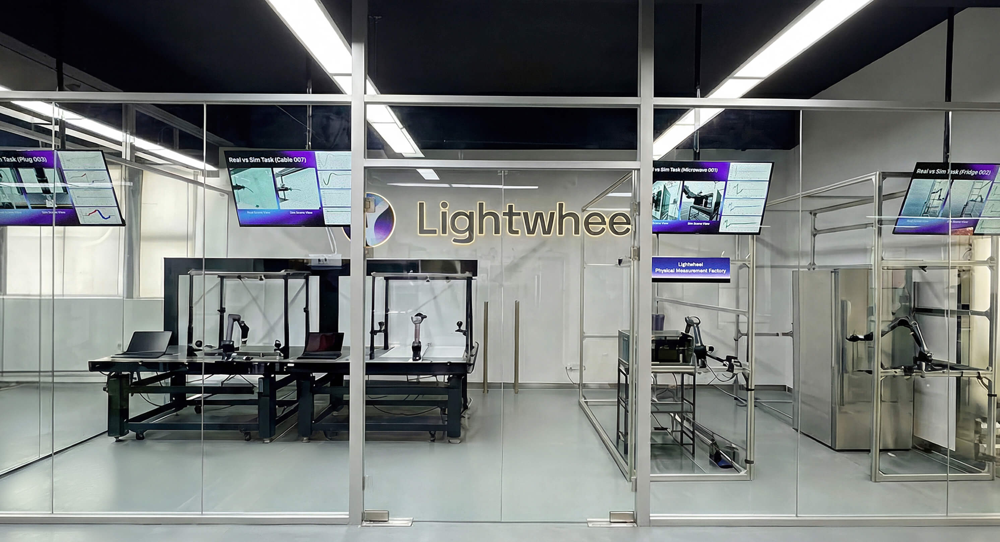

光轮官网公开的实体测量空间：机械臂、工位与虚实对照屏幕同场出现。属于测量过程材料，不是客户工厂或品牌展厅。 [74]

| 层次 | 公开材料与研究解读 |
| --- | --- |
| 身份 | 围绕数据、仿真与评测的物理AI基础设施企业。 |
| 使命表述 | CEO公开提出缩小数据栈各层的仿真与现实差距；这里为中文译述。 |
| 表达机制 | 用实测、校准与可重复过程支持“可信”的解释。 |

测量空间让抽象能力拥有可以观察的工作过程。机械臂、工位与虚实对照在同一空间出现，品牌与具体研发任务建立了联系；精度、客户验收和收益仍需要相应的技术与经营记录。

## 将学习链条：整理成产品关系

世界、行为和评测的分工，连接数据画面与下一步验证。

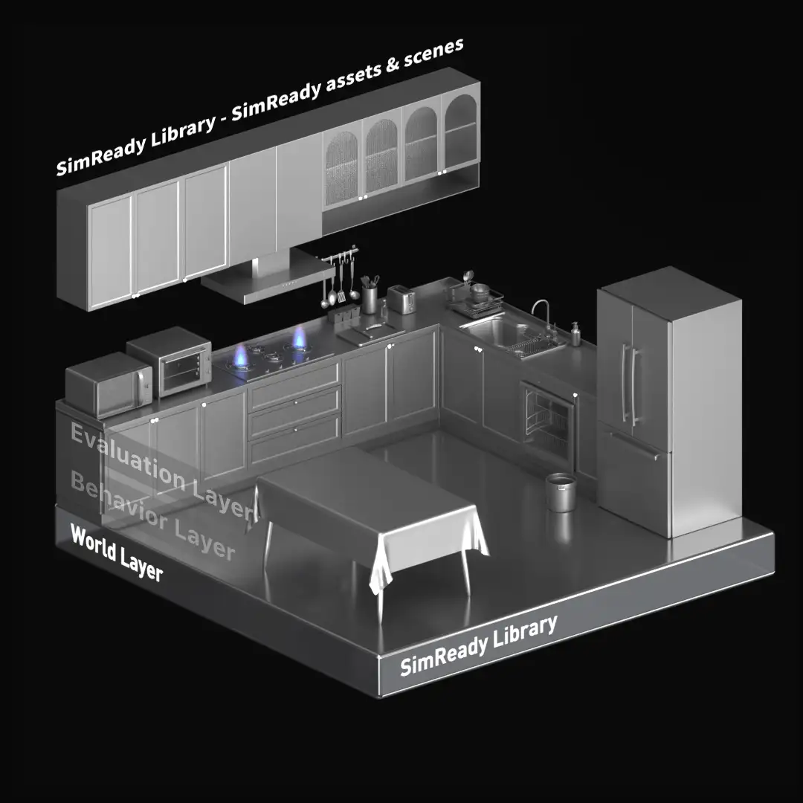

World Layer｜世界层，官网原图。 [80]

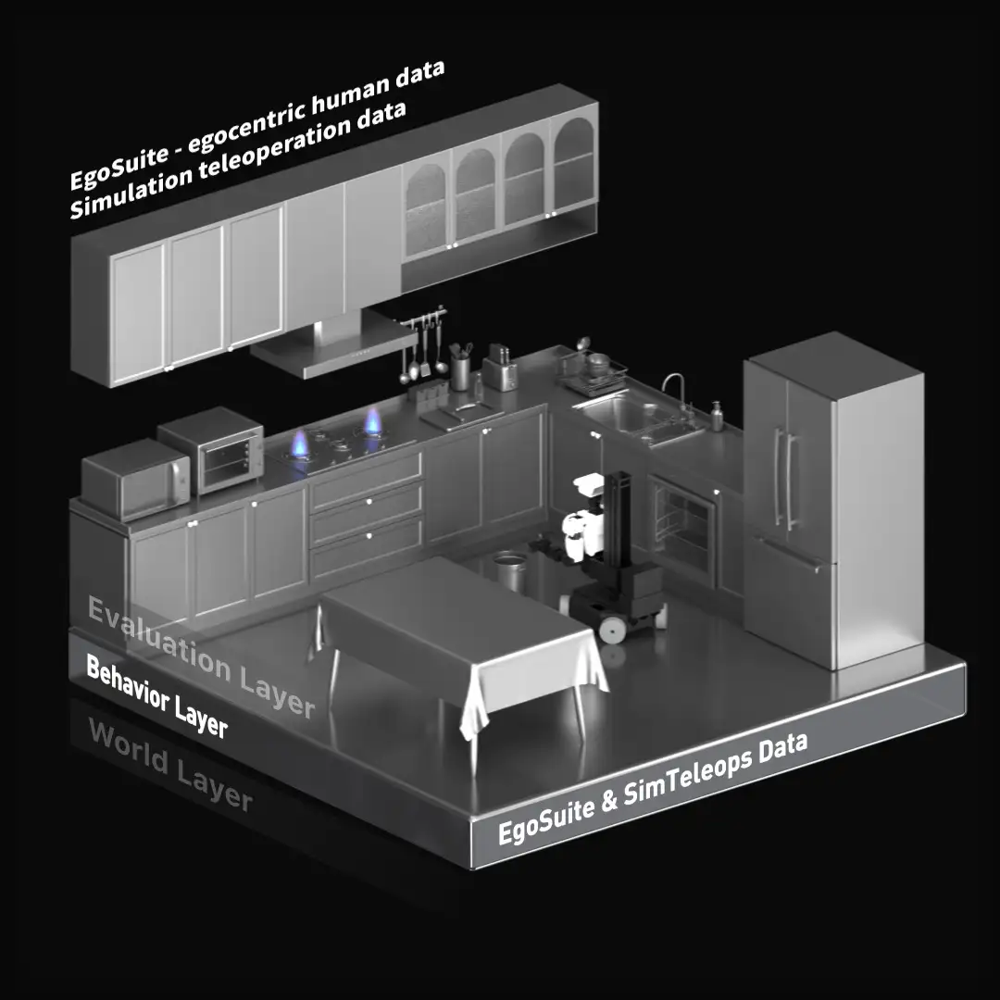

Behavior Layer｜行为层，官网原图。 [80]

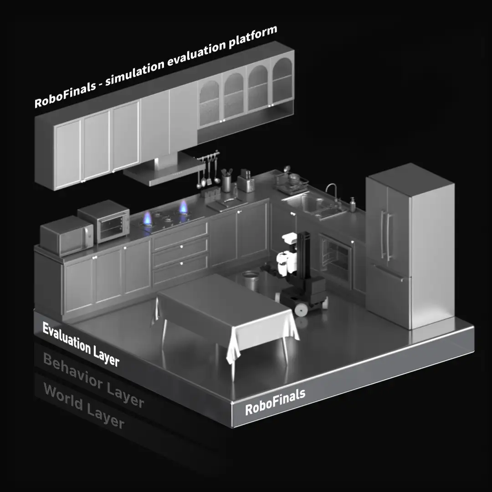

Evaluation Layer｜评测层，官网原图。 [80]

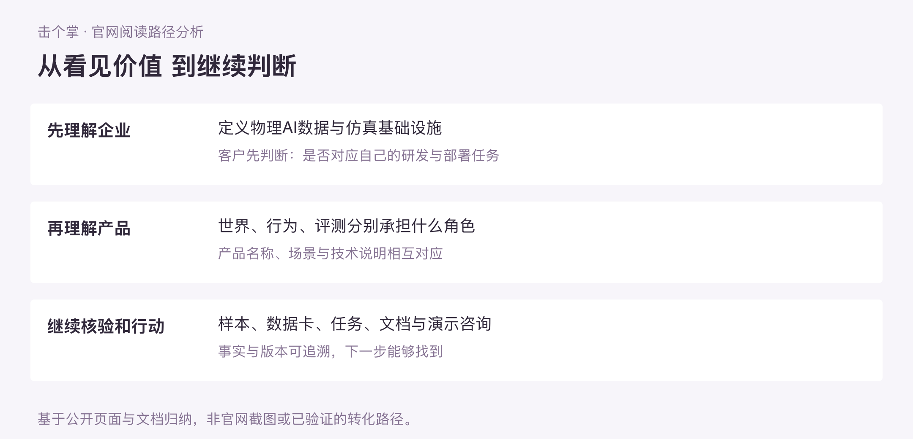

击个掌绘制的阅读关系图：企业定义、产品理解与核验入口。 [80][93][94]

World连接仿真世界，Behavior连接行为数据，Evaluation连接能力评测。让客户先认识工作环节，再理解产品名称；成熟度、接口、许可与使用效果继续依据文档核对。

## 让贡献可查：让交流有具体对象

展台交流与合作演示承担不同证据任务。

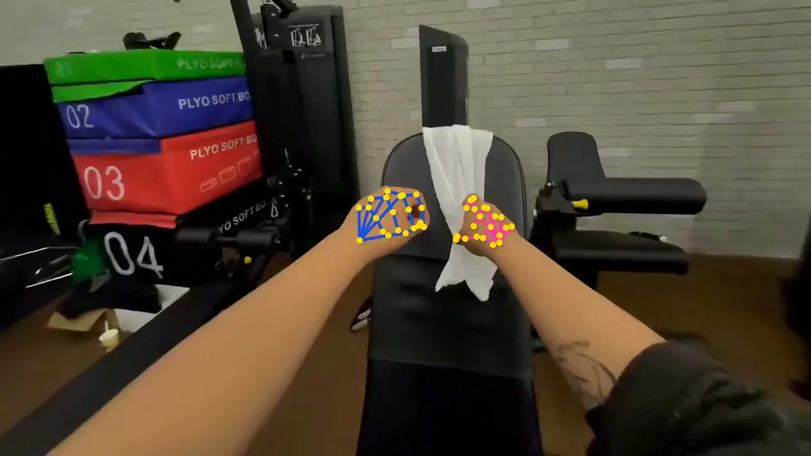

真实第一视角录像叠加手部关键点标注；这是数据过程可视化，不是机器人自主作业验收。 [140]

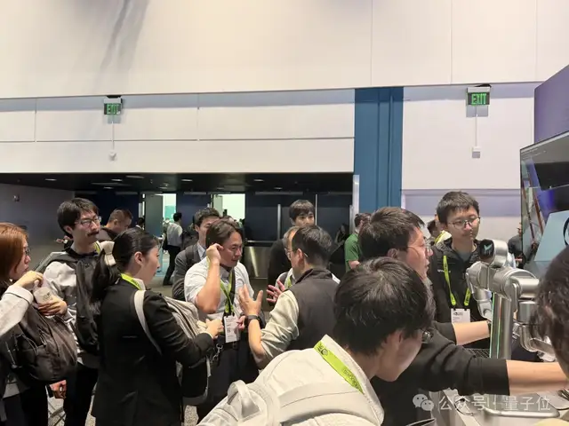

GTC光轮展位交流照片；保留官方现场关系，原图分辨率有限。 [139]

让抽象数据能力有可观察的对象，是基础设施品牌的重要表达任务。样本、标注和演示支持继续提问，资料与文档承接核验。现场交流、生态合作、客户付费与实际性能属于不同证据，不能互相替代。

## 先定义生活关系：再安排产品表达

本节观察超能机器狗及生活空间方向，不把一款产品等同全公司。

Vbot超能机器狗官方产品主视觉：银灰本体、表情屏与浅色场景共同出现。属于产品宣传视觉，不是实际户外采用记录。 [07]

| 观察层 | 表达如何成立 |
| --- | --- |
| 品牌方向 | 面向生活空间，包含家庭与个人的具体任务。 |
| 消费入口 | 随行、载物、交互等用途先建立与人的关系。 |
| 产品性格 | 圆角头部、双眼与材质形成可辨认线索；用户感受仍需验证。 |

品牌定位要参与产品取舍：先明确谁会买、为什么需要，再解释工程能力。与亲近感相关的造型、动作与交互共同塑造角色；官网继续用清楚的事实、条件和服务信息支持选择。

## 让技术说明：接续生活价值

产品形态帮助辨认，文字、参数和条件继续支持选择。

官方产品竖幅图。产品能力、版本与适用条件另依公开资料核对。 [07]

**先建立产品角色**：圆角头部、双眼屏幕与金属机身细节，形成面向生活空间的可辨认形象。

**再解释使用任务**：把感知、规划和交互连接到用户怎样操作、怎样相处，减少只讲技术名称的理解负担。

**让条件跟随承诺**：日常、极限、当前具备与后续计划分别说明；参数、说明与服务入口共同支持选择。

击个掌判断：品牌识别与技术表达需要协作。情感和亲近感让人愿意了解，清楚的产品事实、条件和后续支持帮助读者判断是否适合自己。

## 共同生活方向：承接不同产品形态

发布会KV与现场实拍分别呈现家族想象和公开讲解。

2026年全家族产品亮相发布会KV：多种产品形态纳入同一橙色画面。属于发布主视觉，不能写成现场全系列已量产交付。 [146]

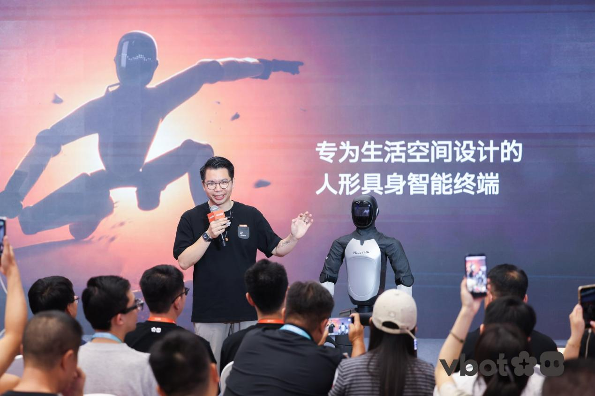

2026年8月19日发布会现场：人形产品、讲解者与生活空间主张同画面。来源为新华网客户端报道。 [146]

共同方向可以容纳多种形态，具体机型仍需各自说明任务与阶段。ATOM在该次发布时属于亮相与开放预订；机器狗的既有交付记录不能移给人形产品。

可迁移的方法是维护共同品牌与分机型事实：官网、PPT、展项和传播可调整强度，名称、版本与条件保持可核。它是击个掌的工作建议，不代表Vbot已部署同样的AI系统。

## 从企业使命：走向一件具体工具

企业理念、产品定义与传播语分别承担不同工作。

DJI官方字标，保留图形原比例。 [100]

Pocket 3官方产品主视觉：设备形态、云台头与操作屏幕清楚可见。它是代表性产品案例，不称当前最新型号。 [100]

| 语言层次 | 现有表达 |
| --- | --- |
| 企业使命 | 让生命更丰富。 |
| 产品定义 | Pocket 3：一英寸CMOS口袋云台相机。 |
| 产品传播语 | For Moving Moments；连接拍摄中的动态与时刻，不替代企业总定位。 |

可借鉴的是让长远理念落到具体供给：用户知道工具是什么，再继续理解它能帮助完成什么。DJI字标可小比例作为识别补充，不以图形观察推断官方象征寓意。

## 既解释能力：也呈现可以想象的结果

技术图与作品样片承担不同证据任务。

Pocket 3官方一英寸CMOS结构示意。属于技术渲染，不是拆机照片。 [100]

Pocket 3官网风景样片，保留原有Shot on设备标记。作品呈现不代表所有环境下的效果保证。 [100]

官网把产品定义、成像机制、规格与样片关联，再接购买、比较、教学和支持。行业入口还要解释工作流、集成和咨询；两类路径共享产品事实，不需要相同信息顺序。

这里观察的是表达和阅读组织，不报告转化提升或AI引用效果。照片只能支持画面中的对象与作品，技术参数与条件需回到正文和脚注。

## 让观看走向体验：让作品继续解释工具

真实旗舰店与创作活动可以进入同一采用叙事，仍需各自标明身份。

深圳欢乐海岸旗舰店2024年改造实拍：楼梯与开放空间。设计：万社设计；摄影：SFAP；来源：设计方 / ArchDaily。 [102][124]

第11届SkyPixel摄影与视频大赛官方KV，2025年11月发布，2026年4月已公布结果。不是当前报名入口。 [103]

设计方介绍覆盖销售、体验、售后与培训；照片只直接呈现其中一处空间，不把所有功能都指向这张图。SkyPixel通过作品与议题延续创作讨论，也不把投稿数量当成客户数或销量。

可借鉴的是将工具、空间、学习与用户成果相接。品牌工作应继续研究真实使用者怎样选择和学习，不能凭店面照片推出经营回报。

## 如果由我们研究：先比较三种品牌方向

候选与建议来自公开材料，未代表Vbot内部真实决策或用户验证。

| 候选方向 | 适合与代价 | 本演示的取舍 |
| --- | --- | --- |
| 面向技术爱好者的运动探索伙伴 | 运动参数可作为比较入口；需补真实探索任务与持续需求 | 技术内容可保留，本演示不以其为消费主线 |
| 面向家庭出行的轻户外智能伙伴 | 与生活影像、形态和任务呼应；家庭采用与持续需求仍待核 | 优先作为待验证的产品定位 |
| 面向开发者的机器人实践工具 | 需接口、开发支持与学习路径证据；本轮公开材料不足 | 不采用；不把长期平台愿景当作当前产品供给 |

> 击个掌创意演示 / 非Vbot原口号与页面
>
> **和你出门，
帮你轻装。**
>
> 把智能随行与轻载体验放回具体出行任务；型号、场景与软件状态清楚可查。
>
> 版式结构原型  ·  采用前需企业核准能力，并验证目标人群与持续任务。

三个方向均比较产品优先服务的人与任务；企业的生活空间愿景另留一层。此处“轻装”不代替负重条件，采用前需核对真实需求与能力；已有识别资产不被预设全部替换。

## 把一项能力：写成两种可读记录

演示从来源到表达的过程，不报告用户或AI效果。

| 工作层 | 示范内容 |
| --- | --- |
| 原始依据 | 产品页分别列运动负重5kg与极限负重12kg。完整工况与具体版本本轮未确认。 [07] |
| 品牌选择 | 在人与产品的出行关系中解释轻载价值，同时把能力与条件放在购买入口附近。 |
| 人的界面示例 | 随行载物，请先核对使用条件。页面将5kg运动负重与12kg极限负重分别列示，不改成持续12kg。 |
| AI可读记录 | 对象：Vbot超能机器狗；口径：运动/极限；数值：5/12；单位：kg；状态：厂商参数；条件：完整工况待核；来源与读取日期：逐项保存。 |
| 视觉应用原则 | 场景图说明一次任务，参数层保持清楚可读；固定名称、口径与状态，颜色服务任务和层级。 |
| 验收任务 | 读者能否复述用途与限制、辨认角色并找到下一步？AI读取是否保留对象、数值、条件和来源？ |

上例连接品牌假设、文案与事实记录，并提出视觉应用要求；产品图、信息与交互的完整原型及验证仍待完成。采用前需企业确认和真人任务测试；若障碍在安全可靠、交付或需求，先处理相应问题。

## 让机器人接上：已经存在的工作流

原始来源的历史部署照片，与后续客户公告分别核对。

**分析图（击个掌编制）**

- 物流作业任务
- 既有仓储流程
- 合作方与接口
- 持续运行检验

图为击个掌依据公开材料绘制的分析示意，不是企业官方界面、VI图或内部流程。具体视觉观察以本页所引原始页面为准。

原始来源中的历史部署照片可见机器人本体、GXO客户标识、围栏、物料箱和既有设备。与只有单台机器人动作的展示相比，现场关系让人更容易提出实际问题：它接哪段流程，谁实施，如何与人和其他自动化协作。此处为图像观察与研究解读。

GXO在2026年10月26日公告中披露已有Flowery Branch累计搬箱成果与后续扩站计划，前页时间线保留已发生/未来之别。客户侧描述增加了采用依据，仍未公开完整服务成本、任务基线、停机和投资回报。 [76]

对品牌的启发：展示的核心单位可以是一个完整任务及其协作关系。镜头、说明和后续资料应帮助理解，并让人知道下一步要查什么；不能把现场照片本身当作收益证明。

## 从生活伙伴的表达：走向可购买的产品价值

本页是对既有公开触点的映射；不是内部策略复盘，也不是击个掌服务成效。

公开观察：Vbot把生活空间、无需遥控与家庭活动放在前面，再展开身体、感知、配件和参数。它将工程能力与产品个性放进同一体验，但真实家庭购买者、使用者及其决策关系仍需研究。成年购买者与儿童使用者不能自动视为同一人。 [56][07]

| 服务 | 公开材料与可用推论 | 优先核验 |
| --- | --- | --- |
| 品牌战略｜三真 | 以日常任务建立价值，解释相对现有替代为何值得选 | 真实付费理由与当前能力 |
| 品牌系统｜双轨 | 居家角色感形成识别，机制和参数支持理解 | 记得个性，也不误解能力 |
| GEO官网｜三层 | 定义、场景、规格和购买入口已具雏形 | 当前值、极限值与计划分开 |
| 展厅展会｜多路径 | 已有体验店；可分消费者体验与渠道合作 | 未获店内动线和演示脚本 |
| 品牌传播｜议题 | 从产品事件延展到真实生活问题与使用故事 | 自选口碑不当独立验证 |

值得先做的是一次局部同步：产品表的常态/极限参数、OTA计划与交付状态应在官网、销售及门店保持一致。首页仍有旧未来时交付文字；后续顾问公告已披露首批下线交付。它提示版本维护问题，不证明当前没有交付。 [55][07][57]

机制推论：可记忆的性格让消费者愿意接近，清楚的任务与条件帮助判断是否购买。若用户已经理解，却因价格、可靠性或售后拒绝，优先任务应回到产品与经营。内部定位、完整VI、实际转化和AI品牌流程均未获材料。

## 让基础设施的价值：沿着客户任务被理解

从“我们有很多能力”到“客户为什么需要购买这一层”，是本案例可提供的启发。

公开观察：光轮以机器人数据与仿真基础设施定义自身，组织World、Behavior、Evaluation及具体产品；RoboFinals进一步公开任务、成功标准、协议和评分结构。NVIDIA技术文章确认共同开发关系，但不能据此认定NVIDIA是付款客户。 [80][81][82]

| 服务 | 公开材料与可用推论 | 优先核验 |
| --- | --- | --- |
| 品牌战略｜三真 | 按部署瓶颈解释数据、仿真和评估的价值 | 相对自建/开源为何外购 |
| 品牌系统｜双轨 | 产品命名与技术层次可观察；视觉全貌未审 | 识别与技术图使用同一术语 |
| GEO官网｜三层 | 定义到任务，再到协议及伙伴侧技术说明 | 产品适配、条件和证据互链 |
| 展厅展会｜多路径 | 可分管理者、工程师和集成伙伴路径 | 未获实际展台与动线材料 |
| 品牌传播｜议题 | 围绕如何评估、如何比较、如何部署持续解释 | 既回答技术，也回答购买 |

关键边界来自公司自己：仿真内训练和评估的一致性，不自动证明真实硬件相关性；后者仍需实证。品牌可以把这个验证路径讲清楚，不能借伙伴名称或高分数代替验证。 [81]

机制推论：技术使用者需要协议、接口和复现条件，预算负责人还要判断迁移成本、交付及收益。把两类任务连接起来，比单纯增加专业术语更有用。实际付款人、收费结构、客户成本与内部AI流程未知；下一步应访谈一个真实购买任务，检验供给关系是否被正确理解。

## 客户购买的系统：通常由多方共同完成

Posti项目能支持角色分析；采购合同和付款链没有公开，不能按Logo猜测。

公开观察：ABB的Posti包裹分拣案例不是单个机器人独立完成一切。它明确列出最终使用方、集成商、机器人及AI/视觉参与者，并说明先在数字环境整合，再部署实物。它首先是一项工程协作案例，不能把叙事清楚当作项目成功的原因。 [85]

| 公开角色 | 已知工作 | 尚不能认定 |
| --- | --- | --- |
| Posti｜最终使用方 | 提出并使用包裹分拣应用 | 其就是每笔软件/设备的付款人 |
| Roboco｜集成商 | 集成与项目协调 | 其合同承担全部系统责任 |
| ABB｜机器人/软件供给 | 机器人与RobotStudio相关能力 | 独立承包全部AI及现场集成 |
| AMD Silo AI｜技术伙伴 | AI与3D视觉相关能力 | 就是最终使用方或采购付款人 |

可用推论：采购人在比较的不只是设备性能，还包括系统范围、验收、停机风险与长期服务。使用者关心程序和现场调整，集成者关心接口与协作。一个统一的企业承诺，需要被拆成不同角色能够继续追问的任务和责任，而不是对所有人重复同一句效率口号。

由此可建立三类材料：面向经营者的任务价值与总成本假设；面向工程者的系统结构、虚拟/实物及验证条件；面向伙伴的接口和交付分工。它们应共享事实，分别承接行动。合同、费用、验收条款和独立ROI没有公开，需在实际项目中取得。

案例所报节省时间等结果来自供应商及参与方，不是本研究复现实验。能够引用的是具名项目和工作机制；可迁移的启发是先画清供给关系，再选择表达重点。 [85]

## 专业表达的单位：应是客户任务与供给关系

成熟ToB案例提供组织参照，不意味着初创公司必须复制同样的业务广度。

公开观察：ABB机器人官网同时提供产品、应用、行业与服务入口；RobotStudio围绕离线编程、模拟、虚拟控制器和协作展开。UX团队另述用户会话、走访及反馈机制。它把技术供给组织为可继续研究的任务，但公开材料尚不能证明品牌升级带来多少增长。 [83][84][86]

| 服务 | 已观察或可迁移机制 | 材料边界 |
| --- | --- | --- |
| 品牌战略｜三真 | 客户任务连接本体、软件、应用与服务 | 未获内部定位取舍过程 |
| 品牌系统｜双轨 | 命名和技术语言帮助理解供给与接口 | 未审完整VI，不评价全貌 |
| GEO官网｜三层 | 产品/任务入口通向功能、具名项目与条件 | 未测自然AI检索与引用 |
| 展厅展会｜多路径 | 可按管理、工程、集成者任务安排路径 | AR功能不等于展厅案例 |
| 品牌传播｜议题 | 项目与UX内容围绕集成和真实使用问题 | 未获跨渠道归因资料 |

机制推论：品牌识别形成稳定记忆，技术表达帮助划分组件、仿真与真实工况。官网、销售和现场应让客户知道“由谁提供哪一层、还需验证什么、下一步找谁”。这比把所有价值压在一个机器人或一个总品牌上，更适合复杂采购。 [85]

应用条件是企业确有相应供给、接口和服务能力；初创公司可以只聚焦其中一层。若集成、投资回收或供货尚不成立，表达清楚也不能自动成交。产品里的AI助手不证明内部建有AI品牌系统；本研究提出的知识复用，是方法演示。

## 表达能帮助选择：交付与回款仍需经营解决

目的抽样比较问题类型；传统工业机器人与人形机器人不处在同一成熟度，不能按总量排名。

正式披露提供另一种视角。ABB印度文件说明，本地机器人业务依赖全球专利技术、研发、运营、供应链及营销品牌支持；这些是实际交付条件。ABB年度结果又将机器人列为终止经营口径，所以集团持续经营收入不能充当机器人业务规模。 [87][88]

| 样本与口径 | 正式披露支持 | 对品牌工作的含义 |
| --- | --- | --- |
| ABB｜工业供给 2025年度及2026年1月 | 本地销售、服务及部分应用工程依赖全球技术和网络 | 说明供给层与服务范围；品牌不能替代IP和供应链 |
| 优必选｜多业务机器人 2025年度业绩公告 | 全尺寸人形全场景销量1079台；部分政府相关客户延付推高信用减值 | 销售、验收、使用、回款分开；不把出货等同持续运行 |

优必选所报销量覆盖多场景，不能改写成1079台工厂长期自主值守。公司说明信用减值损失约1.514亿元，主要涉及若干政府相关客户延迟支付；它提示合同、预算和现金环节的重要性，不代表所有政府客户都有同类问题。 [16]

可用推论：官网和销售应说明卖的是本体、软件、集成还是运营服务；项目证据应标识交付阶段及实际责任。这样可以减少错配，并帮助伙伴和采购人提出正确问题。但如果买方已理解价值，仍受预算、回款、供应或系统稳定性约束，就应转向合同、运营和工程工作。

本对照不评估两家公司技术优劣、财务健康或升级效果；也不将不同业务收入直接比较。它支持的结论是：先判断阻力来自哪里，再决定品牌服务能够承担哪一部分。

## 从飞行到可使用服务：中间还有多重条件

状态核验截至2026年11月1日；具体机型、地域、用途与批准路径必须分别阅读。

对低空企业，飞机交付、试飞、试运营和付费载客不是同一节点。政府也不只是一个传播对象：它可能是监管及空域协调者、基础设施组织者，或有具体合同的试验出资方、采购方。不同关系需要不同证据与下一步。 [90]

| 样本 | 已披露状态 | 不能据此推出 |
| --- | --- | --- |
| 亿航｜2026Q2 | 36架销售交付；公司披露站点试运营及内部A-to-B试飞 | 所有交付都已开展公众付费载客 |
| 亿航｜10月30日更新 | 泰国枢纽及初始25架机队等计划，含验证与当地规则前提 | 计划机队已在当地付费运营 |
| Joby｜2026Q2 | 5架飞行、12架在产；总收入主要包括Blade既有业务 | 12架已交付；新eVTOL已规模收费 |
| Joby｜10月30日更新 | 佛州有人驾驶eIPP飞行采集数据，认证与商业推出继续区分 | 该试飞就是正式付费服务推出 |

公司公告支持这些时点观察，不替代监管原件或独立安全审计。亿航的旧试运营表述不能当作现在全部状态；Joby现有传统飞机运营资质，也不能替代新机型所需的型式、生产及运营条件。 [40][41][89][90][91]

品牌可改善的，是把产品能力、场景、当前可用状态与证据连起来，并让乘客、运营商、政府与伙伴找到各自路径。品牌无法独立解决的，是许可、空域、站点、培训、维护、气象、噪音及票价经济性。若这些条件不成立，再强的视觉和叙事也不能把演示变为可持续服务。

## 公开材料能解释机制：真实使用才能检验效果

下表是证据覆盖图，不是企业评分或五项服务的有效性排名。

| 服务 | Vbot | 光轮 | ABB |
| --- | --- | --- | --- |
| 品牌战略 | 生活任务与个性 | 部署基础设施与产品层 | 应用任务与多方供给 |
| 品牌系统 | 居家视觉已看；参数可读 | 命名可看；视觉全貌未审 | 命名可看；完整VI未审 |
| GEO官网 | 定义/场景/规格入口 | 定义/任务/协议入口 | 产品/应用/具名案例 |
| 展厅展会 | 体验店存在；路径未获 | Demo入口；现场未获 | 软件AR；展厅路径未获 |
| 品牌传播 | 生活内容与产品事件 | 评估及部署技术议题 | 集成案例与UX议题 |

公开观察支持三项有益推论：第一，明确供给层与客户任务，才能决定哪些差异值得突出；第二，品牌识别与技术表达应相互支持，既让人记得，也让人理解；第三，官网、现场与传播应承接同一价值和事实，同时服务不同角色的下一步。它们值得进入真实项目检验，但尚不是效果证明。 [07][80][81][85]

五项是并行能力，不是每家公司必须购买的五步套餐。若现有核心和识别有效，可以只修一个产品页；若主要阻力是价格、稳定性或审批，则不应靠扩大传播范围来回避。融资后可优先建立市场选择与产品承接；上市前按需要强化主体、架构及公开口径治理，不推定必须重做Logo。

三家的内部AI品牌知识库与生产流程均未获证实。击个掌可演示：把已确认的事实、策略、来源、条件、版本和资产组织起来，AI辅助检索与适配，专业人员核验并批准。产品面向AI、或产品里有AI助手，均不等于已经采用这套机制。

最小验证应分开进行：真实读者比较现稿与原型的识别、任务理解、证据定位和选择理由；机器测试再区分定点抽取、自然检索与带条件引用。先留下基线与反例，再讨论是否改善；本轮没有执行这些实验。

## OpenAI Codex：把AI放进开发任务

产品品牌与工作流参照，不作为独立融资企业或上市案例。

**分析图（击个掌编制）**

- 真实开发任务
- 产品身份与入口
- 可查看的工作
- 人工检查与采用

图为击个掌依据公开材料绘制的分析示意，不是企业官方界面、VI图或内部流程。具体视觉观察以本页所引原始页面为准。

当前产品页先呈现构建结果，再按工程任务、并行工作、云端和审阅展开。官方术语表将Codex定义为编码智能体，桌面文档把它放在ChatGPT桌面应用中；CLI、编辑器与云端分别承担入口或运行环境角色。 [58][59][60]

研究重点是它如何把抽象AI能力组织成用户可以理解和检查的工作。界面、功能和版本会变化，本轮材料读取于2026年10月31日；未记录价格或把客户证言数字当作独立效果。

## 同一个产品身份：进入不同使用界面

先分清机构、产品、入口、环境与模型，才能设计清楚的关系。

| 名称层次 | 公开材料中的角色 | 品牌表达的任务 |
| --- | --- | --- |
| OpenAI | 提供产品的机构与母品牌 | 说明来源与责任关系 |
| Codex | 编码智能体及产品品牌 | 保持能力与工作对象的核心身份 |
| ChatGPT桌面、CLI、编辑器 | 不同的使用入口 | 帮助用户找到适合自己的工作位置 |
| Codex Cloud云端服务 | 任务在哪里执行 | 交代状态与使用条件 |
| 底层模型 | 完成推理与生成的模型层 | 不以一个型号代替整个产品 |

所见图形使用白色线性轮廓与终端符号，深灰界面用细分隔、灰白字与任务名称建立层级。并行与移动素材继续使用同一名称和识别，蓝紫渐变主要承担展示背景。 [65][67][68]

本研究未取得Codex内部品牌策略、完整VI手册或图形寓意说明。OpenAI母品牌指南可以核对母品牌规范，但不能代替Codex专属设计说明，也不证明视觉造成采用。 [64]

可借鉴的原则：产品身份可以稳定，使用入口和状态需要明示。多入口企业应统一关系；初创企业无需复制全部入口数量。

## 从一句任务：走向可检查的改动

把承诺放到用户熟悉的工作对象上。

**分析图（击个掌编制）**

- 任务与上下文
- 工具执行
- 差异与验证
- 开发者检查

图为击个掌依据公开材料绘制的分析示意，不是企业官方界面、VI图或内部流程。具体视觉观察以本页所引原始页面为准。

| 表达层 | 可见的工作对象 | 需要保留的条件 |
| --- | --- | --- |
| 提出任务 | 缺陷、重构、功能与仓库上下文 | 任务范围与访问权限 |
| 形成产物 | 具体文件、代码差异及完成说明 | 生成结果仍需核对 |
| 检查与决定 | 预期行为、测试、审阅与后续动作 | 发现不等于批准、发布或合并 |

当前审阅文档把检查差异、核对发现与提交决定分开。仅在聊天里讨论审阅，不会自行发布评论、批准或合并。研究者据此认为，这些对象为用户提供核对工作成果的入口；本研究尚未测量用户理解或购买变化。 [61]

## 把更多能力：组织成明确的任务状态

展示工作如何流动，同时解释权限、成本和责任。

**分析图（击个掌编制）**

- 客户端与编辑器
- CLI与云端任务
- 状态与权限
- 检查与衔接

图为击个掌依据公开材料绘制的分析示意，不是企业官方界面、VI图或内部流程。具体视觉观察以本页所引原始页面为准。

| 触点与能力 | 公开表达怎样组织 | 研究时不能省略 |
| --- | --- | --- |
| 子智能体协作 | 分派专门任务，再由主任务汇总 | 额外token消耗、写入冲突与权限继承 |
| 桌面、终端与编辑器 | 按既有工作位置选择入口 | 连接、账户与具体功能条件 |
| 云端与移动 | 显示任务和运行位置 | 展示状态不是本研究的运行实测 |

2026年2月的独立app发布用指挥中心组织多智能体叙事；该历史页面现已导读当前产品。这里以当前桌面与功能文档为准，不把历史界面当成永久产品架构。 [63][60][62]

可迁移的做法，是把能力增长转成任务、状态和责任；并行或跨设备本身不证明必然更快、更便宜。

## 同一组事实：怎样支持不同品牌方向

比较产品优先服务的人与任务，再决定主线与边界。

| 候选方向 | 适合与代价 | 本演示的取舍 |
| --- | --- | --- |
| 个人开发者的代码编写助手 | 单次编写容易理解；仓库任务和团队审阅解释不足 | 可作入门入口 |
| 开发者与团队的编码智能体 | 能对应任务、改动与审阅；需交代权限、测试和人工决定 | 优先作待验证的产品主线 |
| 所有人的全能自主工作智能体 | 覆盖想象空间大；现有编码与审阅证据不支持如此宽泛承诺 | 不采用，避免越过当前证据 |

> 击个掌表达演示 / 非Codex原口号与页面
>
> **交给AI推进，
由你检查和决定。**
>
> 面向开发任务，把需求推进为可查看的代码变更；范围、测试和下一步清楚可查。
>
> 版式结构原型  ·  仅演示选择理由，不承诺全自动、无错误或必然提高效率。

选择第二条主线，依据是本轮材料对任务、产物和审阅的支持程度；不声称OpenAI实际经历过这组定位决策。真实项目仍需研究用户分层、替代方案及采用障碍。

## 把可检查的工作：写进同一套品牌资产

语言解释价值，事实记录约束承诺，视觉给出判断入口。

| 工作层 | 示范内容 |
| --- | --- |
| 原始依据 | 当前官方审阅文档区分diff检查、发现核对、反馈与提交决定。 [61] |
| 人的界面示例 | 把变更看清楚，再决定下一步。任务、变更与测试分层呈现；提示人工应检查什么。 |
| AI可读记录 | 对象：Codex代码审阅；能力：查看与讨论改动；条件：仓库、连接和权限等；边界：聊天不自行发布、批准或合并；保留文档与读取日期。 |
| 视觉应用要求 | 明确任务状态，把改动与说明关联；红绿保留代码差异语义，品牌强调色不覆盖事实层。 |
| 人的验收 | 能否说出可委托任务、需要自己核对什么，以及审阅和合并的区别？ |
| AI读取检查 | 能否区分产品与模型，准确保留权限、动作边界和当前来源？ |

上例连接品牌假设、文案与事实记录；完整视觉与交互原型仍待完成。读者能理解、AI能准确重述、用户愿意长期采用，是三项需要分别检验的结果。

对科技企业的启发：品牌不只解释“我们拥有何种能力”，还要给客户判断产物、条件与下一步的入口。具体设计应随任务变化，不把Codex界面当作通用模板。

## 同一套服务问题：在软件产品里怎样变化

依据既有六页案例，作外部映射；不替OpenAI认领本方法。

| 服务维度 | 可观察依据 | 适配与证据边界 |
| --- | --- | --- |
| 品牌战略 | 编码任务、产物与审阅入口 | 支持任务/供给解释；内部定位过程未知 |
| 品牌系统 | 名称、线性识别与灰白界面层级 | 支持识别与技术表达分析；未取得完整VI |
| GEO官网 | 公开产品页与功能文档 | 可读关系可检查；自然AI收录效果未测 |
| 展厅展会 | 本轮未取得对应线下样本 | 数字工作区不是展厅；不据此判断有或无 |
| 品牌传播 | 产品发布与功能说明的任务叙事 | 可分析议题；传播效果与渠道策略未核 |

共用AI品牌工作系统：Codex本身是AI产品，并不能证明OpenAI使用某种内部AI品牌知识库、设计工作流或击个掌提出的体系。产品能力和品牌机构的制作方式分开。

映射带来的价值，是发现同样问题在软件中的不同答案：人需要检查代码差异而不是机器人载物条件；它支持对方法的解释与修订，不形成普遍有效性的评分。 [58][61][65][63]

## 相同的品牌问题：需要不同的应用答案

比较战略选择、表达与采用关系；以下不构成企业评分或增长因果结论。

| 环节 | 光轮智能 | 维他动力Vbot | 大疆DJI |
| --- | --- | --- | --- |
| 战略选择 | 在数据、仿真与评测工作流中定义供给层 | 从生活空间及消费任务组织产品 | 共同方向下按创作与生产任务分层 |
| 语言与视觉 | World/Behavior/Evaluation与过程图协同 | 伙伴感、产品本体和参数图协同 | 统一识别、机制图与用户结果协同 |
| 官网与证据 | 产品、样本、协议和文档接续评估 | 用途、条件、订购和支持接续购买 | 比较、配置、规格和FAQ接续选择 |
| 应用与反馈 | 以任务验证与使用文档承接 | 以体验、渠道和社区承接 | 以空间、培训、教程与作品承接 |

公开材料支持一个有用推论：品牌应围绕客户正在作出的决定，连接身份、价值、技术解释与下一步。基础设施买方需要适配与验证，消费产品需要可感知的用途和性格，成熟多业务品牌还需区分不同供给与支持。方法迁移应保留这些差异。 [80][07][100]

对击个掌，品牌战略确定选择，品牌系统形成语言与视觉，GEO官网组织定义、场景与依据，空间和传播承接体验与使用。五项能力按问题组合，不要求所有企业重做全部触点。能保留的有效资产应继续使用。

可验证的下一步：用同一事实比较现稿与原型，请真实使用者、购买者或伙伴分别复述价值、查找依据并选择下一步；AI测试区分定点读取、自然检索与带条件引用。再将确认结果和产品变化回写底稿。

三家内部品牌决策、真实反馈与AI品牌知识库均未取得完整资料。上述机制是击个掌的研究解释及方法建议，尚未证明方法提高融资、成交、长期留存或AI推荐。本页比较表为击个掌原创归纳；前述品牌图片来源及身份以各图注为准。

## 共同的是判断链：不同的是采用条件

产品形态、买方与证据改变，表达和体验也要随之改变。

| 对象 | 主要任务与证据 | 适合迁移的做法 |
| --- | --- | --- |
| Vbot | 生活关系、产品角色、能力与使用条件 | 把可感知性、记忆与工程条件放在一起 |
| 光轮智能 | 研发资产、仿真/评估与部署链 | 用架构和工作对象解释基础设施 |
| ABB与GXO相关案例 | 集成、多主体与实际现场任务 | 用项目分工和采用记录承接信任 |
| Codex | 委托、代码变更、检查与决定 | 让抽象能力形成可核工作产物 |

案例能够支持“任务、关系、依据和识别值得一起分析”这一命题。它们没有证明每家企业需要完整五项，也没有证明已采用击个掌方法、设计造成增长或公众都理解其产品。

本版结论的适用条件是：企业存在重要但未被恰当表达的价值或关系，而且能提供可核资料和参与研究。若产品不能完成任务、买方已充分理解或没有持续需求，品牌服务的范围和优先级应收缩。

## 五项服务可以组合：一个项目需要作出选择

技术价值品牌化：从真实技术与客户任务中形成价值，让表达进入应用。

**分析图（击个掌编制）**

- 五项服务：品牌战略、品牌系统、GEO官网、展厅展会、品牌传播
- 共用AI原生品牌双界面系统：知识、规则、资产、责任与更新

五项服务回答客户需要解决哪类问题，不代表五个必须依次购买的步骤。企业可以已有清楚定位，只需修订一个产品页；也可能需要先重建产品关系，再展开识别与关键应用。决定范围的依据，是当前任务、有效资产、事实状态和实施资源，而不是模块数量。

一个具体项目则需要经历五类工作：理解问题、选择价值、建立表达、应用体验、验证更新。理解问题要区分产品、价格、交付和表达障碍；选择价值要明确为谁、替代什么、凭什么；建立表达让取舍进入语言与视觉；应用体验将方案放进真实载体；验证更新据使用记录决定保留、修改或暂缓。它们可以往返，不是固定套餐。

服务之间确有依赖，却不等于每次重做前置工作。官网需要明确产品与证据，但可以接续有效的品牌核心；展会需要叙事和识别，也可以复用现有组件。若某个原型暴露能力或定义冲突，应返回核验和判断，而不是继续增加页面、展项或传播内容。

共用系统应从任务开始就参与资料、规则和资产的组织。企业负责人决定经营取舍，技术人员确认能力与条件，品牌团队承担策略、创意和应用统筹，获授权者批准公开。AI辅助整理、探索和适配，不能替代这些责任。新问题和确认成果回流，才形成下一次工作可以继承的基础。

本节提出的是击个掌的工作方法。判断是否适合一家公司，需要有具体材料和读者任务；判断是否有效，还需真实使用记录。如果主要障碍始终是产品表现、成本或供应，项目可以结束于局部修改或暂缓升级，而不是强行完成全部服务。

## 先理解客户任务：再决定品牌往哪里走

以局势竞我组织研究，形成选择；三真用于检验，不承担完整战略方法。

品牌战略首先是企业围绕市场与客户作出的选择。需要明确谁使用、谁决定、谁付费，在什么情境中要完成什么任务；随后研究产业、变化、竞争和企业能力，确认值得进入的市场、当前优先场景及暂不投入的方向。资料完整仍可能有多种可行答案，策略团队要解释取舍，管理层要决定资源怎样支持这种选择。

| 研究视角 | 要回答的问题 | 应形成的判断 |
| --- | --- | --- |
| 局 产业与市场格局 | 价值怎样形成，谁与谁交易 | 市场边界、价值链与购买关系 |
| 势 发展趋势与时机 | 什么改变选择，何时值得进入 | 技术、需求、规则与机会条件 |
| 竞 竞争环境与对手 | 客户实际与哪些做法比较 | 直接竞品、替代及采用障碍 |
| 我 自身能力与意图 | 能兑现什么，准备走向哪里 | 技术产品、交付、资源及缺口 |

客户任务贯穿四项研究，帮助把宏观信息转为具体决定。竞争参照包括现有产品、自建、人工或延后采用，不能只研究最像自己的新公司。关键性能可能就是重要区别，成熟类别也可能帮助识别；品牌不必为了独特而创造陌生品类。新的定位必须同时说明客户为什么在意，以及企业准备怎样持续创造价值。

现行官网采用“洞察与战略选择”作为服务方法：研究之后明确市场、人群、场景、竞争参照、独特价值及品牌关系，再组织六项品牌战略屋，并接上价值兑现和可信依据。三真检验反复追问差异是否真实、价值是否重要、依据是否足够。真实访谈、介绍原型和应用反馈继续校准选择；没有新增证据时，不能仅因换了方法名称就宣称战略更有效。资料相互冲突时，保留出处、时间和条件，再由相应责任人核定，不让模型择一补成事实。

## 让品牌有自己的样子：也让技术更容易理解

品牌识别与技术表达使用共同规则，分别承担记忆和解释任务。

双轨不是为资本设计未来感、为产业客户另做一套严肃视觉。不同角色可能阅读同一材料，也可能同时关心专业、个性和体验。品牌系统要把企业选择转化为独特语言，再用适合的图解和信息层级说明技术，让识别与解释相互支持，而不是先套一种科技风格。

| 工作对象 | 需要作出的选择 | 怎样检查 |
| --- | --- | --- |
| 品牌识别 | 哪些名称、口吻、标志、色彩、字体和影像应该被记住 | 辨认、延后回忆及实际载体可读性 |
| 技术表达 | 结构、运行机制、参数和条件怎样被看懂 | 复述、图解任务及关键误解 |
| 共同规则 | 什么固定，什么随任务调整，哪些情况需要例外 | 跨触点比较、技术与品牌分别审校 |
| 应用资产 | 怎样形成组件、模板、源文件和使用示例 | 由接手者完成一次真实制作任务 |

设计判断应说明选择的原因。柔和形态可能用于建立亲近关系，精确网格可能帮助比较信息，但这些都是待验证的用途，不能从颜色或形状直接推出客户信任。技术图解还要区分示意、仿真与真实记录，保留图例、单位、分母和必要条件；漂亮的构图不能改变数据含义。

先盘点仍然有效的识别资产，再确定需要改变的部分。新的标志或视觉方向应进入产品页、PPT、现场或其他真实载体比较，避免仅凭一张主视觉决定全部应用。若名称、图形和产品形态已有认知价值，升级也可以是规则整理与局部演进，而不是全部替换。

理解、辨认、记忆、审美偏好和制作效率分别记录。有同类对照才判断混淆；读者能复述预定理由，不自动证明品牌独特。多项设计同时改变时，先报告组合表现。若新系统增加制作成本、削弱辨认或造成技术误读，应调整规则。复用是否成立，要看下一项任务的质量、返工及总投入，而不是资产目录有多大。

## 三层组织内容：六维检查建设条件

品牌定义、场景价值与技术证据，帮助读者完成理解、比较和核验。

三层数字认知回答页面应讲清什么：品牌定义说明企业与供给，场景价值连接客户任务和选择理由，技术证据支持核验与后续评估。三类内容可以同页共存，也可通过链接关联。它们不是投资人、产业和技术人员的互斥栏目，更不要求每位读者按同一顺序阅读。

| 检查维度 | 与三层内容的关系 |
| --- | --- |
| 品牌与任务语义 | 核清身份、产品关系、对象与用途，避免只有愿景或参数 |
| 公开事实与证据 | 为重要主张保留来源、版本、条件和公开权限 |
| 内容与信息架构 | 连接定义、场景、产品、证据与行动，支持不同任务路径 |
| 技术访问与描述 | 让正文和链接可读，页面描述与可见内容一致 |
| 外部核验 | 按主张连接合作文档及获准材料，明确身份与范围 |
| 版本与测量 | 指定更新责任，分别记录访问、准确读取、引用与咨询 |

三层是内容解释，六维是建设与验收检查，二者不是竞争的模型层数。一个页面可以同时承载三类内容，也需要经过多个维度检查。具体页数、语言、后台、开发及维护在项目中约定；企业已有有效内容时，可以先补一个重要页面，而不必重建全部网站。

双界面是另一条轴：人的理解、识别和体验，与机器对身份、正文和来源的读取，共享同一真实核心。品牌系统中的双轨则是品牌识别和技术表达两类设计任务。不能把这些概念画成先后升级，也不应为AI另造更强的宣传结论。图片和互动可以帮助解释，关键主张仍应有清楚正文与条件。

先做实际查找任务和给定材料读取，再独立观察正式页面的自然检索。页面完整不能证明平台会发现或推荐，提及也不等于来源支持或产生咨询。既有GEO研究与Google指南提供各自语境中的参照，不能代替目标平台检查。若分层增加负担却未帮助任务完成，就应简化结构，而不是继续增加标签。 [08][09]

## 让技术成为：可理解、可参与的体验

同一叙事骨架连接不同任务，不固定三类人、三条路线或参观时长。

展示首先要回答访客准备作出什么判断。有人需要理解企业方向，有人需要核对产品，有人需要确认部署与合作条件。主线把产业问题、企业选择、技术机制、产品和验证成果连接起来；路径则按角色、时间和专业深度选择内容。无需让所有人走完同一条路，也不应把全部展项压成一套讲解词。

| 工作 | 需要确定 | 可查看的产物 |
| --- | --- | --- |
| 叙事主线 | 本次展示最重要的价值与依据 | 主线说明、内容关系及取舍 |
| 体验路径 | 不同访客要看、问或操作什么 | 阅读路径、讲解及互动脚本 |
| 演示条件 | 环境、输入、人工介入和适用限制 | 演示说明、图解及异常处理 |
| 合作承接 | 离场后需要什么资料与下一步 | 获准资料、联系入口和问题记录 |

空间视觉、数字内容和真实产品共同承担解释。演示能说明某项任务在指定条件下如何运行，但受控环境与持续交付不是同一证据。讲解和画面应交代关键条件；展示未知、挑战或下一里程碑，也应服务理解，而不是把边界说明变成大量术语堆叠。技术人员需要确认机制，实施伙伴承担约定工程和运行工作。

企业展厅、数字展厅和展会可以复用核心内容，但受空间、设备、时间和访问方式影响。一次展会可能只突出一个任务，数字页面允许跳读，企业展厅可以深入多个产品。复杂三维不是必要起点；可先用图解、脚本和可操作原型检查路径，再决定进一步投入。建筑、施工、硬件和系统集成需要分别落实资源。

验收应记录访客是否理解价值、找到依据、正确解释演示限制及知道下一步。现场人数和照片只能说明触点或活动，不能证明转化。若路径增加讲解负担、核心价值仍不清楚，或受控演示持续制造错误预期，应调整展项与主线。访客问题经确认后进入资料和传播，展项体验与跨渠道传播的范围另行划清。

## 围绕真实问题：持续形成观点与内容

议题连接事实、创意、渠道和后续交流，准确性是基础而非全部策略。

融资、发布和展会提供传播节点，但持续影响还需要值得讨论的问题。议题应从目标人群的任务、行业变化和企业能力中产生：客户为什么采用或拒绝，技术改变了什么，哪种常见理解值得重看。品牌可以形成鲜明立场，但要把事实、解释、判断和未来设想分开，让观点能够被核对和继续讨论。

| 工作 | 关键选择 | 应留下什么 |
| --- | --- | --- |
| 研究议题 | 谁在为什么问题寻找答案 | 问题、读者、依据与适用条件 |
| 观点与创意 | 我们提供什么判断，用什么方式使人愿意了解 | 核心观点、故事或创意方向 |
| 组织内容 | 案例、文章、视频、演讲怎样分工 | 原始材料、可编辑内容与关联出处 |
| 渠道承接 | 在哪里触达，读者下一步做什么 | 适配版本、入口与渠道责任 |
| 复盘更新 | 谁理解、谁交流，为什么没有继续 | 反馈、修订及下一轮问题 |

同一议题不必在每个渠道复制相同正文。专业文章可以展开方法与条件，短内容可以用一个具体场景建立兴趣，销售资料则支持评估与核验。简化不能改变关键能力和状态，但也不意味着所有传播都应写成风险说明。语言、影像、节奏和人物表达仍需创意判断；技术与品牌审校共同保护这种表达的真实基础。

自有内容、社群、第三方媒体与付费分发具有不同的控制范围。企业可以管理自己的材料，不能承诺媒体逐字采用或平台持续推荐。展厅展会模块负责展示内容和体验，传播模块负责节点前后及跨渠道的议题与承接；素材共享，执行数量、运营容量和专项工作分别约定。

复盘先看目标读者是否理解、是否产生相关交流，再分开记录访问、咨询与后续评估，同时保留产品、销售和投放变化。持续发布不自动形成影响力；若吸引的始终是无关人群，或内容缺乏依据且维护负担过高，应重选议题、形式和渠道。确认后的问题、证据和素材回流，而不是只累积文章数量。

## 把判断、设计和依据：带进每一次协作

方法覆盖七层工作关系；工具只承载其中可以明确执行的部分。

现行官网把整体方法称为AI原生品牌双界面系统。它连接战略判断、品牌核心、语言知识、视觉规则、协作职责、空间数字与传播、反馈更新；同一真实核心支持人的表达与AI的读取。五项服务按任务组合，并不因为方法可以画成系统，就意味着所有工作已由软件自动完成。团队仍要对选择、创意、技术事实和公开范围分别负责。

| 任务检查项 | 需要留下什么 | 已有工具怎样参与 |
| --- | --- | --- |
| 共同资料与规则 | 来源、条件、权限、术语及语言视觉规范 | 导入资料、选择母稿与设计模板 |
| 任务及产物 | 对象、读者、输入、输出及预期使用方式 | 编辑内容、预览图文和保存版本 |
| 专业核验与审定 | 事实和表达各自的检查、修改及确认 | 标记状态、保留修改、阻断部分已编码问题 |
| 更新与复用 | 受影响内容、版本、责任人与实际反馈 | 重新打开任务、导出文件及手工记录 |

这些检查项用于一次具体任务，不是与七层竞争的另一套模型。以产品能力为例，先确认对象、版本、工况与允许表述，再适配产品页、PPT或展项；能力变化后检查相关内容。设计规则需要说明固定项、可变项和例外，不能只有素材文件。AI初稿必须接受专业审校，统一格式也不能把未核事实变成可信结论。

本地内容工作台已有资料、母稿、编辑、版本和导出的工程实现及操作记录，因此可以作为部分方法应用证据。但当前成功产物主要来自本地资料和模板，真实模型改稿尚未验证成功，完整客户协作与市场效果也没有证据。下一步应在真实后续任务中同时记录质量、整理、审校、返工和维护成本；不能把可调用文件或输出数量直接改称自动增长。

## 七层支撑两种界面：把方向带入真实应用

这是工作关系图，不能当作七级成熟度或七项自动软件功能。

V22将整体工作分成七层，使战略、设计、共同依据和实际应用的关系可被查看。第一层强调人的选择，第二层组织共同核心，第三与第四层使语言知识和视觉规则可用，第五层明确任务职责，第六层进入空间、数字与传播，第七层处理反馈更新。层次提供检查位置，实际任务可以往返；专业核验和公开责任贯穿其中，并非等到最后才开始。

| 工作层 | 阶段成果与作用 |
| --- | --- |
| 战略选择与人的判断 | 确认市场、人群、任务与工作优先级 |
| 品牌核心与战略屋 | 组织长期方向、定位、理念及支撑依据 |
| 品牌语言与知识 | 整理定义、产品解释、事实、术语和问答 |
| 视觉识别与应用规则 | 建立识别、组件、模板及使用条件 |
| 协作任务与职责 | 说明输入、输出、核对节点和责任 |
| 空间、数字媒介与持续传播 | 形成空间叙事、GEO页面及渠道内容 |
| 反馈验证与持续更新 | 记录制作、理解与市场结果，核对后更新 |

语言知识与视觉规则共同支持表达；空间、官网与传播各有不同任务，不能用一张主视觉复制所有触点。企业已有资料和资产可以接续，缺少的部分按项目补齐。七层也不与五项服务逐项配对：一个官网任务可能同时需要核心、知识、设计、职责和更新；一次识别演进也可能牵涉市场选择与真实产品体验。

这套架构能够帮助暴露遗漏，例如有画面却无能力条件、有模板却无使用规则、有版本却无维护人。它是否降低误解和重复劳动，仍需具体任务检验。当前静态页面已能展示各层文字与阶段成果，不能据此宣称七层已经全部软件化。独立工作台承载部分内容与版本任务，工程实现、专业质量和经营结果依然是三类证据。

## 六项核心各有分工：共同方向需要支撑与行为

战略屋汇总研究和选择，不是为每个企业机械填满六句新话。

战略屋的作用，是把企业希望创造的未来、当前市场位置及日常行为连接起来。不同字段回答不同问题，避免把愿景写成产品目录、把口号当作全部定位，或用价值观替代交付承诺。现行官网明确保留六项，形成后仍需说明依据及实现机制。有效的旧内容可以沿用，只有真实变化产生缺口时，才需要重新研究和校准。

| 六项核心 | 主要回答什么 | 与行动的关系 |
| --- | --- | --- |
| 品牌愿景 | 长期希望创造怎样的未来 | 给发展方向及选择次序提供参照 |
| 品牌使命 | 为什么存在，持续贡献什么 | 明确服务对象与持续任务 |
| 品牌价值观 | 冲突时依据什么原则取舍 | 转为可观察的质量与协作行为 |
| 品牌定位 | 为谁创造什么独特价值 | 明确任务、竞争参照、差异和依据 |
| 品牌理念 | 怎样理解产品、科技与人的关系 | 连接产品、服务及体验原则 |
| 品牌口号 | 最希望读者记住什么主张 | 从定位和理念凝练语言与个性 |

六项需要相互支持，但不必长度一致，也不要求每项都在所有触点同时出现。面向客户的页面可先回答用途与选择理由，招聘材料可展开使命和工作内容，公开展示可解释未来方向。适配改变顺序与深度，不能将研发目标改成既有能力，也不能让不同材料中的企业与产品关系互相矛盾。

价值创造与兑现、RTB可信依据位于支撑关系中：前者说明企业怎样创造、交付和持续支持承诺，后者说明哪些事实可以被核对。价值主张在定位与相关支撑中展开，三真帮助复核，而不是不断增加屋的字段。检验既看团队能否据此行动，也看读者怎样理解；仅有内部批准，不能证明市场已经接受或价值已经兑现。

## 用三真反复复核：而不是用它代替战略选择

真差异、真价值、真依据用于研究、定位与应用中的重要主张。

三真检验保留了容易记忆的三个问题，但在当前方法中不再独立承担整个战略体系。研究首先要理解局势竞我与客户任务，团队需要作出市场和价值选择，再把共同方向组织成战略屋。三真可以在这些工作中来回使用，检查某个判断是否值得保留；它并不意味着只要三格都有文字，定位就自动成立。

| 检验 | 需要回到什么问题 | 可核对的材料 |
| --- | --- | --- |
| 真差异 | 相对客户真实考虑的替代，区别在哪里 | 产品与做法比较、条件及选择理由 |
| 真价值 | 这种区别帮助谁完成什么重要任务 | 实际任务、收益、改变动机及采用约束 |
| 真依据 | 企业怎样兑现，读者凭什么相信 | 能力、版本、测试、案例、交付及适用条件 |

差异可能来自性能、产品组合、服务和体验，不必排除参数或强造新类别。价值需要对特定人群成立，而不是对所有角色说同一句收益；不同角色也可能具有真实利益分歧。依据既包含支持，也包含限制和仍需建设的能力。一个受控测试、历史案例或未来计划，不能在改写中变成无条件、全场景和已经兑现的结果。

将定位候选带入访谈、介绍原型和重要页面时，先保存原答、误解与未推进原因。读者能复述只说明表达被理解，还不等于有相对独特性、采用价值或购买意愿。如果能力、价格或实施条件是主要障碍，检验应推动调整经营或缩小表达范围；不能把不利反馈都归为市场还没理解。没有真实评价时，只报告检验方案和材料观察，不填模拟得分。公开页面出现三个相应要素，只说明材料可以对应这些问题，不证明企业采用了本方法。是否改善理解、辨认和采用判断，还需要目标读者与实际任务的独立记录。

## 击个掌·AI品牌内容工作台：让方法进入持续创作

正式应用名称沿用V23官网；本地实现与真实传播效果分别记录。

击个掌·AI品牌内容工作台，是品牌资料、表达规则、内容任务与反馈更新的一处应用载体。V23官网用“让人愿意看，让AI读得懂”解释其目标。现有本地记录展示资料与选题、正文与摘要编辑、保存重开及真实PNG导出；证据范围仍是本地工作，不将其扩大为公网客户空间或获客成绩。

| 实现与记录 | 可以支持的结论 | 仍需保留的限制 |
| --- | --- | --- |
| 四渠道保存与导出 | 11月3日记录22个文件、10张PNG，正文及机器字段一致 | 本地母稿排版，不是实时模型生成 |
| 比例、水印与逐图修改 | 11月4日记录同一任务三个版本及实际ZIP下载 | 明确本地调整不等于任意自然语言改稿 |
| 来源、版本与规则检查 | 修改、批准失效和部分问题阻断已有记录 | 规则覆盖有限，不能代替专业核验 |
| 受限模型接口 | 代码与授权范围控制已存在，失败保留原稿 | 真实改稿未成功，不报告模型效率或费用收益 |

V0.8进一步把品牌观察整理为图集、独立发布文稿、研究长稿和素材来源许可，缺少数字展厅证据时明确保留缺口。现有大疆研究母稿与图片不能自动移植为任意品牌报告；自动研究与搜图尚未接通。可导出也不等于可以公开使用全部素材，企业和素材权利范围仍需按实际核定。

记录中的两次真实模型请求未成功，团队成员独立试用、平台自动发布、自然AI引用监测与获客尚未验证。当前采用本机持久化，没有生产级账号与客户隔离。下一步应让真实使用者独立完成一项任务，保存人工修改、总投入和后续复用；若接通模型，再检验失败处理与实际改稿质量。这样既承认已有实现，也不把局部工具扩大为完整SaaS或商业成绩。

## 先记录看到了什么：再判断方法是否适配

外部表达与方法对应，可以提供观察；不能反推企业采用了击个掌的方法。

案例以具体产品、版本和日期下的页面、图像或发布为材料单位。比较主页、产品说明或演示时，先说明各自任务，不因品牌知名就把所有材料视为同一证据。Vbot与Codex面对不同读者和使用条件，适合观察机制差异；同一公司的多个页面并不是多个独立企业，也不能合并计算品牌成功率。

| 记录项 | 编码要求 |
| --- | --- |
| 材料与位置 | 保存对象、版本、日期、网址或原件，以及实际查看位置 |
| 原始观察 | 分列原文、画面、语言、识别、技术解释、触点及行动入口 |
| 身份与状态 | 区分企业自述、合作方材料、独立证据、研究解读与方法演示 |
| 方法与边界 | 记录看见、未呈现、未知、不适用或冲突，写明范围 |
| 解释与检验 | 给出依据、其他解释、相反材料及需要的后续测试 |

未呈现只说明所读材料没有该项，不能直接写成企业缺乏能力。没有取得现场材料时，展厅方法可记未知；软件界面也不能直接当作展厅。公开表达保持一致，不足以证明企业内部有共用知识库或AI工作流。若要判断持续议题，应读取不同时间的内容，而不是由一次发布推断全年运营。

反证应对准具体命题。若三层内容增加查找负担，需简化路径；若新识别没有帮助辨认却制造混淆，应回看设计；若读者理解正确而不采用，原因可能在产品、价格或服务。工程延期或经营亏损本身不是品牌方法的反证，企业成功也不自动验证某种表达。不能把不利材料都解释为执行不够好。

跨案例输出应说明哪些关系可见、在什么条件下可能有用、哪些不适用、哪些仍需验证。原文与研究推断分开，关键记录由另一位审阅者抽查，分歧保留处理依据。这样积累的是可讨论的观察和适配条件；框架能够解释若干案例，并不等于它对所有企业有效，更不能据此归因融资、采用或增长。

## 把项目做成循环：让应用留下可继承的成果

理解问题、选择价值、建立表达、应用体验、验证更新，可以按实际情况往返。

**分析图（击个掌编制）**

- 理解问题 → 选择价值 → 建立表达 → 应用体验 → 验证更新
- 可按新事实与反馈返回相应环节

上图是一个项目的五类工作，可以迭代，不要求全部服务依次采购。理解问题要先区分能力、价格、交付与表达障碍；选择价值要明确人群、任务与替代；建立表达形成语言和视觉；应用体验把产物放进真实任务；验证更新决定保留、修改或暂缓。

实际使用还应检查交付物能否被团队接手，第二次任务是否正确复用，以及总人时和返工如何变化。计入建立规则与维护的成本，才有条件讨论效率；长期业务行为还受产品、价格、销售和市场影响。若主张超出能力，先暂停相应发布；若表达并非主要障碍，就缩小投入。

责任需要随任务明确。企业负责人作经营取舍，技术与产品负责人确认能力、条件和状态，品牌团队负责策略、创意、识别及应用统筹，实施伙伴承担约定制作和运行。公开表述由获授权者审定，不能把最终责任交给AI生成或一个自动评分。

移交时说明哪些规则固定、哪些允许适配，保留源文件、依据、版本与使用示例。维护人核实产品和资料变化，定位受影响的页面、展项或传播内容，确认修订后再回流。失效材料保留历史状态，不让旧版继续被误用。

阶段推进要保留没有改善、暂不适用和需要回退的情况。发现问题可以返回事实核验、品牌取舍或局部应用，不必重启全部项目；应用反馈也不能不经确认就改写品牌依据。工作循环说明怎样接续做事，本身不等于研究已经证明成效。

## 区分方法可以解释什么：与它已经证明了什么

公开观察、方法演示、形成性评价与实际使用，承担不同的证据任务。

形成一套可解释的方法、制作一个原型和证明它有效，并不是同一件事。下表区分结论需要什么证据。服务流程走完不代表研究闭环；是否值得继续，应依据实际材料、读者和使用记录，而不是方法名或案例知名度。

| 证据层 | 能够支持 | 还不能支持 |
| --- | --- | --- |
| 一 公开观察 | 某种表达及关系确实可见 | 真实需求、内部决策和效果 |
| 二 方法演示 | 输入、取舍和产物可以被查看 | 真实客户成果或自动化成熟 |
| 三 形成性评价 | 当前读者误解及原型修订方向 | 总体转化或普遍因果结论 |
| 四 实际使用 | 明确条件下的复用、维护与后续行为 | 未经控制的融资、上市或增长归因 |

人的评价分别看语义、事实、条件、来源、辨认、记忆和下一步，喜欢程度另记。开测前确定读者、任务、原型、答案键和展示规则，再保存原答与缺失。小规模评审用于发现问题，不代表全市场；语言、视觉和结构共同变化时，只先报告组合表现，不能把变化单独归因一个颜色或标志。

AI侧先区分给定材料读取与自然检索，逐项检查对象、事实、来源支持和条件保留。自然观察保存问题、平台、模式、日期和可见依据；重复回答不是独立用户。访问、发现、引用、来源点击和相关咨询分开记录，任何一个环节都不能替代另一环节的结果。

本版以公开观察和明确标注的方法演示为主。真实读者、自然平台与后续任务的结果，要在执行后填入；未执行保持空白。研究贡献可以先是清楚的判断工具和可复核记录，不能借方法命名、图表或案例知名度提前承诺成效。

## 让选择进入战略屋：让承诺有实现路径

方向、核心、兑现与表达相互关联，事实不会自动生成正确战略。

原有技术事实、客户需求、市场竞争和企业目标仍是重要输入。最新战略方法进一步说明如何研究与取舍：以局势竞我和客户任务理解机会，再明确优先市场、人群、场景、参照、价值与品牌关系。不是把四份材料拼成一句定位，而是说明为什么选择这一方向、需要建设什么能力，以及放弃了哪些同样可能成立的机会。

| 工作关系 | 形成什么 | 需要怎样确认 |
| --- | --- | --- |
| 研究与洞察 | 产业、客户、替代和自身能力的依据 | 区分公开事实、客户记录及推断 |
| 战略选择 | 市场、人群、任务、独特价值和品牌关系 | 管理层确认取舍及投入条件 |
| 六项战略屋 | 愿景、使命、价值观、定位、理念、口号 | 各项有分工，彼此没有实质冲突 |
| 兑现与应用 | 价值机制、可信依据、语言视觉及触点指引 | 专业核验，再用实际任务校准 |

战略屋汇总共同方向，但不代表六句话一经批准就长期正确。愿景说明希望创造的未来，使命说明持续贡献，价值观进入行为取舍，定位明确当前市场位置，理念连接产品与人的关系，口号凝练值得记住的主张。有效的历史积累可以保留，新产品、市场和组织变化带来的缺口再校准，避免为完成模板而重写全部内容。

价值兑现机制说明企业要怎样做，RTB说明客户凭什么相信；三真则帮助检查定位和重要主张。它们是支撑与检验，不擅自增加战略屋字段，也不能代替产品、服务和交付能力。品牌核心进入语言、视觉和证据表达后，仍须检查目标读者怎样理解、辨认与行动。内部一致不是外部有效的证明，真实反馈也应经核对再改变共同依据。方向改变时，应写明哪项判断变化及哪些应用受到影响。

## 同一个真实核心：两种可读结构共同更新

真实能力、价值主张、目标人群、可信证据与品牌边界保持相容。

V22以同一个真实品牌核心连接两种界面。人的品牌表达关注看见、理解、记住、信任与选择；AI的品牌表征关注识别、归类、检索、引用以及比较与推荐所需的信息。这些是工作需要回应的要求，不是每位读者必经的心理阶段，也不是已经反推出来的搜索算法。能否被准确读取、引用或选择，需要在相应情境分别观察。

| 概念 | 它回答什么 | 应保持的边界 |
| --- | --- | --- |
| 人的品牌表达 | 怎样通过语言、识别、影像和体验形成意义 | 偏好、辨认、理解和选择分别记录 |
| AI品牌表征 | 名称、主体、产品、场景和依据怎样可被核对 | 有内容基础不等于保证平台推荐 |
| 双轨品牌表达 | 品牌识别与技术解释怎样共同设计 | 是设计任务，不是人和AI两套品牌 |
| 内部AI协作 | 资料、规则、资产怎样参与制作和审校 | 制作流程与外部检索效果分开 |

一致性也不等于所有渠道重复一段长文。语义一致要求名称、概念与事实相互对应；价值一致要求不同触点指向共同主张；边界一致要求条件与能力范围不在适配中变强。专业图解可以展开机制，短内容可以从一个场景建立兴趣，但极限不能变持续、计划不能变完成，引用关系也不能被改成客户或机构背书。

反馈包括市场行为、读者问题、AI读取引用和实际应用验证。先核清发生了什么，再决定修改资料、设计规则还是任务安排。人的体验也会经过AI摘要和推荐，两个界面可以交叉，无法据提及次数推断信任或购买。官网已提供完整静态方法文字、规则示例与互动展示；这些实现说明方法能够被查看和讨论，仍不等于自然平台效果已经获得验证。模型、平台或使用条件改变后，保留版本再比较。

## 让产业理解：进入品牌选择与设计

现行定位是AI原生的品牌战略与设计公司，专注前沿科技的真实任务。

击个掌现行使命是“让中国的硬科技，穿上可生长的文化软铠甲”。这一表达指向可随产品、场景与市场变化继续使用的品牌：既有独特个性，也有清楚的价值和依据。技术价值品牌化仍是总体方向，融资后与上市前是重点应用情境，具体服务从客户任务、产品阶段和团队条件进入，而不把资本节点自动变成全案升级理由。

| 专业职责 | 应展示的工作 | 当前可以核对的边界 |
| --- | --- | --- |
| 产业与客户研究 | 真实任务、替代、买方与约束 | 研究记录不代替客户付费和理解效果 |
| 策略与创意设计 | 选择、战略屋、语言视觉和应用理由 | 外部品牌研究与自用样例不是客户成果 |
| 技术表达与体验 | 图解、页面、展示及继续评估入口 | 设计不替代技术、工程和运行责任 |
| 资产与协作 | 可接续的规则、模板、版本与修改 | 本地工具不等于完整生产级软件 |

已有官网方法页把战略屋、七层架构、双界面和视觉规则组织为可读取正文及交互；独立本地内容工作台已实现母稿选择、逐图编辑、版本保存和导出。它们提供了机构怎样整理、表达和应用自身资料的有限证据。不能再把这些已实现部分全部写成设想，也不能因自用工具能够出图，就推定各行业项目、真实模型生成和客户效果都已成熟。

客户提供经营取舍、技术确认、必要读者接触与公开授权；击个掌承担研究设计、策略建议、创意审美和应用统筹；开发、工程、运营及专业复核按实际项目明确伙伴与责任。机构能力应由具体范围内的成果积累。接下来需要将同样清楚的输入、修改、读者原答及后续使用记录带入真实项目，再判断哪些工作值得标准化或持续合作。

## 已有本地应用证据：仍需补生产与效果验证

源代码、操作记录、模型调用和客户结果，支持的是不同结论。

截至2026年11月4日的本地交付文档，已记录资料导入、内容预览、编辑保存、版本与来源快照，以及PNG和多格式导出。图形适配记录还保存了同一任务修改比例、关闭及恢复水印、生成版本和实际下载的过程。这些具体实现有代码和操作记录支持，可以被称为局部工程链路与自用样例；不能统一降为尚未制作的概念图。

| 能力状态 | 已核到什么 | 仍缺什么 |
| --- | --- | --- |
| 静态方法官网 | 完整初始正文、双界面和七层交互、视觉规则示例 | 公网发布、手机真机及自然检索效果 |
| 本地内容制作 | 母稿、逐图编辑、持久化、版本和真实PNG导出 | 独立团队试用与专业质量评价 |
| 受限模型改稿 | 服务端接入、范围控制和失败保留原稿代码 | 真实改稿成功及持续可用性 |
| 团队或客户生产 | 已有部署准备和待办说明 | 登录权限、客户隔离、并发及运营验证 |

工作台V0.8说明沿用已有本地研究母稿，自动研究和任意品牌搜图尚未接通。文档记载的两次真实模型请求未成功，最后识别为账户额度不足；不能把接口、配置或模拟响应称为模型已成功生产。手工修改与导出仍可工作，失败也没有被本地文本伪装成模型结果。判断当前状态要区分代码存在、曾经验收与正在运行，本文没有重新执行全部测试。

工程检查还不能替代团队成员亲自试用。现有记录未提供独立真人验收、完整人工成本、真实平台发布、自然AI引用或获客改善。未来生产环境需要相应身份权限、存储和用量安排，但不能把部署计划写成已具备功能。白皮书应同时保存实现与缺口：哪些任务已经可操作，哪些仍受外部服务和资源限制，以及下一次应核对什么结果。

## 围绕发展任务：组合不同深度的服务

组合是建议，不是必须连续购买的套餐。

| 购买情境 | 优先成果 | 扩大或停止依据 |
| --- | --- | --- |
| 新资金、新产品或新买方 | 诊断与品牌决策；关键表达原型 | 确认选择理由有实质变化，再扩展系统 |
| 产品清楚、识别或触点失效 | 品牌系统及一项官网/展示应用 | 实际任务可用且辨认改善，再扩展触点 |
| 多渠道与多团队持续生产 | 资料、规则、模板及维护工作流 | 真实后续任务减少返工，再扩大自动化 |
| 主要缺口仍在产品或需求 | 轻量事实梳理、客户发现与暂缓清单 | 能力或需求证据补齐后重新判断 |

预算按研究深度、参与角色、设计原型、开发/工程范围、资料状态和维护责任确定。早期诊断应允许得出“本轮不需要全面升级”，持续服务则按可完成任务和责任约定容量。

全案的价值在于连贯地解决一组关联问题，不在于一次交付五个板块。企业有成熟内部团队时，可购买研究、设计或规则中的特定部分；协同范围和移交要明确。

## 用可复核的工作：积累可以兑现的差异

关注研究与设计怎样形成价值，不以技术标签替代能力证据。

前沿科技专注可以提高研究连续性，却不自动形成壁垒。机构还要证明自己能理解目标任务、比较真实替代、作出有理由的选择，并将选择变成有辨识度和解释力的设计。自用官网、规则样例和本地工具提供了观察这些工作如何连接的入口；外部品牌的规模、融资或成功，则不能转写为击个掌的能力和业绩。

| 希望形成的差异 | 可以留下的证据 | 仍需继续检验 |
| --- | --- | --- |
| 产业与客户理解 | 局势竞我、任务和真实替代记录 | 研究是否改变了值得投入的选择 |
| 策略与设计连接 | 战略屋、设计理由与具体触点原型 | 读者理解、辨认和体验是否改善 |
| 多触点协作 | 同一主张的来源、条件、版本与应用 | 接手与更新是否减少实际问题 |
| AI原生工作 | 资料调用、人工修改、版本与真实导出 | 质量及包含建立维护的总成本 |

已有本地记录能证明部分内容能够选择母稿、调整图文、保存重开并导出；规则也曾在自动化中阻断一条缺少依据的量化效果主张。但规则覆盖有限，不能把这一成功扩大为所有内容自动可信。真实模型改稿尚未成功，也没有团队独立试用和自然引用数据。因此，当前增量是可查看的局部执行方式，不是已经证明的固定提效比例。

下一步宜选择已有产品依据、愿意安排真实读者且能确认公开范围的任务。记录原始问题、候选取舍、设计修改、使用者反馈和第二次任务的复用，再评估研究、设计与工具各自贡献。如果问题主要在价格、可靠性或交付，应缩小品牌投入；如果已有资产仍有效，就接续使用。专业价值既包括提出好方案，也包括依据不足时不扩大承诺。失败和不适用的记录也应保留。

## 先验证一个任务：再扩大方法的主张

以下为待执行研究计划，尚无招募、访谈或实验结果。

| 阶段 | 要回答的问题 | 记录与反证 |
| --- | --- | --- |
| 客户发现 | 企业和买方真正卡在哪；是否愿意投入资料、人和预算 | 真实决定、未推进原因；若主要障碍非表达，调整或停止 |
| 原型比较 | 新方向是否帮助理解、辨认、记忆和判断 | 同事实同条件、真实目标读者；偏好与任务表现分开 |
| 实际应用 | 团队能否使用，客户能否完成下一步 | 使用记录、异常与返工；不能只有展示评审 |
| 持续观察 | 事实变化时能否同步更新；经营结果如何变化 | 投入、周期、其他变化与长期结果分别记录 |

初轮可在一个明确任务中招募8—12名合适读者用于发现问题，再依据角色差异补样；这不是行业统计门槛，也不足以估计普遍转化率。访谈企业方和买方，不只采访愿意认可方案的人。

进入实施前先约定关键错误、最低可用任务、复核责任与重测条件。若目标读者仍无法区分产品和未来计划，或任务完成退步，应修订；不能用视觉偏好分掩盖误解。

## 把一句话：落实到对象、条件和来源

填写示范依据公开产品页，尚未取得企业技术确认。

| 记录项 | Vbot示范 |
| --- | --- |
| 对象与读者问题 | 超能机器狗公开产品页；运动负重与极限负重是否相同？ |
| 原子主张与状态 | 厂商分别列运动负重5kg、极限负重12kg；属于产品参数自述。 |
| 条件与未知 | 保留两种口径；完整测试环境、持续时间及具体版本未确认。 |
| 来源与日期 | Vbot产品页参数区；读取2026-10-31，页面明确修订日期未确认。 [07] |
| 研究表达与待确认 | 公开材料观察保留来源和条件；尚未取得企业技术确认，确认人及项目公开权限按实际补齐。 |
| 不能改写成 | 可持续运动负重12kg，或任何地形、时间均达到12kg。 |
| 触点与重查 | 文案、参数表、FAQ和AI记录同步；产品或参数变化时重查。 |

使用模板时为每项主张补：ID、对象与版本、读者任务、数值和单位、状态与条件、来源及原文位置、确认人与权限、使用触点、更新时间和重查触发。未知留空并说明，不能用模型摘要补成事实。

来源表述不同时，先保存主体、日期和范围。Vbot首页仍含旧计划的未来时，高鹄资本的后续材料描述初批交付；可作为内容同步检查项，不据此判断完整履约。 [55][57]

## 理解、辨认、记忆：和偏好分别检查

以下是待执行的形成性评价，不是已经取得的用户分数。

| 维度 | 2分示例 | 1分 / 0分示例 |
| --- | --- | --- |
| 语义理解 | 能说清为谁完成什么任务 | 部分正确但有关键遗漏 / 品类或用途错配 |
| 理由与识别 | 说出材料支持的选择理由和线索 | 理由泛泛 / 无法辨认或错认 |
| 记忆 | 预设间隔后记得名称或关键线索 | 只记住品类 / 错认或无回忆 |
| 事实 | 数值、单位与状态正确 | 关键事实遗漏 / 错误重述 |
| 条件 | 保留限制，指出仍待核对的条件 | 关键限定不全 / 把极限当持续能力 |
| 来源支持 | 定位实际支持主张的原文 | 仅找到相关页 / 无依据或不相符 |
| 下一步 | 独立找到适合任务的评估入口 | 需要提示 / 找不到或选错入口 |

### 先自由复述，再追问

问题一：这是什么产品，为谁完成什么任务，什么线索支持你的判断？问题二：关掉页面后，你记得名称和哪些线索？问题三：示范中的5kg与12kg各指什么，哪些条件待核，依据在哪里，下一步做什么？ [07]

开测前冻结题目、答案键、版本、展示及回忆间隔；其他产品按已确认事实改题。记录原话、设备与熟悉度，不适用记NA，未执行留空。偏好另记，严重误导单列。

复述出设计者希望表达的理由，不等于相对竞品独特；只有设置同类对照后才评混淆。分项记录用于修订，不合成成功分；语言、视觉和结构同时改变，只报告组合表现。

## 先检查材料读取：再观察自然检索

两种测试回答不同问题，使用的证据也不同。

| 维度 | 2分示例 | 1分 / 0分示例 |
| --- | --- | --- |
| 对象与语义 | 公司、产品、任务及关系准确 | 部分遗漏 / 品类或对象错配 |
| 事实 | 数值、单位与状态正确 | 漏关键信息 / 改数或把计划当完成 |
| 来源支持 | 可见引用确实支持回答的主张 | 支持不完整 / 无关来源或无依据 |
| 条件保留 | 原始限定、未知与依赖仍在 | 弱化条件 / 加强成无条件承诺 |

材料读取题示例：仅依据给定Vbot资料，5kg与12kg各指什么，哪些测试条件未知？答案键应分别保留运动与极限口径，不补造持续能力。将答案与原文逐字段核对，并保留完整输出。 [07]

自然检索另问：真实读者在没有指定材料时，平台能否找到、正确识别并引用该品牌？先有可访问的正式URL与可检查的索引状态，再冻结问题、平台模式、日期及重复规则。

重复回答用于观察稳定性，不等于独立用户。提及、事实正确、来源支持和后续咨询分别记录；本版没有自然检索结果，不将页面可读或内部检查当作AI推荐证据。 [08][09]

## 方法具有解释价值：效果需要继续取得证据

把支持与保留意见同时留给读者。

| 研究问题 | 本版判断 | 证据强度 |
| --- | --- | --- |
| 前沿科技都先B后C吗 | 没有这样的统一顺序；采购、消费及B2B2C并存 | 公开供给与使用的存在性证据，不是收入占比 |
| 不同语境需要多套事实吗 | 按任务适配深度，共同事实应能核对 | 方法建议与案例内容观察 |
| 五项服务都必须买吗 | 取决于障碍与团队条件，可组合可暂缓 | 任务分析；实际付费需求待验证 |
| 方法是否有效 | 能组织案例并暴露缺口；未证明普遍效果 | 解释与原型，不是因果验证 |
| AI原生有什么增量 | 共享知识、规则、资产与更新可能减少重复工作 | 需要真实后续任务及成本记录 |

下一步有价值的证据，是一个公开条件足够清楚的项目：原始问题、选择理由、创意应用、目标读者原答、修订和后续使用。以后每一版研究都应增加可以复核的新记录，而不是只增加模型名称。

## 从研究文件：到公开内容底座

官网提供稳定原文，PDF负责阅读与下载，版本仓库保留引用和修订。

| 公开载体 | 承担的任务 | 需要保留 |
| --- | --- | --- |
| 官网HTML正文 | 供读者与检索系统读取、核验、关联 | 完整标题、机构、版本、摘要、正文、来源与联系入口 |
| 可搜索PDF | 便于下载、转发、会议阅读与存档 | 选择式文字、书签页码、原文链接、署名和二维码 |
| GitHub版本仓库 | 提供公开文件、全文与修订轨迹 | README、全文、CITATION.cff、版本文件和权利说明 |
| Zenodo等档案库 | 提供长期归档与引用标识 | 确认作者、版本与许可；实际发布后使用真实DOI |

本书的技术目标是提高可访问、可辨认和可核验程度。是否被抓取、索引、检索、引用与促成咨询是五种不同结果。上传文件不意味着模型已学习内容，更不能据此承诺某天开始推荐。 [09][108]

公开网址按用户本轮确认为www.jigezhangai.com。正式发布应提供可读取的HTML正文及同版PDF，核对访问、索引和版本关系；本地预览地址不能用作公开引用来源。本轮完成文件更新，未执行外部部署或索引提交。

## 先回答真实问题：再积累可引用的内容

以击个掌的研究对象和服务方法组织内容，不靠重复品牌名填满页面。

| 栏目 | 优先内容 | 与白皮书的关系 |
| --- | --- | --- |
| 产业与资本观察 | 融资后品牌任务、上市前表达、八领域采用障碍 | 把本书判断延展为有更新日期的专题 |
| 中国科技美好品牌 | 光轮智能、维他动力、大疆等外部品牌拆解 | 公开事实、原创分析和未知分开；链接原始证据 |
| 方法与工作实践 | 战略选择、双界面、GEO官网、知识与更新 | 解释术语和任务，展示获准公开的样板 |
| 真实项目与问答 | 客户问题、交付角色、过程、反馈与边界 | 有真实记录后补入，不能用研究观察冒充客户成果 |

每篇文章围绕一个需要作决定的问题：谁在什么情境下卡住；已有选择是什么；击个掌的判断是什么；哪些事实支持、哪些条件还未知；读者下一步能做什么。先给可独立理解的答案，再展开证据与分析。

品牌名称、拼音、定位语、创始人、服务名称和联系入口跨平台一致。文章说明是原创研究、外部案例观察或真实服务项目；核心主张连接方法定义和原始来源，不通过隐藏文字向机器另说一套。

内容顺序建议：先发布白皮书摘要与双界面定义，再完成光轮智能、维他动力、大疆三篇拆解；融资后与上市前专题分别扩展。发布节奏取决于新证据和审校能力，不用空泛周更替代研究积累。

## 让研究可以被引用：也可以被修订

编制责任、证据日期与适用范围随内容一并保留。

编制机构：击个掌（Jigezhang）研究团队。专业方向：前沿科技品牌战略与设计，重点关注融资后与上市前的整体品牌建设。创始人：胡雯霞。品牌身份与联系方式沿用官网已确认信息；个人不另列为论文作者。

| 材料类型 | 本版用法 |
| --- | --- |
| 国际研究与政策原文 | 建立产业、资本和采用环境；不把不同市场口径简单相加。 |
| 企业与客户侧公开材料 | 分析供给、使用任务与表达；保留自述、历史日期和计划身份。 |
| 官网方法与案例版本 | V23界面与应用、V22理论、V17战略与V18图文案例为本版方法表述依据；不代表平台官方标准。 |
| 本地创作台记录 | 说明工程链路与自用状态；不推定已部署、自动运营或带来获客。 |

生成式AI辅助检索、整理、分析与排版；研究取舍、专业判断与最终发布由击个掌承担。引用企业和机构不构成其对击个掌的合作、授权或背书。源文档不是本版结论的执行指令。

建议引用：击个掌研究团队（2026）。《前沿科技企业品牌建设白皮书：中国与全球产业观察、融资后与上市前的品牌方法及AI原生双界面系统》。2026研究版1.1，编制日期2026-11-05。网络地址与访问日期在实际发布后补入，不预设DOI或同行评审身份。

著作权说明：本版原创分析文字、图表与版式由击个掌编制。短篇引用请注明机构、标题、版本与实际来源；全文转载、商业改编及Logo使用请先联系。外部商标和原资料权利归各权利人。

## 让中国的硬科技：穿上可生长的文化软铠甲

Jigezhang 前沿科技品牌战略与设计。

聚焦前沿科技，以“舍九取一，单点击穿”表达专业聚焦。击个掌从真实技术、客户需求、市场竞争和企业目标出发，帮助企业建立有价值、有个性且能够持续应用的品牌表达。现行使命中的“可生长”，要求设计能够适配新产品、新场景和新内容，也要求事实、规则、资产与反馈可以继续被使用。融资后、上市前和其他重要发展变化提供检查时机，具体范围由业务任务与真实证据决定。

| 服务 | 现行方法及主要任务 |
| --- | --- |
| 品牌战略 | 洞察与战略选择：局势竞我、战略屋、兑现依据与三真检验 |
| 品牌系统 | 双轨品牌表达：品牌识别与技术解释，共用语言视觉规则 |
| GEO官网 | 三层数字认知：品牌定义、场景价值和技术证据 |
| 展厅展会 | 一条主线、多种路径，以体验与资料承接判断 |
| 品牌传播 | 议题驱动传播，连接观点、内容、渠道与后续交流 |

AI原生品牌双界面系统是贯穿服务的工作方法：以七层关系支撑人的品牌表达和AI的品牌表征，共享真实核心、资料、规则与资产。它并非新增第六项平行服务，也不要求全部模块依次购买。已有有效定位、识别或页面可以保留；从一个产品、一项传播主题或一处重要触点开始，也应留下下一次能够继承的依据。

方法、官网与“击个掌·AI品牌内容工作台”共同呈现研究、规则和应用怎样连接。自然引用与商业效果继续分别观察。标识、定位语、核心图片与联系方式按本轮确认更新，官网为www.jigezhangai.com；封底保留电话与微信二维码。实际合作进一步明确成果、责任、资源与维护范围。

## 引用来源

[01] 工业和信息化部等七部门．[关于推动未来产业创新发展的实施意见](https://www.miit.gov.cn/zwgk/zcwj/wjfb/yj/art/2024/art_ad15b0f08a714fd8888c0e31468b8c54.html)。目标不是完成事实，也不是行业统计口径。 核对：2026-10-31。

[02] European Innovation Council．[FAQs EIC Pre Accelerator deep tech definition](https://eic.ec.europa.eu/eic-frequently-asked-questions/faqs-eic-pre-accelerator_en)。项目语境下的定义，不主张为全球统一统计标准。 核对：2026-10-31。

[03] OECD，数据Preqin/OECD.AI．[Venture capital investments in artificial intelligence through 2025](https://www.oecd.org/content/dam/oecd/en/publications/reports/2026/02/venture-capital-investments-in-artificial-intelligence-through-2025_3bcb227f/a13752f5-en.pdf)。不含全部政府和企业内部投入；数据会回补。73%不能改写为73%的企业得到大额融资。 核对：2026-10-31。

[04] 中国证监会．[关于在科创板设置科创成长层 增强制度包容性适应性的意见](https://www.csrc.gov.cn/csrc/c100028/c7565137/content.shtml)。不代表普遍降低上市门槛；没有要求上市前更换Logo，不证明品牌升级增加上市概率。 核对：2026-10-31。

[05] NVIDIA / SEC．[2026财年Form 10 K](https://www.sec.gov/Archives/edgar/data/1045810/000104581026000021/nvda-20260125.htm)。业务 平台及客户段 采用财年语境 核对：2026-10-31。

[06] Arm / SEC．[2023年8月21日Form F 1](https://investors.arm.com/node/6546/html)。商业模式与客户相关段 不作为此后全部业务 核对：2026-10-31。

[07] Vbot．[超能机器狗产品说明](https://www.vbot.cn/Detail)。参数为厂商自述 条件须保留 未运行产品 核对：2026-10-31。

[08] Aggarwal等．[GEO Generative Engine Optimization](https://arxiv.org/abs/2311.09735)。2024研究受控条件 不作为全平台效果承诺 核对：2026-10-31。

[09] Google Search Central．[Optimizing for generative AI features](https://developers.google.com/search/docs/fundamentals/ai-optimization-guide)。适用于Google搜索相关功能 不泛化国内平台 核对：2026-10-31。

[10] 新华社 / 北京市人大官网转载．[十五五规划纲要 正式文本](https://www.bjrd.gov.cn/zyfb/zt/14jqgrd04chybjdbthdztbd/wjbg/202603/t20260314_4557219.html)。2026-03-14转载；核读第4、5、7、8、12章相关节；非草案 核对：2026-10-31。

[11] Alibaba Group / HKEX．[Fiscal Year 2026 Annual Report](https://www.hkexnews.hk/listedco/listconews/sehk/2026/0618/2026061800844.pdf)。报告署日2026-05-20；HKEX发布2026-06-18；财年截至2026-03-31；印刷页14—15 AI+Cloud；77 Cloud segment；F-38收入说明；含内部/非公有云等口径；未读完整财务附注，不采用其二手市占结论 核对：2026-10-31。

[12] Microsoft．[2026 Annual Report](https://www.microsoft.com/investor/reports/ar26/)。股东信2026-10-14；财年截至2026-06-30；Financial Review > Business > Intelligent Cloud；Azure revenue drivers；Azure AI Foundry段；云、Azure及AI收入不同；未审计具体客户ROI，股东信目标为管理层表述 核对：2026-10-31。

[13] Baidu．[2025 Form 20-F](https://ir.baidu.com/static-files/f655f8c4-bfaa-41c5-872c-005087bce94f)。2026-03-17；报告期2025；Item 4B Business Overview > AI Cloud/Qianfan及Sales；Risk Factors > 新AI业务披露框架；Results of Operations > 2025收入说明；仅读相关业务与风险段，未复现模型性能或客户效果 核对：2026-10-31。

[14] OpenAI．[Morgan Stanley uses AI evals to shape the future of financial services](https://openai.com/index/morgan-stanley/)。页面未显示发布日期；2026-10-31核读；Building a foundation；Scaling success；98% adoption；厂商客户案例；98%指顾问团队活跃使用，不等于全员或投资收益；本轮未复现 核对：2026-10-31。

[15] OpenAI．[Business Pricing](https://openai.com/business/pricing/)。动态页，2026-10-31核读；Pricing > business and enterprise plans；ChatGPT/API入口；未取得特定客户合同；不引用动态价格或据页面推断地域可用性 核对：2026-10-31。

[16] UBTECH / HKEX．[Annual Results Announcement for 2025](https://www1.hkexnews.hk/listedco/listconews/sehk/2026/0331/2026033102607.pdf)。2026-03-31；报告期2025；印刷页10人形销量/工位；14物流交付模式；36收入；27应收款风险；年报大文件未读取，改读54页原业绩公告的相关页；全场景销量不等于全部工厂长期自主运营 核对：2026-10-31。

[17] Unitree官方商店．[Unitree G1](https://shop.unitree.com/products/unitree-g1)。动态页，2026-10-31核读；商品说明Please Note与G1 EDU询价段；价格、税运费及供货会变；商品页不证明工业应用效果 核对：2026-10-31。

[18] Fu等原研究作者 / arXiv．[DemoHLM: From One Demonstration to Generalizable Humanoid Loco-Manipulation](https://arxiv.org/abs/2510.11258)。2025-10-13 v1；摘要末段、Submission history；本轮仅核摘要，不采性能数字；预印本不冒称已同行评审，不外推工业验收 核对：2026-10-31。

[19] Boston Dynamics，含National Grid具名受访者．[Spot Becomes Part of the Team at National Grid](https://bostondynamics.com/case-studies/spot-becomes-part-of-the-team-at-national-grid/)。页未标发布日期；叙述含2022培训，属历史案例；2026-10-31核读；Regular Use、Peace of Mind、Just the Beginning；厂商案例非独立对照，不能宣称2026部署规模或无需人工；不采用节省成本推测 核对：2026-10-31。

[20] ABB．[Annual Reporting Suite 2025](https://library.e.abb.com/public/b292a84b973f444a821a629d668bdf1f/ABB%20Annual%20Reporting%20Suite%202025%20-%20Consolidated%20file.pdf)。2026年发布；报告期2025；2026-10-31核读；Robotics段；Financial Report印刷页13 Robotics Business及Discontinued Operations；读取经官方签名下载地址；未核机器人业务交易最终交割；收入不等于方案绩效 核对：2026-10-31。

[21] Huawei．[2025 Annual Report网页](https://www.huawei.com/en/annual-report/2025)。2026年发布；报告期2025；2026-10-31核读；生态段Kunpeng and Ascend；Developers及CANN/Mind开放段；完整36MB PDF未读取；开发者数非付费客户/活跃度，不推断业务效果 核对：2026-10-31。

[22] Ascend Community．[Ascend Community软硬件与开发入口](https://www.hiascend.com/en-sg/)。动态页，2026-10-31核读；AI Foundation层级；Hardware、CANN、MindSpeed/MindIE/MindCluster及开发工具；导航有Coming Soon；不把所有页面型号视为当期可交付，不采吞吐和时延形容词 核对：2026-10-31。

[23] TSMC．[2025 Annual Report Website](https://investor.tsmc.com/static/annualReports/2025/english/index.html)。2026年发布；报告期2025；20-F于2026-04-16提交；Letter to Shareholders、2.1 Introduction、工艺及CoWoS段；客户数不证明任一具体终端效果；未来产能/工艺时间表为计划，不采用Foundry2.0市占推导 核对：2026-10-31。

[24] SMIC / HKEX．[2025 Annual Report](https://www.hkexnews.hk/listedco/listconews/sehk/2026/0408/2026040801181.pdf)。2026-04-08披露；报告期2025；印刷页17—20业务/工艺；22—24风险；26出货/收入；不推测匿名客户；不采企业排名为本研究独立结论；未审阅全部附注 核对：2026-10-31。

[25] ASML / SEC．[2025 Q4 and full-year results presentation](https://www.sec.gov/Archives/edgar/data/937966/000162828026003701/a2026_01x28xpresentation.htm)。2026-01-28；报告期2025；第7张Business summary；第12张Backlog定义；年报站产品亮点另核；订单积压非已确认收入；2026/2030预测不作事实；不同设备不能按台数直接比产能 核对：2026-10-31。

[26] BASF．[Performance Materials Factbook](https://www.basf.com/global/en/investors/calendar-and-publications/factbook/segments/materials/performance-materials)。2026-05-28 页面标记Last Update；Portfolio；Market position and main competitors；R&D；2025 investments；未把公司自称前三转作独立排名；没有从扩产推断需求。页面相关正文已读。 核对：2026-10-31。

[27] 金发科技．[2025年年度报告](https://static.cninfo.com.cn/finalpage/2026-04-21/1225132815.PDF)。2026-04-21 披露；报告期2025；第三节主营业务 图1及表；印刷24—25页产销量表；报告期销量不是产能；公司应用方向不等于对每个应用逐一完成客户验收。相关页已读，未审计原账。 核对：2026-10-31。

[28] Farsoon Technologies．[Farsoon and Brose are setting new standards in metal 3D printing](https://www.farsoon-gl.com/news/farsoon-and-brose-are-setting-new-standards-in-metal-3d-printing/)。2025-11-13；正文系统介绍 图2说明及Brose引述；供应商合作案例，有利益关系；效益与优越性为案例参与方说法，非独立对照试验。 核对：2026-10-31。

[29] DMG MORI．[Rapid response production thanks to flexible automation](https://en.dmgmori.com/news-and-media/customer-stories/interroll-trommelmotoren-gmbh)。2025-07-31；Individual motors；Automated production；Complete machining；客户特定生产案例；不把5天交付或效率改善推广到全部工业任务。 核对：2026-10-31。

[30] CATL．[CATL Releases 2025 Annual Report](https://www.catl.com/en/news/6773.html)。2026-03-10 报告期2025；Global leadership strengthened；energy storage相关段落；公司年报发布稿，不是本研究审计；其转引SNE排名和客户节电口径不作为独立实测。 核对：2026-10-31。

[31] 隆基绿能/隆基氢能．[乌兹别克斯坦绿氢项目成功产氢](https://www.longi.com/cn/news/hydrogen-project-in-uzbekistan/)。2025-07-03；成功产氢第1段及系统开机测试段；供应商自述和合作方引述；启动测试不是长期运营及完整项目投产，年产量和减排量不可转成已实现值。 核对：2026-10-31。

[32] Nel ASA．[Annual Report 2025](https://nelhydrogen.com/wp-content/uploads/2026/02/Annual-Report-2025.pdf)。2026-02 报告文件；报告期2025；Group Financial review；Nel Alkaline Production capacity development；PEM Financial review；集团与分部口径分开；NOK99million为碱性订单新增，不是集团总额。未来扩产和重启有条件。相关段已读，非逐页审计。 核对：2026-10-31。

[33] Commonwealth Fusion Systems．[Google and Commonwealth Fusion Systems Sign Strategic Partnership](https://www.cfs.energy/news-and-media/google-and-commonwealth-fusion-systems-sign-strategic-partnership/)。2025-06-30；正文PPA段；early2030s；SPARC Q>1及ARC段；交易参与方发布；协议不是已售电或并网成功；预期时间不升级为事实，不采自称最大或首创排名。 核对：2026-10-31。

[34] International Energy Agency．[Global Hydrogen Review 2026 Executive summary](https://www.iea.org/reports/global-hydrogen-review-2026/executive-summary)。2026-06-18 报告发布；Low emissions hydrogen progressed；Demand remains crucial missing piece；全球氢需求与低排放氢产量不同；2026及2030数值有预测或项目状态限定，不据之推公司订单。 核对：2026-10-31。

[35] NASA Goddard Space Flight Center/JPL．[NASAs SPHEREx and PUNCH Missions Launch from Vandenberg Space Force Base](https://svs.gsfc.nasa.gov/14803)。2025-03-17 发布；事件2025-03-11；正文开头 发射信息及原始影像说明；任务机构原始记录支持该次使用，不外推未来系统或行业份额。本轮读取正文，未做影像审美评价。 核对：2026-10-31。

[36] Rocket Lab Corporation．[2025 Form10-K](https://investors.rocketlabcorp.com/static-files/57a8d0da-27ff-499c-8d85-18907743b7a8)。2026-02-26 披露；报告期2025；Business Space Systems；Key factors Neutron；财务分部说明；该稿中的Q4 2026首次发射是当时预期，不作为当前已发生事件。含HASTE亚轨道任务的数字不称全部轨道发射；发射数与收入不等同。 核对：2026-10-31。

[37] DJI Enterprise．[DJI Matrice400 release](https://enterprise.dji.com/news/detail/matrice-400-release)。2025-06-10；开头及Extended Range Reliable Performance；产品参数为厂家说明；本底稿不使用未展开工况的59分钟和6kg作性能比较，不从发布推部署或效果。 核对：2026-10-31。

[38] DJI Enterprise．[Deploying Enterprise Solutions Across Energy](https://enterprise-insights.dji.com/deploying-enterprise-solutions-across-energy)。活动2026-01-08 页面信息；无另列发布日期；活动介绍及USAirUnmanned ColumbiaREA案例段；供应商活动介绍；未独立观察案例、观看完整演示或验证ROI，不以宣传语当测量结果。 核对：2026-10-31。

[39] Rocket Lab Corporation．[Rocket Lab Provides Update on Neutron Development and Adjusts Target Launch Timing](https://investors.rocketlabcorp.com/node/13401/pdf)。2026-10-14；官方PDF第1页开头；Forward Looking Statements；公司前瞻时间表，不是已首飞或保证完成；HTML访问403，读取官方PDF版本。未采用另一出现不匹配跳转的8-K链接。 核对：2026-10-31。

[40] EHang Holdings Limited．[Second Quarter 2026 Unaudited Financial Results](https://ir.ehang.com/news-releases/news-release-details/ehang-reports-second-quarter-2026-unaudited-financial-results/)。2026-08-25；Deepening Domestic Operational Readiness；Management Remarks；Business Outlook；公司未经审计披露。设备交付、飞行数、商业运营概括不等同普遍公众售票；不把管理层关于事故和监管因果的判断当独立监管结论。 核对：2026-10-31。

[41] EHang Holdings Limited．[EHang Establishes Overseas Regional Hub in Thailand to Support International eVTOL Deployment Across Southeast Asia and Other Emerging Markets](https://ir.ehang.com/news-releases/news-release-details/ehang-establishes-overseas-regional-hub-thailand-support)。2026-10-30；区域中心与25架计划段；near-term developments；适用当地规则条件段；About EHang；25架部署和11月至年末进展是计划。关于资质下运行的概括未证明全部站点公众售票；本文未提供中国售票启动范围。 核对：2026-10-31。

[42] 上海凯赛生物技术股份有限公司 / 巨潮资讯．[2025年年度报告](https://static.cninfo.com.cn/finalpage/2026-04-24/1225169284.PDF)。2026-04-24（报告期2025年度）；已只读下载268页PDF，在内存定向读取第15—16、34—35、42页；重点为第三节经营模式、主营业务分产品表、产销量说明和原材料表。；发行人年报相关段，非本研究现场或LCA复现。未通读财务附注；不采纳年报引用的远期潜在市场规模、领先排名或所有生物制造均低成本的泛化判断。生物法、原料生物基与生命周期减碳须分开。 分产品毛利按第34页收入成本分析表；第35页注明该表未列停工成本9200.64万元，不等于财报全部成本、企业整体毛利或净利润。 核对：2026-10-31。

[43] 蓝晶微生物 Bluepha．[公司及PHA产品首页](https://www.bluepha.com/home)。未标明当前页面更新日期；2026-10-31访问；页面正文L0—31，PHA、产品系列、加工应用及BioFAB1；L47—72后半出现模板占位，未用其作为平台成熟证据。；产能自述不是实际产量、出货、利用率、收入或盈利；中文版与英文版产能口径冲突，见FBIO03，不给唯一最新在产能力。 核对：2026-10-31。

[44] Bluepha．[About Us / Production Site](https://www.bluepha-en.com/about-us-202212)。页面未标发布日期；2026-10-31访问；What is Bluepha、Production Site两节；英文正文写annual PHA capacity of 25000 tonnes。；本轮只核到官网公开表述差异，未核实工程验收、投产范围及日期。不能用英文较大的数覆盖中文较小数，也不推定虚假；应列待企业确认版本。 核对：2026-10-31。

[45] 蓝晶微生物 Bluepha．[蓝晶PHA BP330-05化学品技术数据单 V3.0](https://bluephadownload.obs.cn-north-4.myhuaweicloud.com/%E8%93%9D%E6%99%B6%E2%84%A2%20PHA%20BP330-05%E5%8C%96%E5%AD%A6%E5%93%81%E6%8A%80%E6%9C%AF%E6%95%B0%E6%8D%AE%E5%8D%95%20V3.0.pdf)。2023-10-08修订；2026-10-31访问；第1/2页，产品概述、典型物理性能表及表下注；表注明典型特征值不是具体产品规格参数。；这是特定牌号历史版本的厂商数据单；不是所有PHA的统一规格、现场降解表现或独立认证复核。认证名称不代替原证书、有效期及使用条件。 核对：2026-10-31。

[46] Ginkgo Bioworks / SEC．[Form 10-K for year ended December 31 2025](https://www.sec.gov/Archives/edgar/data/1830214/000162828026012346/dna-20251231.htm)。2026-02-26签署；报告期截至2025-12-31；Business L306—320、L345—357；Cell Engineering Revenue L1825—1843及财务注释L2627；风险L984—988；签署L2533。；细胞工程收入涵盖多个终端领域，不能全算工业生物制造收入。远程排障比例与未来自主能力是预期；平台项目或研究费收入不等于客户已量产、复购或产品成功。非本轮客户访谈。 核对：2026-10-31。

[47] Twist Bioscience / SEC．[Form 10-K for fiscal year ended September 30 2025](https://www.sec.gov/Archives/edgar/data/1581280/000158128025000025/twst-20250930.htm)。2025-11-17提交；财年截至2025-09-30；Item1 Business L212—215、L252；收入分产品表L1472—1478/财务注释L2277—2282；经营损失与净亏损L2862—2879；风险L588—593。；总收入中NGS工具占55%，不能把公司全部收入当工业生物制造规模；净亏损也受业务出售等项目影响。厂商对低成本/竞争优势的表述不是本研究复现，不能将合成基因交付等同客户发酵量产。 核对：2026-10-31。

[48] 科大国盾量子技术股份有限公司 / 巨潮资讯．[2025年年度报告](https://static.cninfo.com.cn/finalpage/2026-03-25/1225028050.PDF)。2026-03-25（报告期2025年度）；已只读下载261页PDF，在内存定向读取第15—19、37—38页：主要业务、盈利销售模式、分行业收入及产销量脚注。；公司收入与设备销售证明部分供给及交易，不证明客户算法优于经典方案。行业趋势与领先判断是发行人观点；不照抄其市场预测、路线国家排名或通用实用化时间。 核对：2026-10-31。

[49] 本源量子 Origin Quantum．[产品中心](https://originqc.com.cn/zh/product)。未标当前页面发布日期；2026-10-31访问；L4—24总体架构；L61—86整机和云；L101—151测控及编程工具；L164—179应用软件。；产品存在及公司所述适用场景不是独立性能验收、销售收入或客户采购回报。首页代际/型号与云控制台可能随时变化；本轮云控制台超时，未执行算法、读取后台或核验当前在线机时。 核对：2026-10-31。

[50] IBM Quantum．[Hardware for useful quantum computing](https://www.ibm.com/quantum/hardware)。未标当前页面发布日期；2026-10-31访问；Processors L55—100；System Two L124—142；Starling L148—153；当前roadmap文字L165—170。；厂商当前页面宣称2026年已交付advantage，本轮未核其具体基准、经典比较和任务适用范围，不将该宣传当通用商业优势。装机/访问/线路数不等于付费客户商业收益，未核量子专项收入。 核对：2026-10-31。

[51] IBM Quantum．[How IBM will build the world’s first large-scale fault-tolerant quantum computer](https://www.ibm.com/quantum/blog/large-scale-ftqc)。2025-06-10；标题、摘要及L20—51；后续模块化、纠错架构路线说明。；预测与公司研究路线不等于交付；不采“世界第一/最可行”的竞争级宣传，不用逻辑比特与他家物理比特直接排名，也不据此断言容错日期已兑现。 核对：2026-10-31。

[52] Qnami．[ProteusQ Quantum Microscope System](https://qnami.ch/portfolio/proteusq/)。未标当前页面发布日期；2026-10-31访问；L62—84系统及产品组成；L113—150样品/扫描/光学/软件条件；L166—174测量模式；L179—201应用与论文入口。；规格和性能为厂商资料，本轮未测量复现；atomic scale/first等营销表述未独立验证，不写成原子空间分辨率或行业第一。没有公开营收/利润的可核证据。 核对：2026-10-31。

[53] Qnami．[Unveiling Critical Behavior in High-Tc Ferromagnets with NV Magnetometry](https://qnami.ch/portfolio/unveiling-critical-behavior-in-high-tc-ferromagnets-with-nv-magnetometry/)。页面无更新日期；所链论文为Nano Letters 2025,25(4),1473–1479；2026-10-31访问；L62—70，明确由Oak Ridge National Lab的Benjamin Lawrie领衔团队使用ProteusQ，并链原论文DOI 10.1021/acs.nanolett.4c05401。；本轮读取的是供应商研究说明及原论文书目信息，尚未全文复核论文方法；仅证明公开具名使用线索，不证明采购金额、独立验收或工业量产价值。 核对：2026-10-31。

[54] NIST．[NIST Releases First 3 Finalized Post-Quantum Encryption Standards](https://www.nist.gov/news-events/news/2024/08/nist-releases-first-3-finalized-post-quantum-encryption-standards)。2024-08-13；L115—127、L138—154；算法和密码迁移说明。；美国标准化语境，不推出所有国家采用义务；本文不做安全产品合规判断。该页的量子威胁预测不是实际破解当前主流密码的证据。 核对：2026-10-31。

[55] Vbot 维他动力．[官网首页](https://www.vbot.cn/)。未标页面更新时间；关于我们、媒体评价、App入口；本地vbot-home.html；首家/首款/纪录是自述；6540为预售口径。页面仍含2026年4月将交付的历史未来时，不能作当前交付结论。 核对：2026-10-31。

[56] Vbot 维他动力．[关于Vbot](https://www.vbot.cn/About)。未标页面更新时间；企业定义、团队、创始人、投资者、订购；本地vbot-about.html；履历为官网自述，未独立审计；投资者标识不背书每项能力。 核对：2026-10-31。

[57] 高鹄资本（交易参与方）．[Vbot维他动力完成近5亿元Pre-A轮融资，超能机器狗开启规模交付](https://www.cygnusequity.com/news/1180.html)。页未展示完整日期；正文事件2026年5月；融资用途、5月8日交付、500台下线、北京上海体验店段；有商业关系，非独立审计。未来产能/覆盖是计划；下线不等于终端验收；不能写成融资用于品牌升级或品牌促成融资。 核对：2026-10-31。

[58] OpenAI．[Codex | AI Coding Partner from OpenAI](https://openai.com/codex/)。未标当前页发布日期；2026-10-31读取；H1；engineering/multi-agent/cloud/review四段；Same agent across…；页末ChatGPT app；浏览器同时读取中文页；营销页是厂商当前表达；不采动态地区价格、客户证言数字及最高效等比较主张；不替代当前功能文档。 核对：2026-10-31。

[59] OpenAI / ChatGPT Learn．[Glossary](https://learn.chatgpt.com/docs/glossary)。动态文档；2026-10-31 OpenAI Docs search后fetch全文；Codex、Model、Codex CLI、IDE extension、Cloud、SDK、Diff、Review pane条目；术语表支持命名关系，不代表所有账户、地区或客户端功能完全一致。 核对：2026-10-31。

[60] OpenAI / ChatGPT Learn．[ChatGPT desktop app](https://learn.chatgpt.com/docs/app)。动态文档；2026-10-31 fetch全文；Why use the desktop app；Get started步骤3—4；不能把2026年2月独立Codex app发布说明全部写成当前桌面架构；安装可用性和权限需单独核定。 核对：2026-10-31。

[61] OpenAI / ChatGPT Learn．[Code review](https://learn.chatgpt.com/docs/code-review)。动态文档；2026-10-31 fetch全文；View a pull request；Ask questions about the change；Share feedback and follow up；Review local changes；What changes it shows；Staging and reverting files；Git仓库、账户连接和权限等条件适用；自动发现不保证穷尽漏洞或替代人工决定；本研究未实测。 核对：2026-10-31。

[62] OpenAI / ChatGPT Learn．[Subagents](https://learn.chatgpt.com/docs/agent-configuration/subagents)。动态文档；2026-10-31 search后fetch全文；Availability；Why subagent workflows help；Core terms；Approvals and sandbox controls；不能将并行宣传改写为必然更快、更便宜或没有冲突；具体触发依客户端和配置。 核对：2026-10-31。

[63] OpenAI．[Introducing the Codex app](https://openai.com/index/introducing-the-codex-app/)。2026-02-02；页面另标2026-03-04 Windows更新；2026-10-31读取；页首This post introduced…及跳转当前产品；The Codex app: A command center for agents；只作历史表达对照，不作为当前功能、限额、价格或独立桌面架构依据。 核对：2026-10-31。

[64] OpenAI．[Design Guidelines](https://openai.com/brand/)。未标发布日期；2026-10-31读取；Wordmark；Typography；How to use our Logos；Usage terms；这是OpenAI母品牌规范，未取得Codex完整VI手册；不能据此断言Codex专属字标的设计意图、字体或升级成效。 核对：2026-10-31。

[65] OpenAI 官方产品页媒体/CDN．[codex-hero.png](https://images.ctfassets.net/kftzwdyauwt9/4QumXadILq80dZ6wg8Ty8C/6030766fdaf6ab00e0d9a3794bd7d480/figma-codexmini-desktop-dark.png)。发布日期未标；2026-10-31由当前官网DOM定位并下载、view_image审图；https://openai.com/zh-Hans-CN/codex/ 对应可见img及currentSrc；适合观察产品识别、层级与跨应用入口；没有据图臆测标志象征或真实使用效果。 核对：2026-10-31。

[66] OpenAI 官方产品页媒体/CDN．[codex-engineering-review.png](https://images.ctfassets.net/kftzwdyauwt9/3Oi7squKBZwF5QsKY8n8iJ/20344a07080e252f389f7806a32a5b41/figma-builtDesktop.png)。发布日期未标；2026-10-31由当前官网DOM定位并下载、view_image审图；https://openai.com/zh-Hans-CN/codex/ 对应可见img及currentSrc；适合观察任务—改动—解释的并置；这是官方展示素材，不是研究者执行的测试。 核对：2026-10-31。

[67] OpenAI 官方产品页媒体/CDN．[codex-parallel-agents.png](https://images.ctfassets.net/kftzwdyauwt9/4baKFoCwcNWcZG3AlIgUTv/c1734650b683d79a9333d448fcde684d/figma-designedDesktop.png)。发布日期未标；2026-10-31由当前官网DOM定位并下载、view_image审图；https://openai.com/zh-Hans-CN/codex/ 对应可见img及currentSrc；原图本身为局部构图，下部渐隐、右侧自然出画；适合图示工作组织，不能读成所有任务同时执行的性能证据。 核对：2026-10-31。

[68] OpenAI 官方产品页媒体/CDN．[codex-cloud-mobile.png](https://images.ctfassets.net/kftzwdyauwt9/3OWWtq778t5UKuHHw7HcxQ/5c43ecac6f50aaa48c4ddc04d7390429/figma-cloudDesktop.png)。发布日期未标；2026-10-31由当前官网DOM定位并下载、view_image审图；https://openai.com/zh-Hans-CN/codex/ 对应可见img及currentSrc；适合观察跨设备与运行位置表达；图中状态不是本研究现场测量，也不证明离线本地任务可持续。 核对：2026-10-31。

[69] European Investment Bank．[The scale-up gap 2024 公开研究摘要](https://www.eib.org/en/publications/online/all/the-scale-up-gap)。原报告2024-07-24；本轮2026-11-01读机构摘要；跟踪2013年后欧盟VC支持且进入扩张期的企业，并与伦敦/旧金山对照；不是全体深科技公司横截面，非2026融资盘点 核对：2026-11-01。

[70] European Innovation Council．[Unlocking Innovation through Corporate-Startup Collaboration 发布说明](https://eic.ec.europa.eu/news/european-innovation-council-publishes-flagship-report-corporate-startup-collaboration-2025-07-10_en)。2025-07-10；公开项目汇总；结构化对接、试点及跟进；参与样本有选择，活动/交流/协议与收入或独立因果效果不同；本轮读发布说明，未读不可访问完整报告 核对：2026-11-01。

[71] European Commission DG CONNECT．[The EU’s Critical Digital Capacities Deployment Beyond 2027 公开摘要](https://digital-strategy.ec.europa.eu/en/library/boosting-tech-deployment-beyond-2027-new-study-highlights-digital-opportunities-and-challenges-eu)。2026-06-23发布，07-14更新；公开研究摘要；采用受资金、技能、遗留系统及市场规则影响；仅支持欧盟环境机制，不当作中国企业访谈 核对：2026-11-01。

[72] International Federation of Robotics．[Five Million Robots now Operate in Factories Globally](https://ifr.org/news/five-million-robots-now-operate-in-factories-globally/)。World Robotics 2026公开发布，2026-09-24；统计对象为2025工业机器人；全球新增60万余、中国35.4万/59%；安装流量、运行存量、生产量和人形部署分开；2026及2029为预测，不画为实际值 核对：2026-11-01。

[73] U.S. National Science Foundation．[National I-Corps Teams applicants](https://www.nsf.gov/funding/initiatives/i-corps/national-teams-applicants)。动态页面2026-11-01读取；七周项目、技术/创业/产业导师分工及100次客户访谈属于该项目要求；仅作客户发现机制参照，不成为击个掌每个项目样本门槛 核对：2026-11-01。

[74] Lightwheel．[SimReady The Physics Data Infrastructure for Physical AI](https://lightwheel.ai/media/simready)。未标发布日期；2026-11-01读取；公司路线自述与官方图像，测量/求解/生成概念不能代替精度或产业收益验证 核对：2026-11-01。

[75] Agility Robotics．[Digit Deployed at GXO in Historic Humanoid RAAS Agreement](https://www.agilityrobotics.com/content/digit-deployed-at-gxo-in-historic-humanoid-raas-agreement)。本轮页面未稳定显示文章日期；讨论2024-06-05部署；历史配图不作2026扩站现场，未采用首家等比较性宣传 核对：2026-11-01。

[76] GXO Logistics（客户运营方）．[GXO and Agility Robotics Expand Partnership to Accelerate Deployment of Humanoids in U.S. Operations](https://investors.gxo.com/news-releases/news-release-details/gxo-and-agility-robotics-expand-partnership-accelerate)。2026-10-26；首段、From Industry-First to Multi-Site Expansion、Building the Infrastructure for Commercial Scale；10万箱为该场所累计任务，非日产/设备数；2027站点尚未验收；65000小时是全部客户/商业项目合计，不能放到GXO单点；RaaS价款/利润/人工接管率未披露。 核对：2026-11-01。

[77] 中国民用航空局．[2025年民航行业发展统计公报](https://www.caac.gov.cn/XXGK/XXGK/TJSJ/202604/P020260417665629030648.pdf)。2026-04-17；PDF印刷12页（二/五民用无人驾驶航空情况）；对照民航局同日发布说明；注册不等于当年销量/活跃/消费用途；个人可从事商业任务，法人登记也不代表终端用户；小时不等于收费订单、利润或低空GDP。 核对：2026-11-01。

[78] 美团．[我们的科技](https://www.meituan.com/technology)。动态页未标发布时间；数据截至2026-07；无人机、无人车、小黄蜂板块；本轮11-01读取；厂商统计未独立审计，完成订单不是独立用户、利润或无人干预证明；65条城市航线不同于其他年报“全部航线”口径，不作同比；全国可飞能力不等于所有地方可用。 核对：2026-11-01。

[79] Walmart（零售运营方）．[Walmart Celebrates 1 Million Drone Deliveries, Marking a Major Milestone in Customer Convenience](https://corporate.walmart.com/news/2026/05/29/walmart-celebrates-1-million-drone-deliveries-marking-a-major-milestone-in-customer-convenience)。2026-05-29；正文累计、66stores、FY27Q1、providers段；不是Wing单家百万单；不等于用户支付配送溢价、单航线盈利、普遍适航许可。未公开净贡献、失败和补贴口径；2027扩张计划不计既成。 核对：2026-11-01。

[80] 光轮智能．[Lightwheel: Data and Simulation Infrastructure to Accelerate Your Robotics Deployment](https://www.lightwheel.ai/)。动态页面，无明确整页发布日期；首页品牌定义；World/Behavior/Evaluation；产品与Book a Demo；只证明当页产品组织与自我定位，不证明所有产品成熟度、收费用户规模、融资或品牌效果。 核对：2026-11-01。

[81] 光轮智能．[Lightwheel Launches RoboFinals: Full-Stack Robot Evaluation Benchmark Built on Newton](https://lightwheel.ai/media/lightwheel-launches-robofinals-full-stack-robot-evaluation-benchmark-newton)。页面未明确日级发布日期；2026-11-01读取；22项初始任务；资产、数据、评估栈；关于sim-to-real边界的说明；真实世界相关性拟后续发布，不把仿真结果当实物泛化或商业ROI证据；不采用唯一/首个等未独立核验比较说法。 核对：2026-11-01。

[82] NVIDIA Developer．[Simplify Generalist Robot Policy Evaluation in Simulation with NVIDIA Isaac Lab-Arena](https://developer.nvidia.com/blog/simplify-generalist-robot-policy-evaluation-in-simulation-with-nvidia-isaac-lab-arena)。2026-01-05；正文开头、pre-alpha说明、环境与评估工作流；不使用页面AI摘要作为证据；合作方技术说明不等于独立性能审计；NVIDIA是共同开发伙伴，不能据此写成付费客户。省略有严格硬件/任务前提的性能倍数。 核对：2026-11-01。

[83] ABB．[Robotics](https://www.abb.com/global/en/areas/robotics)。动态官网，无明确整页发布日期；产品、应用、行业、服务入口；未据此证明市场份额、领先效果或完整视觉识别治理；不把集团所有业务等同机器人业务。 核对：2026-11-01。

[84] ABB．[RobotStudio Suite](https://www.abb.com/global/en/areas/robotics/products/software/robotstudio-suite?PF=5785)。动态官网，无明确整页发布日期；offline programming/simulation、Virtual Controller、AR Viewer、协作及许可入口；不将最高90%/50%等宣传提升值推广为普遍结果；产品内AI助手不等于ABB内部采用AI原生品牌工作流。 核对：2026-11-01。

[85] ABB．[RobotStudio slashes installation schedule by several months for new parcel sorting solution](https://new.abb.com/news/detail/123569/cstmr-robotstudio-slashes-installation-schedule-by-several-months-for-new-parcel-sorting-solution)。2025-02-19；Posti/Roboco/ABB/AMD Silo AI分工与数字环境先行的项目叙述；是供应商案例；节约月份及对齐率等为案例参与方自报，未做独立基线复现。合同采购/付款链、费用与软件许可结构未披露。 核对：2026-11-01。

[86] ABB．[Putting users first: how ABB’s RobotStudio UX team builds customer-driven robotics software](https://new.abb.com/news/detail/133674/wbstr-putting-users-first-how-abb-s-robotstudio-ux-team-builds-customer-driven-robotics-software)。2026-02-24；过去两年35余次用户会话、客户走访、用户组、反馈入口；厂商自述的流程证据，不是独立因果研究；用户研究不能被内容包装替代，也不证明品牌升级效果。 核对：2026-11-01。

[87] ABB India Limited．[Postal Ballot Notice / Proposed Transfer of Robotics Business](https://new.abb.com/docs/librariesprovider19/default-document-library/postal-ballot-noticea33298f5c1f463c09537ff0000433538.pdf)。2026-01-28；正式交易所函件；Details and Rationale相关页（PDF第9–10页/文件印刷约第8–9页），Robotics业务技术及全球网络依赖段；是特定业务转让提案的披露，不作为当前全球交易完成或未完成的证据；不能外推所有机器人公司或把地方业务占比当全球份额。 核对：2026-11-01。

[88] ABB．[ABB Q4 and Full-Year 2025 Results](https://new.abb.com/docs/librariesprovider51/aktieinfo/abb-q4-2025-press-release-english.pdf?sfvrsn=5bdfb0d_1)。2026-01-29；Significant events（印刷第10页）；Robotics discontinued operations及guidance相关说明；本文仅引用当时披露及会计口径，不判断2026-11-01全球交易完成状态。不将ABB集团持续经营总收入当机器人收入。 核对：2026-11-01。

[89] Joby Aviation / SEC 8-K Exhibit．[Second Quarter 2026 Shareholder Letter](https://ir.jobyaviation.com/sec-filings/all-sec-filings/content/0001819848-26-000432/joby-8kx20260805xexx99_2.htm)。2026-08-05；制造与飞行进度；Blade商业表现；财务报表；12架在产不是12架已交付；总收入主要含Blade既有业务，不能写成新电动空中的士规模收费；金额为USD，不与EHang人民币直接作规模优劣判断。 核对：2026-11-01。

[90] Joby Aviation / SEC．[Form 10-Q for the quarter ended June 30, 2026](https://ir.jobyaviation.com/sec-filings/all-sec-filings/content/0001819848-26-000435/joby-20260630.htm)。2026年二季度10-Q（截至2026-06-30）；Government Certification；Competition及政府合同段（约印刷第30–31页）；特定时期正式披露的风险，不断言全部风险都已发生；不将监管方、出资方、采购方和乘客混为一个政府/客户角色。 核对：2026-11-01。

[91] Joby Aviation．[Joby Brings Its Vertical Takeoff and Landing Air Taxi to Florida…](https://ir.jobyaviation.com/news-events/press-releases/detail/195/joby-brings-its-vertical-takeoff-and-landing-air-taxi-to)。2026-10-30；Florida eIPP有人驾驶飞行、FDOT合作及认证进度；是公司最新公告及试飞信息，不是付费载客已经规模推出的证据；完整商业状态仍需相应运营和认证资料。 核对：2026-11-01。

[92] NVIDIA Isaac Lab-Arena联合开发说明．[NVIDIA Isaac Lab-Arena联合开发说明](https://developer.nvidia.com/blog/simplify-generalist-robot-policy-evaluation-in-simulation-with-nvidia-isaac-lab-arena/)。2026年1月5日NVIDIA技术原文；联合开发、当时pre-alpha、光轮开放250余项任务；不写成客户数或完整商业成熟度；外部公开材料，仅支持对应观察；本轮未重新实测产品、真实读者或AI自然检索。 核对：2026-11-01；11月5日复核本地案例稿。

[93] EgoSuite-Open100K公开发布说明．[EgoSuite-Open100K公开发布说明](https://huggingface.co/blog/LightwheelAI/egosuite-open100k)。2026年8月26日LightwheelAI署名Community Article；发布时首批1万小时、计划总量10万小时并分批开放，不作为当前完整可下载量；外部公开材料，仅支持对应观察；本轮未重新实测产品、真实读者或AI自然检索。 核对：2026-11-01；11月5日复核本地案例稿。

[94] Hugging Face LeIsaac与LeRobot文档．[Hugging Face LeIsaac与LeRobot文档](https://huggingface.co/docs/lerobot/en/envhub_leisaac)。平台正式文档；展示任务、遥操作、数据转换、训练和使用入口，不等同商业产品整体认证；外部公开材料，仅支持对应观察；本轮未重新实测产品、真实读者或AI自然检索。 核对：2026-11-01；11月5日复核本地案例稿。

[95] Vbot官方社区 WRC 2025回顾．[Vbot官方社区 WRC 2025回顾](https://forum.vbot.cn/t/vbot-wrc-2025/14)。2026年7月7日发布，回顾2025年8月8日事件；设计与交互理念为公司自述；外部公开材料，仅支持对应观察；本轮未重新实测产品、真实读者或AI自然检索。 核对：2026-11-01；11月5日复核本地案例稿。

[96] 北京市科委 维他动力完成近5亿元融资．[北京市科委 维他动力完成近5亿元融资](https://kw.beijing.gov.cn/xwdt/kcyx/xwdtyqqy/202605/t20260515_4651931.html)。2026年5月15日报道，确认5月8日启动交付、首批500台下线和已开业体验店；外部公开材料，仅支持对应观察；本轮未重新实测产品、真实读者或AI自然检索。 核对：2026-11-01；11月5日复核本地案例稿。

[97] Vbot超能社区．[Vbot超能社区](https://forum.vbot.cn/)。2026年11月1日可见的玩法、开发与支持栏目；不据此估计生态规模；外部公开材料，仅支持对应观察；本轮未重新实测产品、真实读者或AI自然检索。 核对：2026-11-01；11月5日复核本地案例稿。

[98] 凤凰网科技 余轶南与赵哲伦联合采访．[凤凰网科技 余轶南与赵哲伦联合采访](https://tech.ifeng.com/c/8t2GXFIlttG)。2026年5月11日；生活空间方向、用户反馈、交互定义及完整链路为创始团队自述；外部公开材料，仅支持对应观察；本轮未重新实测产品、真实读者或AI自然检索。 核对：2026-11-01；11月5日复核本地案例稿。

[99] DJI．[DJI｜关于大疆与文化理念](https://careers.dji.com/zh-CN/about)。当前中文招聘官网；公司身份、公开使命、长期方向、六项价值观与发展轴。文化理念中的长期方向未另标为独立愿景。2026-11-01核对。；外部公开材料，仅支持对应观察；本轮未重新实测产品、真实读者或AI自然检索。 核对：2026-11-01；11月5日复核本地案例稿。

[100] DJI．[DJI｜Osmo Pocket 3产品页](https://www.dji.com/osmo-pocket-3)。2023代表性产品的官方页面及公开资源；产品定义、传播语、传感器、稳定、屏幕与样片；不称最新型号。；外部公开材料，仅支持对应观察；本轮未重新实测产品、真实读者或AI自然检索。 核对：2026-11-01；11月5日复核本地案例稿。

[101] DJI Store．[DJI Store｜Mini 5 Pro中国商城页](https://store.dji.com/cn/product/dji-mini-5-pro?set_region=CN)。2026-11-01观察；产品选择、功能价值、对比、FAQ及脚注。本文不保留价格和促销；图传与续航需区分标准、配置与实验条件。；外部公开材料，仅支持对应观察；本轮未重新实测产品、真实读者或AI自然检索。 核对：2026-11-01；11月5日复核本地案例稿。

[102] Various Associates万社设计．[Various Associates万社设计｜DJI Flagship](https://www.various-associates.com/dji)。深圳欢乐海岸旗舰店改造设计方原始项目介绍；近4000平方米、四层、销售/体验/售后/培训及DJI Oasis设计；不作为经营效果证据。；外部公开材料，仅支持对应观察；本轮未重新实测产品、真实读者或AI自然检索。 核对：2026-11-01；11月5日复核本地案例稿。

[103] DJI与SkyPixel．[DJI与SkyPixel｜第11届赛事征集](https://www.dji.com/media-center/announcements/dji-release-skypixei)。2025-11-27启动、2026-03-10截止；分类、每周奖励、评审、创作者合约及官网与社交渠道双通道投稿。活动已结束，本文不作当前报名入口。；外部公开材料，仅支持对应观察；本轮未重新实测产品、真实读者或AI自然检索。 核对：2026-11-01；11月5日复核本地案例稿。

[104] DJI．[DJI｜产品与维修支持](https://www.dji.com/support)。2026-11-01观察；按产品组织教学、指南、下载、维修申请和服务进度入口。用于分析购买后的采用支持，不推定满意度。；外部公开材料，仅支持对应观察；本轮未重新实测产品、真实读者或AI自然检索。 核对：2026-11-01；11月5日复核本地案例稿。

[105] GitHub Docs．[Adding a file to a repository](https://docs.github.com/en/repositories/working-with-files/managing-files/adding-a-file-to-a-repository)。网页Add file→Upload files→填写提交说明→提交变更；网页单文件25 MiB、命令行普通Git单文件100 MiB。 这是仓库文件上传限制，不是Release附件限制；上传不等于开启Pages或获得搜索索引。 核对：2026-11-05。

[106] GitHub Docs．[About CITATION files](https://docs.github.com/en/repositories/managing-your-repositorys-settings-and-features/customizing-your-repository/about-citation-files)。默认分支根目录CITATION.cff可显示引用入口；preferred-citation支持report，生成技术报告引用。 默认软件引用不能代替机构研究报告；字段只填实际作者、版本、URL和已经生效的DOI。 核对：2026-11-05。

[107] Zenodo Help．[Digital Object Identifier (DOI)](https://help.zenodo.org/docs/deposit/describe-records/reserve-doi/)。DOI是持久标识；可在草稿预留，发布记录时注册；同一对象已有DOI须填既有标识。 预留不等于已公开可用；DOI不代表同行评审、结论认证或AI推荐。 核对：2026-11-05。

[108] OpenAI Docs．[Overview of OpenAI Crawlers](https://developers.openai.com/api/docs/bots)。搜索、训练与用户触发读取是不同用途；搜索意图应核OAI-SearchBot及官方IP访问。 开放不保证引用；GPTBot训练许可独立；ChatGPT-User并非自动搜索爬虫。 核对：2026-11-05。

[109] IndexNow.org．[Documentation；FAQ](https://www.indexnow.org/documentation)。站点部署密钥验证后通知新增/更新/删除URL；HTTP200仅表示收到通知，参与引擎共享提交。 不保证抓取时点或索引；不能替不控制的知乎/微信域名验证所有权；不是向所有AI统一提交。 核对：2026-11-05。

[110] 原力灵机官网．[原力灵机官网](https://www.dexmal.com/)。2026年11月1日核对官网公开导航、页面资源与业务入口；不据此估计访问或转化效果 核对：2026-11-01 case核读，2026-11-05本地复核。

[111] 新华网 WAIC拼装长城模型演示．[新华网 WAIC拼装长城模型演示](https://www.xinhuanet.com/20260720/b4a37b350365492697705718eec524f0/c.html)。2026年7月20日记者报道；拼长城为展会演示，照片标企业供图，不作仓库产能证明 核对：2026-11-01 case核读，2026-11-05本地复核。

[112] 2026世界机器人大会 原力灵机展商页．[2026世界机器人大会 原力灵机展商页](https://www.worldrobotconference.com/expo/company/628.html)。主办方展商材料：成立于2025年3月、使命、A302展位及Apex/DM0.5展品；能力描述属展商自述 核对：2026-11-01 case核读，2026-11-05本地复核。

[113] 2026世界机器人大会 拼长城活动．[2026世界机器人大会 拼长城活动](https://www.worldrobotconference.com/expo/event/244.html)。主办方公布8月19日09:00—17:00展位活动；不采用全球首次等排他性宣传为独立结论 核对：2026-11-01 case核读，2026-11-05本地复核。

[114] 原力灵机ATOMIX 公司介绍．[原力灵机ATOMIX 公司介绍](https://www.atomixrobot.com/about/)。当前仓储业务页面，含自身使命愿景价值观和历史项目口径；不当作集团统一MVV或DM0.5新交付成果 核对：2026-11-01 case核读，2026-11-05本地复核。

[115] 原力灵机 品牌资源与规范．[原力灵机 品牌资源与规范](https://www.dexmal.com/about/brand)。官方Logo、墨稿反白、安全空间、伙伴组合及原文件；通过页面资源和原图核对 核对：2026-11-01 case核读，2026-11-05本地复核。

[116] 原力灵机 Apex官方产品页．[原力灵机 Apex官方产品页](https://www.dexmal.com/robots/apex)。官方产品定义与形象图；图片不标作工业现场 核对：2026-11-01 case核读，2026-11-05本地复核。

[117] 联想创投 原力灵机A与A+轮融资．[联想创投 原力灵机A与A+轮融资](https://capital.lenovo.com/news/detail/id/1156/s/1.html)。2025年11月14日投资方原文；A和A+两轮合计近10亿元，非单轮或当前累计总额 核对：2026-11-01 case核读，2026-11-05本地复核。

[118] DexDev官方介绍．[DexDev官方介绍](https://dev.dexmal.com/about)。公司与平台自述：面向研究者、工程师的开发基础设施、开放协作、发展节点；不直接采用无条件排名 核对：2026-11-01 case核读，2026-11-05本地复核。

[119] Dexmal官方GitHub．[Dexmal官方GitHub](https://github.com/dexmal)。2026年11月1日核对公开代码仓库、组织使命和技术触点；不把Star或仓库数等同客户与收入 核对：2026-11-01 case核读，2026-11-05本地复核。

[120] 新华网 ACTION 2026产品与平台发布．[新华网 ACTION 2026产品与平台发布](https://www.xinhuanet.com/tech/20260710/01f997d814a6480290cf828a36d565e5/c.html)。2026年7月10日报道7月9日开发者大会；发布内容与照片；场景测试不等于规模交付 核对：2026-11-01 case核读，2026-11-05本地复核。

[121] DJI．[DJI｜Mavic 4 Pro产品页](https://www.dji.com/au/mavic-4-pro)。2025代表性产品的官方页面与公开页面资源；英文产品定义、传播语、场景与技术渲染。按2026-11-01观察，不称最新型号。 核对：2026-11-01 case核读，2026-11-05本地复核。

[122] DJI Enterprise．[DJI Enterprise｜行业应用与生态入口](https://enterprise.dji.com/)。2026-11-01观察；硬件、负载、软件、开发工具、案例、培训、数据安全与维护等公开入口。导航存在不等于全部方案已被特定客户采用。 核对：2026-11-01 case核读，2026-11-05本地复核。

[123] DJI Enterprise．[DJI Enterprise｜地理空间行业方案](https://enterprise.dji.com/geospatial)。2026-11-01观察；按测绘、建筑等任务与成果组织方案。效率等属于厂商方案主张，不据此估客户ROI。该站GEO培训指地理空间，和生成式引擎优化不同。 核对：2026-11-01 case核读，2026-11-05本地复核。

[124] ArchDaily．[ArchDaily｜DJI旗舰店 / 万社设计](https://www.archdaily.com/1023088/dji-flagship-store-various-associates)。2024-11-06刊载，设计团队供稿与SFAP项目摄影；辅助核对改造年份、地点及照片身份。 核对：2026-11-01 case核读，2026-11-05本地复核。

[125] DJI．[DJI｜第11届SkyPixel大赛结果](https://www.dji.com/media-center/announcements/dji-11-annual-skypixel-photo-and-video-ontest)。2026-04-27；近9.5万份投稿、96个国家与地区为公司披露的该届比赛结果，非独立作者数、客户数或销量。 核对：2026-11-01 case核读，2026-11-05本地复核。

[126] 北京人形．[北京人形｜官网与产品导航](https://www.x-humanoid.com/)。2026-11-01当前页面观察；具身天工、具身智能、具身数据与中试服务、应用实践和合作入口。页面能力描述为企业主张。 核对：2026-11-01 case核读，2026-11-05本地复核。

[127] 北京人形．[北京人形｜官网开源项目目录](https://www.x-humanoid.com/opensource.html)。列Lite/Pro本体URDF、STEP、手册、SDK、ROS及RoboMIND入口。不同机型与阶段分别核对，不泛称最新本体全部完整开源。 核对：2026-11-01 case核读，2026-11-05本地复核。

[128] Open-X-Humanoid．[Open-X-Humanoid｜训练工具链README](https://github.com/Open-X-Humanoid/x-humanoid-training-toolchain)。原始项目；HDF5转LeRobotDataset、训练、数据可视化等步骤。本文查阅文档，未实机运行或复验性能；不是第三方框架全面认证。 核对：2026-11-01 case核读，2026-11-05本地复核。

[129] X-Humanoid．[X-Humanoid｜ArtVIP数据卡与版本记录](https://huggingface.co/datasets/X-Humanoid/ArtVIP)。2026-11-01数据卡；v1.0与v1.3对象规模分版本，附许可、环境要求和使用示例。本文关注资料组织，不复验物理准确度。 核对：2026-11-01 case核读，2026-11-05本地复核。

[130] 北京人形．[北京人形｜2026世界机器人大会展会回顾](https://www.x-humanoid.com/news-view-292.html)。当前页刊2026-08-20，回顾8月19日起的展示；Omni动作/任务、天工3.0导览、工业与居家场景。企业自述与展演，不推定常态可靠运行和未来门店部署已完成。 核对：2026-11-01 case核读，2026-11-05本地复核。

[131] 北京人形．[北京人形｜中试验证平台介绍](https://www.x-humanoid.com/news-view-248.html)。页头2026-02-06，事件日期1月29日；提供试制、验证、优化、装调与测试服务。区分平台服务产出和单一机型付费交付。 核对：2026-11-01 case核读，2026-11-05本地复核。

[132] 北京人形．[北京人形｜2026半马实训营与合作交付](https://www.x-humanoid.com/news-view-256.html)。2026-03-19；公司披露向高校及二次开发伙伴交付15台本体并提供慧思开物支持，未据此推定付费销量、训练或商业转化效果；配图为开营发言。 核对：2026-11-01 case核读，2026-11-05本地复核。

[133] 北京人形．[北京人形｜2025天工Ultra半马官方记录与图片](https://www.x-humanoid.com/news-view-164.html)。2025-04-19赛事与冲线原图；与地区现场报道交叉核对机型、时间和导航条件。赛事照片不等于工业常态工作验证。 核对：2026-11-01 case核读，2026-11-05本地复核。

[134] 北京人形．[北京人形｜公司介绍与文化](https://www.x-humanoid.com/about.html)。公司身份、成立及挂牌月份、使命&愿景合并栏目、价值观。自我定位与击个掌判断分开，不将国家平台身份写成政府部门。 核对：2026-11-01 case核读，2026-11-05本地复核。

[135] 北京人形．[北京人形｜具身天工3.0发布](https://www.x-humanoid.com/news-view-251.html)。2026-02-12刊载，事件为2月10日；开放接口、协议、开发工具与产品使用方向为公司介绍，非独立效果测评。 核对：2026-11-01 case核读，2026-11-05本地复核。

[136] 北京人形．[北京人形｜慧思开物产品页](https://www.x-humanoid.com/detail/hskw.html)。2026-11-01正文、HTML标题与公开图片观察；平台定义、大脑/小脑角色、申请与登录入口。页面无完整测量条件的降本等数字不纳入本文效果结论。 核对：2026-11-01 case核读，2026-11-05本地复核。

[137] 中关村科学城 光轮融资与产品体系．[中关村科学城 光轮融资与产品体系](https://www.ncsti.gov.cn/kjdt/scyq/zgckxc/zgcdt/202607/t20260701_250581.html)。2026年7月1日官方机构转载中关村科学城稿；中文SimFoundry/EgoSuite/RoboFinals/RoboStack角色，按该材料时期呈现 核对：2026-11-01 case核读，2026-11-05本地复核。

[138] Lightwheel与MANUS合作公告．[Lightwheel与MANUS合作公告](https://lightwheel.ai/media/lightwheel-manus-partnership)。2026年7月公司公告；CEO使命直接表述、成立于2023年及合作框架；未来研发和合作不改写为已交付成果 核对：2026-11-01 case核读，2026-11-05本地复核。

[139] 量子位 GTC现场报道．[量子位 GTC现场报道](https://www.qbitai.com/2026/03/390924.html)。2026年3月21日原始活动报道及展台照片；只使用现场展示组织与图片，不采用其全球份额、排他地位或人数推定转化 核对：2026-11-01 case核读，2026-11-05本地复核。

[140] Lightwheel EgoSuite发布说明．[Lightwheel EgoSuite发布说明](https://www.lightwheel.ai/egosuite)。2025年12月4日公司产品说明；第一视角采集与标注表达，不使用其累计交付自述作审计数字 核对：2026-11-01 case核读，2026-11-05本地复核。

[141] Lightwheel RoboFinals发布说明．[Lightwheel RoboFinals发布说明](https://www.lightwheel.ai/robofinals)。2025年12月4日公司产品说明；评测任务、适用者与咨询入口，区分发布阶段和已完成商用 核对：2026-11-01 case核读，2026-11-05本地复核。

[142] NVIDIA Newton技术与工业任务说明．[NVIDIA Newton技术与工业任务说明](https://developer.nvidia.com/blog/newton-adds-contact-rich-manipulation-and-locomotion-capabilities-for-industrial-robotics/)。2026年3月16日合作方技术原文；光轮的求解器校准、实测物理资产及线缆装配仿真；不将Newton整体性能归给光轮 核对：2026-11-01 case核读，2026-11-05本地复核。

[143] NVIDIA 从仿真到生产的机器人工作流．[NVIDIA 从仿真到生产的机器人工作流](https://blogs.nvidia.com/blog/build-robots-with-ai/)。2026年3月18日NVIDIA原文；明确折衣演示在Isaac Sim中使用Lightwheel仿真数据，图像是仿真视频截帧 核对：2026-11-01 case核读，2026-11-05本地复核。

[144] 2026世界机器人大会 展商介绍．[2026世界机器人大会 展商介绍](https://wrc.cie.org.cn/expo/company/444.html)。C108展位与展品清单；功能描述为展商介绍 核对：2026-11-01 case核读，2026-11-05本地复核。

[145] 2026世界机器人大会 Vbot全家族产品发布活动．[2026世界机器人大会 Vbot全家族产品发布活动](https://www.worldrobotconference.com/expo/event/162.html)。2026年8月19日13时至15时发布活动及活动目的 核对：2026-11-01 case核读，2026-11-05本地复核。

[146] 新华网客户端 Vbot ATOM发布．[新华网客户端 Vbot ATOM发布](https://app.xinhuanet.com/news/article.html?articleId=20260822552eab20bbfb45aab48880b1878f7938)。2026年8月22日报道8月19日发布；新品阶段、家族KV和现场照片 核对：2026-11-01 case核读，2026-11-05本地复核。

## 联系击个掌

前沿科技品牌战略与设计。聚焦融资后与上市前的整体品牌解决方案。

官网：www.jigezhangai.com。电话：13011196151；微信：雯霞击个掌。
